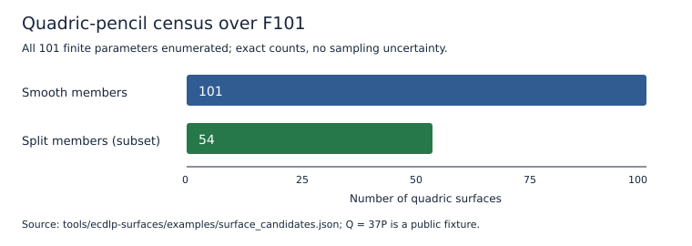
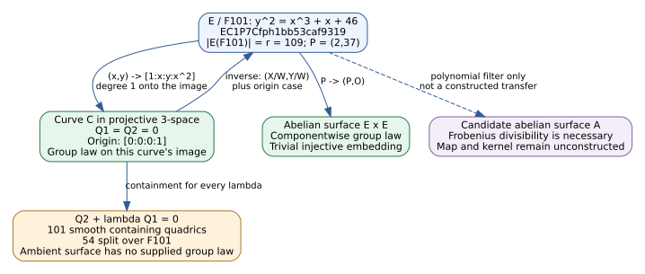

# Elliptic-curve surface tools — 2026-10-11

The integration adds three native Rust tools to both `aburan28/crypto` and
`aburan28/cryptanalysis`, under [`tools/ecdlp-surfaces`](../../tools/ecdlp-surfaces/README.md).
They enumerate a bounded family of surfaces, check the group law on the
embedded curve, and filter supplied abelian-surface Frobenius polynomials.
They support point arithmetic over prime fields `3 < p <= 10,000`.

The [protocol](PROTOCOL.md) fixes the inputs and acceptance checks.
This is tooling and correctness evidence, with no timing comparison, new IC
candidate, catalog promotion, or destination-solver advantage. The
[PDF](report.pdf), [diagram source](transfer.dot), [diagram](transfer.svg), and
[census graphic](counts.svg) accompany the report.
Run `make -C docs/ecdlp-surfaces` to rebuild it with Graphviz, Pandoc,
pdfLaTeX, and PyMuPDF. Python here renders the recorded graphic only.

## Exact input and identity

The public fixture is `y^2 = x^3 + x + 46` over F101, with 109 rational
points, prime subgroup order 109, cofactor 1, generator `P=(2,37)`, and
known-answer point `Q=(64,19)=37P`. The origin is the point at infinity.

Its complete field/model/subgroup metadata is in
[`evidence/curve_record.json`](evidence/curve_record.json):

```text
EC1P7Cfph1bb53caf9319
urn:ec-record:1:sha256:1bb53caf931906365143bc019d9e52ffe8e4173cd4565cecd3fe832867cb6eee
```

Both repositories carry identical metadata, following
[`docs/curve-identities.md`](../curve-identities.md). This identifies the
fixture, including its field encoding and generator; it is not an isogeny-route
ID or an IC measurement ID.

## Construction and verified results

The embedding sends `(x,y)` to `[1:x:y:x^2]` and the origin to `[0:0:0:1]`.
Its image is the intersection of `Q1=WZ-X^2` and
`Q2=Y^2-XZ-aWX-bW^2`. Every finite member `Q2+lambda*Q1=0` contains the image.
Substitution and the matrix determinant have native identity certificates:

| Identity | Certificate | Verification |
| --- | --- | --- |
| Substitution into the quadric pencil | [IDC1h72074ababc49d184](evidence/embedding_identity.json) | Exact integer-coefficient expansion and 32+32 point checks |
| `det(2M)=4(lambda^3+a*lambda+b)` | [IDC1h6e9fc67ebca6f151](evidence/quadric_determinant.json) | Exact integer-coefficient expansion and 32+32 point checks |

The [native generator](certificates/README.md) replays the certificates and
rejects a false identity or corrupted digest. The certificate schema evaluates
over `2^61-1`; the separate coefficient expansion checks these integer identities.
Checks used one Linux x86-64 host, not a second-host verifier. `proof` remains
null; no formal-prover artifact is claimed. See the
[replay receipt](evidence/identity_replay.json).

Since 2 is invertible, `det(M)=(lambda^3+a*lambda+b)/4`. Smoothness is exactly
nonvanishing of that value. A smooth member has the displayed rational origin
and is split over the source field precisely when the determinant is a square.
The [native census](../../tools/ecdlp-surfaces/examples/surface_candidates.json)
enumerates all 101 finite parameters: 101 smooth members and 54 split members.
Thus 47 smooth members are nonsplit, derived as `101-54`. The parameter at
infinity is `Q1`, a singular quadric, and is outside that finite census.



The [transfer fixture](../../tools/ecdlp-surfaces/examples/transfer_certificate.json)
checks actual membership in the cyclic subgroup, projective round trips,
order preservation, and the public scalar witness. The law is
`encode(decode(U)+decode(V))` on the curve image. Points lying only on a
containing surface are rejected. Rank-two rational torsion is a negative
control: `rQ=O` alone does not establish that `Q` belongs to `<P>`.

The product `E x E` supplies an ambient abelian-surface group law, with the
injective map `P -> (P,O)`. It is a trivial transfer and supplies no solver
advantage. The diagram distinguishes it from containment in a quadric.



## Necessary filter and negative findings

For an actual abelian surface over the same finite field, a nonzero algebraic
homomorphism from the source elliptic curve requires its Frobenius polynomial
as a factor. The supplied-polynomial filter checks divisibility, reciprocal
conditions, and the elliptic quotient's Hasse bound.
The source polynomial is `T^2+7T+101`; its square passes the
[compatible example](../../tools/ecdlp-surfaces/examples/frobenius_result.json).
The polynomial `(T^2+101)^2` fails the
[incompatible control](evidence/incompatible_frobenius.json).

Passing this necessary filter does not establish existence of a variety,
construct a homomorphism, determine its kernel, or certify subgroup transfer.
Prime-power validity and all Honda-Tate existence conditions are unimplemented.
The current checker uses small-subgroup enumeration for membership; it is not
a scalable transfer verifier or an ECDLP accelerator. Arbitrary new surface
constructions, their maps and kernels, and a faster destination solver remain
unimplemented. A bounded pencil search is not a search over all surfaces.

## Validation and delivery status

`tools/ecdlp-surfaces/check.sh` passed separately in both checkouts: formatting,
13 release tests, Clippy with warnings denied, all three binaries, byte-identical
example replay, and rejection of an incorrect witness and a composite modulus.
The certificate package passed 3 release tests, including standard hash vectors,
false-identity refusal, and digest-tampering rejection; its formatting and Clippy
also passed. Reproduction commands are in the crate and certificate READMEs.
The [verification record](evidence/integration_checks.json) retains exact
commands, repository revisions, and scope.

The required `crypto` root-library check was attempted and failed on an existing
syntax error in `src/cryptanalysis/koblitz_factor_base_search.rs:1608`, ending
with an unexpected closing delimiter at line 1854. That file is unchanged by
this integration. The [diagnostic excerpt](evidence/crypto_library_check.txt)
records the failed gate; the root library is not reported as passing.
A bounded attempt to remove the stray line exposed another malformed function
in `koblitz_index_calculus.rs`; that attempted repair was reverted. Both larger
library source files remain unchanged, and both diagnostics are retained.
Conductor is unavailable (`conductor check` exits 127). GitHub authentication
returns HTTP 401, preventing branch publication and ready-for-review PR creation.
Local commits and patches are the available delivery while that access is blocked.

| Requirement | Status | Evidence or remaining gap |
| --- | --- | --- |
| Rust tools in both local repository checkouts | Verified complete | Crate, tests, fixture replay |
| Documentation, visual, and PDF | Verified complete | This report and adjacent sources |
| Native algebraic certificates | Verified complete within stated scope | Integer expansion, finite-field replay; no formal proof |
| Required `crypto` root-library gate | Blocked by existing failure | Compiler diagnostic above |
| Conductor coordination | Blocked by unavailable tool | Command not installed |
| Publish both repository PRs | Blocked by access | GitHub HTTP 401 |

## Canonical graph review and sources

Checked `crypto:docs/index-calculus-scoreboard.html`,
`crypto:docs/ic/progress-timeline.json`, `crypto:docs/curves/registry.json`,
`cryptanalysis:experiments/ic-candidate-catalog/curves.yaml`, and
`cryptanalysis:experiments/volcano-ic/README.md`. Their performance results and
registered isogeny edges remain current: this change contains no measured solver
cost, new IC/rho ratio, isogeny neighbor, or promoted curve record. Those graphs
remain unchanged; this package's diagram describes only its own checked maps
and conditional filter.

Implementation sources:
[`curve.rs`](../../tools/ecdlp-surfaces/src/curve.rs),
[`frobenius.rs`](../../tools/ecdlp-surfaces/src/frobenius.rs), and
[`tests/math.rs`](../../tools/ecdlp-surfaces/tests/math.rs).
The historical `examples/verification_summary.json` retains the prototype's
earlier Python-reference comparisons; those are historical provenance, not
new Python research runs. Current execution and certificate generation are Rust.

Mathematical background: J. Silverman, *The Arithmetic of Elliptic Curves*,
Chapters III and V (elliptic embeddings, group law, Frobenius), and
[J. Tate, *Endomorphisms of Abelian Varieties over Finite Fields* (1966)](https://doi.org/10.1007/BF01404549)
for the isogeny and Frobenius-factor framework. Neither is a claim of an
ECDLP speedup from a change of representation.
