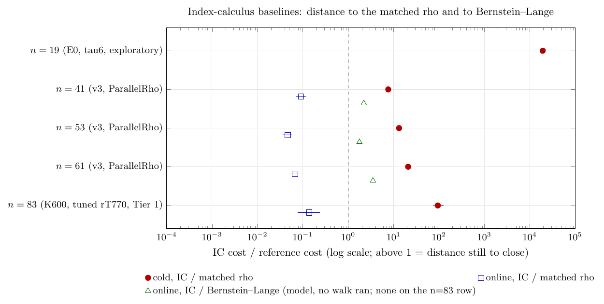

# Index-calculus baselines: the ratchet

**Status (2026-10-15).** This is the first edition of the ledger, with the tuned-rho
rows added from run 38777903922. It takes no new measurement: every number is
copied from a committed experiment, and each row cites that experiment. Figure 1
was checked and stays current: no baseline row's numbers changed. The n=83 row for the two-level root table was added on 2026-10-16; Figure 1
was checked and stays current, because no baseline row's numbers changed.
The machine-readable twin is
[`baselines.json`](baselines.json); update both files in the same change.

## The rule this file serves

AGENTS.md, "Success criterion: iterative improvement of the index-calculus
baseline" (owner, 2026-10-15; cryptanalysis#919, crypto#1908):

- **The baseline** for a curve and size is the best current verified IC
  pipeline. It is frozen with its protocol, receipts and end-to-end cold `S`.
- **A success** is any verified, measured improvement over that baseline on
  the same instances, under a protocol frozen before timing. Advance and
  engineering both count. Relabelling and accounting are recorded and do not
  count.
- **The ratchet.** A landed improvement replaces the row here, and the old
  row moves to [the history](#ratchet-history) with its delta.
- **The gap** to the matched rho, and to Bernstein–Lange (BL) where it was
  measured, is the distance remaining. It is not a pass/fail gate. A claim
  to *beat* rho still needs every reference rule: a cold `S` below the
  matched rho's, robust at growing `n`, independently replayed.

**How to read the numbers.**

- **One row, one experiment.** No row combines numbers from two experiments.
  Where an experiment did not measure a quantity, the cell says so.
- **Every gap is IC cost over the reference's cost.** Above 1 is distance
  still to close; below 1 means the IC is cheaper on that boundary. The
  sources quote the online figure the other way up (rho over IC). That
  figure is kept in each JSON row's `source_figure`.
- **`S` = cost / √r**, in the row's own unit. The unit differs between
  experiments, so compare `S` inside a row only. The gaps carry no unit.
- **Tuned rho** means rT770: A's tuned `StrongRhoG` (Fold field kernel, 64
  lanes, DP 6, escape off). `koblitz-n83-reconcile-20261014` found it to be
  the fastest correct n=83 reference. At n=41–61 it has been run as rT770's
  configuration on the one-word kernel (`koblitz-s23-tuned-rho-20261015`).
  ParallelRho, inside crypto's `ic price`, is crypto's own signed-Frobenius
  walk (64 lanes in lockstep). It is the matched rho at n=41–61, but it is
  not rT770.

## The baselines

| n | curve | current best verified IC pipeline (commit; protocol) | targets | `S` cold / online (IC) | `S` cold / online (rho) | cold gap, IC / rho [95%] | online gap, IC / rho [95%] | gap to tuned rho (rT770) | gap to BL (online, IC / BL) | evidence tier | next improvement to try |
|--:|:------|:----------------|:------|-------:|-------:|-------:|-------:|:----------|:-------|:------|:------------|
| 19 | E0 / GF(2^19), a=1 | volcano-ic τ-orbit dim-6 base, Sage Gröbner (arm `tau6`); cryptanalysis `3f722e2e`; protocol.json of volcano-ic/ rho-arm-20261014; run 38520305068 | 10 planted scalars, each one complete ECDLP | 5,154 / not separable | 0.260 / — | **1.94e4** [1.69e4, 2.23e4] (CPU, geometric mean) | not measured: each IC run is cold | none; the matched rho is a signed-Frobenius walk at 0.997× the floor in steps, run in Python/Sage, not tuned for wall time | none | exploratory (GitHub VM, unpinned) | Move tau6's per-relation Gröbner solve out of Sage (native, or the subspace `PDP2ht` oracle); re-run against the same rho arm |
| 41 | K_0 / GF(2^41) | `ic price --single-target` at IC programme baseline v3: 6,560 points, 80 columns, aimed m=3 collection, m=2 pair-table descent; crypto `995ea207`; rule v3 | 64 public points, 1 process each, +4 A/A | 11.17 / 0.121 | 1.459 / 1.318 | **7.66** [6.90, 8.61] | 0.092 [0.071, 0.116] | **measured in a separate experiment, not combined**: see the 41 row of Other verified records (run 38777903922: online IC/tuned 0.09, cold 6.6); the matched rho in this row is ParallelRho (0.56× the strong walk's ns/step) | model only: 2.21 | crypto isolated_bench container | Setup is 98.9% of cold `S`: cut the reusable setup at fixed recipe, as a new IC programme round against v3 |
| 53 | K_0 / GF(2^53) | same pipeline, 27,984 points, 264 columns; crypto `995ea207`; rule v3 | 64 + 4 A/A | 16.98 / 0.058 | 1.282 / 1.236 | **13.2** [11.8, 15.0] | 0.047 [0.036, 0.059] | **measured in a separate experiment, not combined**: see the 53 row below (online 0.0423, cold 10.6); ParallelRho here is 0.53× strong | model only: 1.77 | crypto isolated_bench container | Setup is 99.7% of cold `S`: cut it at fixed recipe; then price the n=53 representative-plus-Frobenius orbit domain as its replacement |
| 61 | K_0 / GF(2^61) | same pipeline, 39,040 points, 320 columns; crypto `995ea207`; rule v3 | 64 + 4 A/A | 24.93 / 0.079 | 1.189 / 1.168 | **21.0** [18.6, 23.8] | 0.067 [0.051, 0.088] | **measured in a separate experiment, not combined**: see the 61 row below (online 0.0687, cold 18.9); ParallelRho here is 0.50× strong | model only: 3.52 | crypto isolated_bench container | Setup is 99.7% of cold `S`, and the cold gap grows as r^0.18: cut the setup; price the compact-orbit K=500 producer on these 64 points |
| 83 | K_1 / GF(2^83) | B's `koblitz_orbit_dlp_fast_online` + `ic_log_cache.patch`, K600 (99,600 points, 600 orbit columns), S3 root index (candidate ID below); crypto `770f6a69`; `koblitz-n83-bl-arm-20261014/protocol.json` at cryptanalysis `507c1ec4`; run 38689817618 (**PR #918, not merged yet**) | B's 16 fresh public points + Q0 ×4 | 32.93 / 0.083 (rT770 steps) | 0.091 / 0.082 | **360** (no interval) | 1.01 [0.30, 2.12], not separated | **measured on this row**: online not separated from parity, cold 360× | **measured: 235** [61, 645], 16/16 points BL faster; cold IC/BL 0.987 by construction | Tier 1 (GitHub runner, one pinned CPU) | The rank stage is 520.8 s of the 549.8 s precomputation (95% of cold `S`): replace it with the guided minimum-rank policy on K600, then re-run this BL protocol |



*Figure 1. The baseline rows' gaps on a log scale: cold and online to the
matched rho, and online to Bernstein–Lange (measured at n=83, a model
elsewhere). Each row is one experiment. Bars are 95% intervals where the
source gives one ([source](figures/baselines_gap.tex),
[vector](figures/baselines_gap.pdf)).*

**Curves and candidates.**

| n | curve ID | ICV1 slug | r | IC1 candidate of the baseline |
|--:|:----------|:-------------|---------:|:---------------------------------|
| 19 | `EC1N19Ckb1h01617b86df6c` | (volcano-ic surface curve E0) | 130,873 | none recorded |
| 41 | `EC1N41Ce0he09550ab560a` | `icv1-f2m41-tm2308219-7f48b14a` | 549,756,390,943 | `IC1N41Ckb0fb6560PDP3pairtableRCaimedLAsparseTDwalkISO0h5b25909970b3` |
| 53 | `EC1N53Ce0hb097de99be9a` | `icv1-f2m53-tm56619371-dac20a85` | 21,044,858,204,113 | `IC1N53Ckb0fb27984PDP3pairtableRCaimedLAsparseTDwalkISO0h715dd7692112` |
| 61 | `EC1N61Ce0hd8c15448081e` | `icv1-f2m61-t158598901-ab42b6c5` | 162,888,033,982,417 | `IC1N61Ckb0fb39040PDP3pairtableRCaimedLAsparseTDwalkISO0he9352435e473` |
| 83 | `EC1N83Ce1h35c7ced6b497` | `icv1-f2m83-t6151469093347-9eba6cd5` | 8,569,786,107,849,059 | `IC1N83Ckb1fb99600PDP4s3rootindexRCguidedLAdenseTDsingleISO0hc0ecc1fffbd7` |

**Notes on the rows.**

- **n=19.** The `S` unit is one rho group operation of CPU time
  (2.17e-5 s). The IC's cold `S` is the τ6 arm's CPU per ECDLP in that unit.
  The baseline subspace base reads 1.77e5× rho in the same run. τ6 over the
  baseline base is 9.12 [8.12, 10.27].
- **n=41–61.** The unit is one batched affine addition, measured in each
  row's own process. v3's unit is 2.3–3.2× cheaper than §23's, so `S` is
  not compared across the two (rule v3 README). Every row passes
  `validate_claim` at `vs_rho` (68/68 per size). Both certificates were
  replayed outside the process, and the logarithms equal §23's.
- **n=83.** `S` is derived inside the one run: wall ms divided by that run's
  measured rT770 step (180.8 ns) and by √r. Cold is the matched precomputation
  P_IC (520,825 ms rank stage + 29,022 ms per-process setup) plus the mean
  online time. BL's precomputation was matched to P_IC in wall time on the
  same CPU, so the cold IC/BL ratio is 0.987 by construction. The baseline
  is this experiment, not the merged reconcile run, because it is the one
  experiment that measures the tuned rho, BL and cold together. If PR #918
  changes, this row changes with it.

## Other verified records

These rows are kept for context and as the history behind the baselines.
None is combined with another row.

| n | role | experiment | reference | cold gap, IC / ref [95%] | online gap, IC / ref [95%] | BL | tier |
|--:|:-------|:----------------|:---------|-------:|-------:|:-----|:-------|
| 41 | previous baseline (v0) | ledger §23, crypto `0bf67f16` | ParallelRho, same process | 8.04 [7.26, 9.01] | 0.107 [0.082, 0.135] | model 2.50 | crypto isolated_bench container |
| 53 | previous baseline (v0) | ledger §23 | ParallelRho | 14.7 [13.1, 16.7] | 0.057 [0.044, 0.073] | model 2.02 | same |
| 61 | previous baseline (v0) | ledger §23 | ParallelRho | 31.6 [28.2, 35.7] | 0.113 [0.084, 0.148] | model 8.04 | same |
| 41 | other pipeline, complete cold CPU | crypto `disjoint_cold_v2_outcome_20261001` (run 36803331080), compact-orbit K85 | 32-walk signed-Frobenius normal-basis rho (not rT770) | 13.4 [9.37, 18.5] | not measured | none | hosted, A/A and quiet-host gates, second-host replay |
| 53 | other pipeline, complete cold CPU | same, compact-orbit K220 | same | 22.7 [17.9, 31.6] | not measured | none | same |
| 61 | other pipeline | crypto autolab run `20261012T202048Z-5521627904`, compact-orbit K=500 | strong rho rung 3 (not rT770) | 83.4 (median of rows) | 0.072 [0.052, 0.102] (inverse of median 13.94) | none | taskset-pinned container with a CPU-isolation receipt |
| 41 | gap to the tuned rho (this experiment only; cf. the baseline row) | `koblitz-s23-tuned-rho-20261015`, run 38777903922 (PR #923) | tuned = rT770 configuration on the one-word kernel; same run: ParallelRho cold 7.83, strong 6.43, rA770 2.54 | **6.6** [5.91, 7.4] | **0.09** [0.0715, 0.111] | model 0.53 | Tier 1 |
| 53 | gap to the tuned rho (this experiment only; cf. the baseline row) | `koblitz-s23-tuned-rho-20261015`, run 38777903922 (PR #923) | tuned = rT770 configuration on the one-word kernel; same run: ParallelRho cold 11.8, strong 9.2, rA770 3.01 | **10.6** [9.45, 12] | **0.0423** [0.0325, 0.0534] | model 0.322 | Tier 1 |
| 61 | gap to the tuned rho (this experiment only; cf. the baseline row) | `koblitz-s23-tuned-rho-20261015`, run 38777903922 (PR #923) | tuned = rT770 configuration on the one-word kernel; same run: ParallelRho cold 19.4, strong 13.7, rA770 4.42 | **18.9** [16.7, 21.5] | **0.0687** [0.051, 0.0903] | model 0.759 | Tier 1 |
| 83 | same pipeline as the baseline (merged) | `koblitz-n83-reconcile-20261014`, run 38617911080 | rT770, two seeds per point | 313 (fresh-rank setup) | 0.92 [0.28, 1.78], not separated | none | Tier 1 |
| 83 | same pipeline, first Tier 1 run | `koblitz-single-target-n83-tier1-20261014`, run 38523707244 | rung 3, slower per step than StrongRhoG, so not the matched tuned rho | 134 | 0.36 [0.11, 0.66] | model 33.5 (measured later: 235) | Tier 1 |
| 83 | promoted improvement over the probe-pipeline producer: two-level root table, 32 MiB filter + 16-byte slots (this experiment only) | `koblitz-n83-tablefilter-20261015`, run 38829449594 | rT770, 384 new points | cold not measured against rho; cold pP / pT 1.0101 [1.0090, 1.0113] | IC/rho 0.1523 [0.1358, 0.1709] (inverse of 6.5642 [5.8533, 7.3649]); pipeline 0.1620; online pP / pT 1.0633 [1.0589, 1.0679], probes identical, mostly from the 16-byte slot | none | Tier 1 |

## Ratchet history

| n | from | to | cold gap | online gap | class |
|--:|:--|:--|:--|:--|:--|
| 41 | §23 (v0, `0bf67f16`) | rule v3 (`995ea207`) | 8.04 → 7.66 | 0.107 → 0.092 | engineering (IC programme rounds R03, R05, R07) |
| 53 | §23 (v0) | rule v3 | 14.7 → 13.2 | 0.057 → 0.047 | engineering |
| 61 | §23 (v0) | rule v3 | 31.6 → 21.0 | 0.113 → 0.067 | engineering |
| 83 | probe-pipeline producer | two-level root table (run 38829449594) | not measured | 0.1620 → 0.1523 (online, tuned rho; 1.0633 faster) | engineering; promoted by its own frozen rule; baseline row not replaced (no cold `S` against rho) |

The paired cold-time ratios between baselines, each in its own runs, are in
crypto `research/notes/index-calculus/IC_TOOL_PROGRAM.md` §7. The gaps above
are each against that comparison's own rho, and that rho also changed
between §23 and v3. So the gap delta is the distance remaining, not the IC's
own speedup.

## Stage results: canonicalization

Stage improvements are recorded here. One becomes a pipeline improvement
only once it moves an end-to-end `S` above.

| stage | n | experiment | result | tier | pipeline effect |
|:--|--:|:--|:--|:--|:--|
| normal-basis least rotation, isolated | 131 | `canon-n131-20261014` | Five exact canonicalizers on `[u64; 3]`. Ir per uniform word: lift_scan 514, gap_scan 1,435, exhaustive 1,850, exhaustive_bf 3,664, refine_bf 4,510. 0 mismatches. | deterministic Ir; wall times exploratory | none yet |
| the same, inside a decomposition-style loop | 131 | `canon-n131-loop-20261014`, run 38607684318 | lift_scan is fastest on all four workloads: 16/16 contrasts at Bonferroni, ratios 1.83–3.81. In-loop Ir over the loop floor: lift_scan 519, gap_scan 1,760, exhaustive 2,883. | Tier 1 for the timing | none yet. No n=131 pipeline exists, and at n=53 the isolated ranking did not survive the loop (`papers/frobenius-orbits` §4/§7) |

## Open

- **n=41, 53, 61:** the gap to the tuned rho is measured by
  `experiments/koblitz-s23-tuned-rho-20261015` (run 38777903922, PR #923;
  rows above, one per size, each from that experiment alone; n=47, 57 and 59
  are in its README). It ran rT770's configuration on the one-word `Gf2`
  kernel, because `Gf2_128` exists only for n > 64, and it measures about the
  same cost as ParallelRho. It is accounting: no IC change, so no baseline
  row moves. A rho tuned on the one-word kernel is not measured.
- **n=19 and n=41–61:** no Bernstein–Lange walk has run, so the BL figures
  are models or absent.
- **n=83:** the baseline's experiment is on PR #918, which is not merged yet.
  The two-level root table is promoted over the probe-pipeline producer
  (`koblitz-n83-tablefilter-20261015`, 1.0633, mostly the 16-byte slot);
  which pipeline the baseline row names is not decided here.
- **n=19:** there is no IC1 candidate manifest, and online `S` is not
  separable.

## Updating this file

1. Freeze a protocol for the candidate improvement against the row's
   pipeline, on the same instances, before timing.
2. When the improvement lands, replace the row in `baselines.json` and in the
   table above. Add a history row with the before and after figures and the
   class (advance, engineering, relabelling, accounting). Relabelling and
   accounting do not replace a baseline.
3. Name the next improvement to try in the new row.
4. Re-render Figure 1 and this file's PDF:

   ```sh
   cd docs/ic/figures && pdflatex baselines_gap.tex && pdftoppm -png -r 160 -singlefile baselines_gap.pdf baselines_gap
   cd .. && pandoc BASELINES.md -o BASELINES.pdf --pdf-engine=pdflatex -H pdf-header.tex -V geometry:landscape,margin=1.2cm -V fontsize=9pt
   python3 -m json.tool baselines.json > /dev/null
   ```

## Sources

- crypto `docs/ic/BOUNDARY_TARGETS.md` and `docs/ic/boundary_targets.json`
  (Regime B `vs_rho`; complete cold compact-orbit panel).
- crypto `research/notes/index-calculus/RESEARCH_IC_BOUNDARY_LEDGER.md` §23;
  `research/ic_single_target_20260930/` (PROTOCOL, analysis.json).
- crypto `research/ic_tool_program/rule/v3/` (README, PROTOCOL,
  analysis.json); `research/notes/index-calculus/IC_TOOL_PROGRAM.md` §7.
- crypto `research/notes/ecc2k130/disjoint_cold_v2_outcome_20261001/RESULT.md`.
- cryptanalysis `experiments/koblitz-n83-bl-arm-20261014/` (branch
  `claude/n83-bl-arm`, PR #918): README, `run_github_38689817618/result.json`.
- cryptanalysis `experiments/koblitz-s23-tuned-rho-20261015/`: README,
  `run_github_38777903922/panel/result.json` (PR #923).
- cryptanalysis `experiments/koblitz-n83-reconcile-20261014/`: README,
  `run_github_38617911080/panel/result.json`.
- cryptanalysis `experiments/koblitz-single-target-n83-tier1-20261014/`:
  README, `tier1_github_38523707244/`.
- cryptanalysis `experiments/volcano-ic/rho-arm-20261014/`: README,
  `results/summary.json`.
- cryptanalysis `experiments/canon-n131-20261014/` and
  `experiments/canon-n131-loop-20261014/`.
