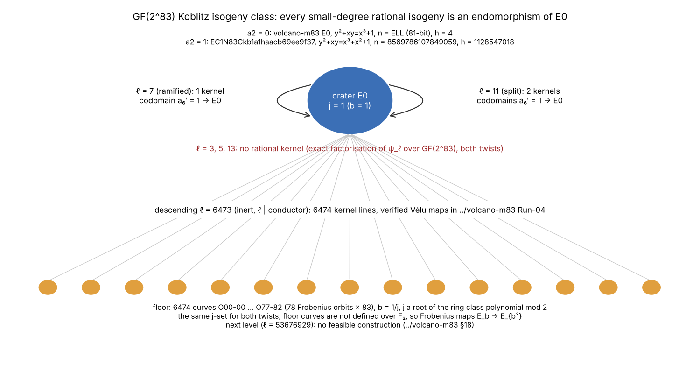
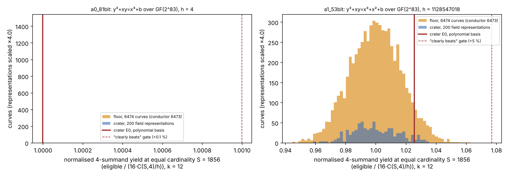
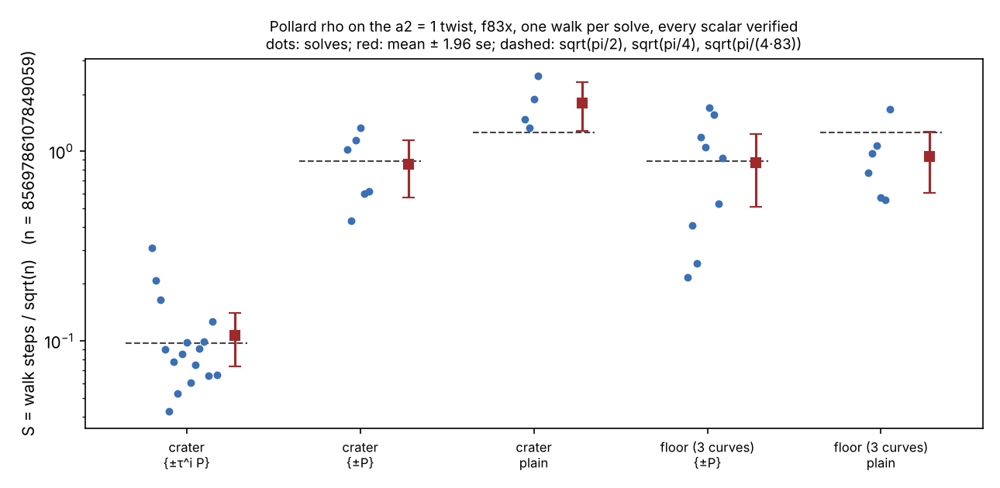
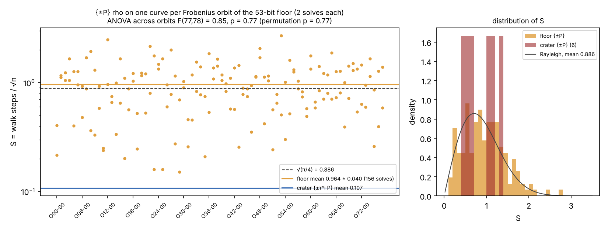
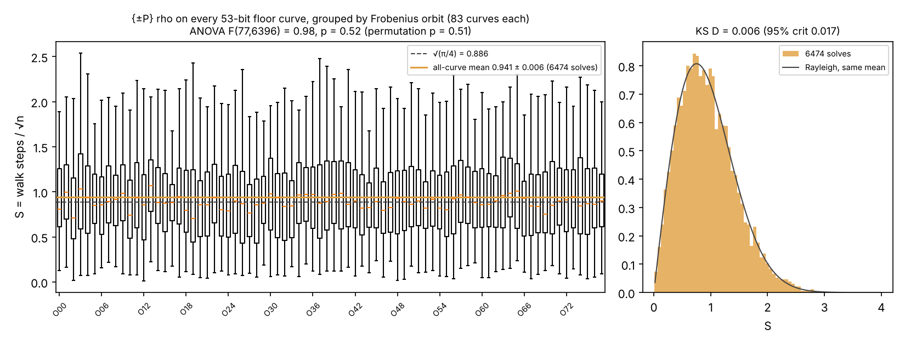

# Factor-base yield and Pollard rho across the GF(2^83) Koblitz isogeny class

Date 2026-10-16. Study directory `cryptanalysis:ecc2k130/research/volcano-m83-twist/`, extending
`cryptanalysis:ecc2k130/research/volcano-m83/` (the a2 = 0 floor census) to the a2 = 1 twist, field
representations and Pollard rho. Frozen protocol: `PROTOCOL.md`. Stage diagnostic only: no IC1
candidate, no end-to-end index-calculus run, `candidate_id: null`.

## Question and answer

Does a curve reachable by isogeny from the GF(2^83) Koblitz curves, or a field representation of the
Koblitz curve, give a factor base that clearly beats the Koblitz crater? **No.** No candidate cleared the frozen gate
(+0.1 % for a2 = 0, +5 % for a2 = 1, equal cardinality S = 1856, k = 12), on 2 × 6474 floor curves and
2 × 200 representations. Floor curves also lose the 83-fold Frobenius folding. By the protocol, the end-to-end
N83 run against the 28.688 ms K3425/root4 baseline (`crypto:research/n83_final_tournament_results_20261015`) is
not opened.

## Curves

- a2 = 0: y² + xy = x³ + b, n = ELL = 2417851639230796216685689 (81-bit), h = 4. Crater b = 1 is
  ../volcano-m83 E0 (no EC1 ID registered in `experiments/ic-candidate-catalog/curves.yaml`).
- a2 = 1: y² + xy = x³ + x² + b, n = 8569786107849059 (53-bit), h = 1128547018 = 2·10459·53951. Crater b = 1
  is `EC1N83Ckb1a1haacb69ee9f37` (crypto N83 instance).
- Field F₂[z]/(z⁸³ + z⁷ + z⁴ + z² + 1) for both. Floor: the 6474 conductor-6473 curves O00-00 … O77-82 of
  ../volcano-m83 (b = 1/j, j a root of the ring class polynomial mod 2). The j-set does not depend on the twist,
  so each floor j gives one a2 = 0 and one a2 = 1 curve; every curve passed [N]R = O in the census.

## Structure (derived, exactly computed)



t² − 4q = −7c², c = 6473 · 53676929, and Q(√−7) has class number 1, so the crater has End = O_K and every
horizontal isogeny of degree prime to c is an endomorphism. `scripts/s00_small_isogenies.py` factors ψ_ℓ over
GF(2^83) for ℓ = 3, 5, 7, 11, 13 on both twists: ℓ = 3, 5, 13 give no rational kernel; ℓ = 7 gives 1 kernel and
ℓ = 11 gives 2, and every codomain has a₆′ = 1 (the crater itself, with the same abscissae in this normal
form). The first other curves are the degree-6473 floor (verified maps in ../volcano-m83 Run-04). The F₈₃ toy's
7-isogeny/rescaling tournament therefore has a single candidate on GF(2^83).

## Instrument and control (measured)

`native/f83x.c` (x86-64 PCLMUL) computes the factor base of rational x in span(basis), cofactor tags
(log of [n]P in E(F_q)[h], Pohlig–Hellman, homomorphism self-check), and the exact number of (4-subset, sign
vector) with tag sum 0 mod h, the eligible4 count of ../volcano-m83 run06. `scripts/control_run06.py`
reproduces all 24 run06 counts exactly (all_match = True). Normalised yield
Y = eligible / (16·C(S,4)/h); for a2 = 1 the Poisson sd of Y at S = 1856 is about 0.012.

## Four-summand yield census (measured)



a2 = 0 (h = 4):

| arm | Y at S = 1856 | vs crater |
|---|---|---|
| crater E0, polynomial basis | 0.999998 | — |
| floor mean ± sd (6474 curves) | 1.000000 ± 9.9e-07 | +0.0002 % |
| best floor curve O05-46 | 1.000024 | +0.0025 % |
| crater, 200 field representations: mean ± sd | 1.000000 ± 1.5e-06 | +0.0002 % |
| best representation | 1.000016 | +0.0018 % |

a2 = 1 (h = 1128547018):

| arm | Y at S = 1856 | vs crater |
|---|---|---|
| crater E0, polynomial basis | 1.025606 | — |
| floor mean ± sd (6474 curves) | 0.999845 ± 0.017 | -2.5118 % |
| best floor curve O66-54 | 1.062818 | +3.6282 % |
| crater, 200 field representations: mean ± sd | 0.999368 ± 0.015 | -2.5583 % |
| best representation | 1.035052 | +0.9210 % |

Crater rank from top among the floor: a2 = 0 6178 of 6475, a2 = 1 415 of 6475.
Natural factor-base sizes on the floor: a2 = 0 1922–2175, a2 = 1
1920–2173 points. For a2 = 1 the observed floor sd of Y is 0.0171,
1.43× the Poisson sd (0.0120) of a count near 6986; the excess is
observed, not explained here (overlapping 4-subsets make eligible counts dependent, which is one candidate). The best floor curve,
O66-54, is +3.6282 % above the crater, inside the gate; no replication was
preregistered, so it is not promoted and no curve is named a lead.

## Pollard rho on the a2 = 1 twist (measured)



`f83x rho`: r = 32 adding walk, next-index rule and doubling escape against fruitless cycles, distinguished points
on bits 1..d of the canonical x (bit 0 is pinned: Tr = bits {0, 79, 81} and Tr(x) = Tr(a2) on the odd-order
subgroup), one walk per solve, fixture scalar recovered and checked by [k]G = Q on every solve. Yield of rho =
collisions per step, reported as S = steps / √n. Priced columns charge the canonicalisation squarings at
0 / 0.1 / 1 GAE each (crypto CLAUDE.md §5a band).

| arm | solves | S (± se) | theory | squarings / step | S priced at 0 / 0.1 / 1 GAE | wall s / solve |
|---|---|---|---|---|---|---|
| crater E0, classes {±τ^i P} | 16 | 0.107 ± 0.017 | 0.097 | 123.0 | 0.107 / 1.43 / 13.3 | 29.4 |
| crater E0, classes {±P} | 6 | 0.855 ± 0.146 | 0.886 | 0.0 | 0.855 / 0.855 / 0.855 | 98.4 |
| crater E0, plain | 4 | 1.796 ± 0.263 | 1.253 | 0.0 | 1.8 / 1.8 / 1.8 | 200.4 |
| floor O00-00/O39-00/O77-82, {±P} | 9 | 0.869 ± 0.184 | 0.886 | 0.0 | 0.869 / 0.869 / 0.869 | 100.3 |
| floor O00-00/O39-00/O77-82, plain | 6 | 0.935 ± 0.170 | 1.253 | 0.0 | 0.935 / 0.935 / 0.935 | 105.1 |

The crater's τ classes give S ≈ 0.107 against 0.855 for ±P, the √83 factor.
Floor curves have no τ over F₂ and run as ±P rho. Across the 0–1 GAE band the {±τ^i P} and {±P} arms do not keep
one order (0.107 < 0.855 at 0 GAE, 13.3 > 0.855 at 1 GAE), so the band rule does not rank them; the single-core,
contended wall times (29.4 s against 98.4 s) are exploratory, not a tiered timing claim.
The plain-walk means sit above and below theory with 4–6 solves each; their intervals are wide.

The k = 12 subspace base is not competitive with rho: collecting 2248 rows needs at least
2^50.7 uniform queries against 2^23.2 measured τ-class rho steps.
That is the expected scale gap for a 2^12-point domain; the N83 pipeline uses ≈ 5.7·10⁵ projected points and a root index.
The a2 = 0 twist needs ≈ 2^37 τ-class rho steps (prediction, not run).

## Pollard rho over the whole 53-bit floor (measured; protocol addendum)



The 6474 floor curves form 78 orbits of 83 under b → b², and (x, y) → (x², y²) is a group isomorphism
E_b → E_{b²}, so one representative per orbit (O00-00 … O77-00) covers the floor up to that isomorphism.
`scripts/rho_floor.py` ran 156 {±P} solves (2 per orbit, seeds 1000 and 1001), all verified
(True), 0 restarts, 1.39e+10 walk steps in all.

| arm | solves | S (± se) |
|---|---|---|
| floor, 78 orbit representatives, {±P} | 156 | 0.964 ± 0.040 |
| crater E0, {±P} | 6 | 0.855 ± 0.146 |
| crater E0, {±τ^i P} | 16 | 0.107 ± 0.017 |
| theory {±P} | — | 0.886 |

- Orbits are homogeneous: one-way ANOVA F(77, 78) = 0.85, p = 0.77;
  a 20000-draw permutation test gives p = 0.77. Two solves per orbit cannot rank orbits,
  so no orbit is named a lead (lowest orbit means O11-00 0.24, O00-00 0.31, O31-00 0.36 are draws).
- The floor's {±P} rho costs 9.00× the crater's τ-class rho, against √83 = 9.11: the Frobenius factor the
  floor loses, as derived.
- The pooled floor mean sits 2.0 se above √(π/4). Observed and not explained here; an r = 32
  adding walk with fruitless-cycle escapes is expected to sit slightly above the random-mapping constant, which this run does not test.
- The a2 = 0 floor (~2^37 steps per solve) was not run.


## Pollard rho on every one of the 6474 floor curves (measured; protocol addendum 2)



`scripts/rho_floor_all.py` ran one {±P} solve on every floor curve (seed 2000), split over 8 cloud sessions
(`--shard I --of 8`; session IDs in `outputs/rho-floor-all-a1.sessions.json`) and merged here:
6474 solves on 6474 distinct curves of 6474 expected, 0 missing,
0 duplicates, all verified (True), 1 restart, 5.64e+11 walk steps,
mean wall time 105 s per solve.

| quantity | value |
|---|---|
| S = steps / √n, mean ± se | 0.9413 ± 0.0061 |
| S standard deviation | 0.494 |
| theory √(π/4) | 0.8862 |
| mean − theory | +8.98 se |
| ANOVA over the 78 orbits | F(77, 6396) = 0.982, p = 0.523 |
| permutation test (2000 draws) | p = 0.507 |
| Rayleigh KS distance (95 % critical) | 0.0062 (0.0169) |
| orbit mean range | 0.815 – 1.092 |

- No isogeny on the floor changes rho: the 78 orbits are indistinguishable (ANOVA and permutation p ≈ 0.5), and
  the per-curve S follow a Rayleigh shape (KS distance well under its critical value). The orbit means span
  0.81–1.09 with ~83 solves each, the spread expected from sd 0.49.
- The pooled mean is 9.0 se above √(π/4), confirming the 156-solve offset at much higher precision.
  Approximate attribution, not proven: retried additions on the {±P} class (≈ 1/32), the r = 32 adding walk's
  departure from a random mapping (≈ 1.6 %) and escapes (0.12 % of steps) predict S ≈ 0.93; the measured value sits
  about 2 se above that. Reported as observed.
- The 81-bit (a2 = 0) crater and floor were not run: they need ~2^37 steps per solve and a distributed walk that
  this session did not build, and the cloud credentials in the environment are placeholders.


## What this does not show

- No end-to-end IC row and no IC1 candidate: yields are stage diagnostics.
- The 53676929-level curves and isogenies of degree > 13 other than 6473 were not examined (../volcano-m83 §18:
  no feasible construction).
- Only polynomial-subspace factor bases at k = 12 and representations of the form span{1, ρ, …, ρ^11} were screened.
- Rho timings are one shared cloud core, exploratory tier.

## Graphs checked

New: `outputs/structure.svg`, `outputs/yield-census.svg`, `outputs/rho-a1.svg`, `outputs/rho-floor-a1.svg`, `outputs/rho-floor-all-a1.svg` (rendered PNG beside each).
../volcano-m83 figures and `experiments/volcano-ic/figures/` were checked and remain current: no verified edge
or curve was added and the a2 = 0 census agrees with ../volcano-m83 Run-06.

## Reproduce

```
make -C native
cd scripts
python3 control_run06.py && python3 s00_small_isogenies.py
python3 census.py floor --a2 0; ./run_rest.sh; python3 rho_panel.py
python3 analyze.py && python3 diagram.py
python3 rho_floor.py && python3 rho_floor_analyze.py
python3 rho_floor_all.py --shard I --of 8   # I = 0..7, then:
python3 rho_floor_all_analyze.py
cd ../report && python3 make_report.py && python3 build_report.py
```
