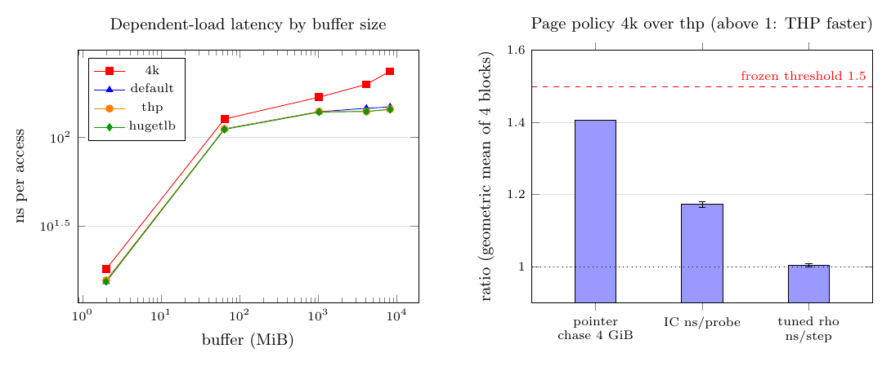

# IC probe latency and huge pages at n=83: result

**Status (2026-10-15): measured; frozen rule applied.** GitHub run
[38779143540](https://github.com/aburan28/cryptanalysis/actions/runs/38779143540)
(one fresh `ubuntu-24.04` runner, Tier 1, instance scoped; AMD EPYC 9V74, image
20261012.334.1, sha `d16225c7`) completed the frozen protocol
([`PROTOCOL.md`](PROTOCOL.md), [`protocol.json`](protocol.json)). The artifact
`ic-probe-latency-38779143540-1` is archived in
[`run_github_38779143540/`](run_github_38779143540/). This tests stages 1 and 2
of crypto-autoresearcher `IDEA-20261015-b41f68` (an uncommitted proposal).

## Question

On B's n=83 K600 index calculus (IC) on Q0, does backing its 4 GiB root table
with 2 MiB transparent huge pages (THP) lower ns per root-index probe by at
least 1.5×, while the tuned rho's ns per step moves by under 5%? How does the
IC compare with a pointer chase over the same bytes?

## Frozen verdict

The frozen rule is `analyse.py` (verbatim from `protocol.json`). The receipt is
**eligible**: every IC row has 8,845,441 probes and scalar 3141592653589793,
every rho row 12,592,070 steps, all rows valid and verified, 0 issues, and the
manipulation check passes (every thp IC process reached at least 4.8 GB of
`AnonHugePages`, every 4k process 0; every thp pointer chase at 1 GiB or more
was fully huge, every 4k chase 0).

| quantity | reading |
|:--|:--|
| IC ns/probe, 4k over thp, geometric mean of 4 blocks [95% t, 3 df] | **1.173 [1.165, 1.181]** → `thp_cuts_ic_ns_per_probe_below_1.5x` |
| tuned rho ns/step, 4k over thp | **1.004 [0.9994, 1.009]** → `rho_change_under_5pct` |
| idea's prediction 4 (IC ≥ 1.5× and rho within 5%) | **not met** (IC lower bound 1.165, upper bound 1.181, both below 1.5) |

The IC does speed up 1.17×, which clears 1 but not the 1.5× threshold. The
idea's falsification reading `thp_change_under_10pct` does not apply (the
interval lies outside [0.9, 1.1]). The rho control moved 0.4%, inside the 5%
band.

## The runner's default already uses huge pages

The runner's THP mode is `enabled=[always]`, `defrag=[madvise]`
(`allocation.json`), so the `default` arm is already THP-backed (4.8 GB of
`AnonHugePages`). The secondary statistics say so:

| statistic | IC | rho |
|:--|--:|--:|
| 4k over default | 1.172 [1.170, 1.175] | 1.004 [1.001, 1.008] |
| default over thp | 1.0007 [0.996, 1.006] | 0.9997 [0.995, 1.005] |

Forcing `MADV_HUGEPAGE` on top of the runner's default changes the IC by
0.07%, inside noise. The 1.17× is the cost of *disabling* THP, which is not how
the earlier n=83 runs (38523707244, 38617911080, 38689817618) ran. So the page
policy is not an improvement over the as-run baseline on this instance: the
as-run baseline already has it. Whether to treat the frozen
`thp_cuts_*` reading as a baseline improvement is the owner's call; this
report records that the comparison arm is the non-default 4k policy.

## Key numbers

| arm | IC online ms (mean of 4) | ns/probe | IC setup ms | tuned rho online ms | rho ns/step |
|:--|--:|--:|--:|--:|--:|
| 4k | 5,954 | 673.1 | 53,761 | 3,997 | 317.4 |
| default | 5,079 | 574.2 | 46,548 | 3,980 | 316.0 |
| thp | 5,076 | 573.8 | 46,519 | 3,981 | 316.1 |

(IC probes 8,845,441; rho steps 12,592,070.) Setup (index build) is 53.8 s at
4k and 46.5 s under default and thp: 1.156× longer at 4k.

**Gap to the tuned rho on Q0.** The IC's online stage is **1.275× the tuned
rho's** under thp (5,076 ms over 3,981 ms; the receipt's `gap_to_tuned_rho_on_q0`
is the reciprocal, 0.784), 1.275× under default (0.783) and 1.49× under 4k
(0.671). Counting setup, the IC's cold cost is 51.6 s against the rho's 4.2 s.

## Pointer-chase null

One dependent load per access, 64-byte slots, one Sattolo cycle, 2e7 loads × 5
repetitions per process, median of two rounds with reversed order:

| buffer | 4k ns | default ns | thp ns | hugetlb ns | thp / 4k | thp huge fraction |
|--:|--:|--:|--:|--:|--:|--:|
| 2 MiB | 17.9 | 15.2 | 15.5 | 15.3 | 0.865 | 1.00 to 1.00 |
| 64 MiB | 127.1 | 111.7 | 111.6 | 111.0 | 0.878 | 1.00 to 1.00 |
| 1 GiB | 169.0 | 139.8 | 140.1 | 139.2 | 0.829 | 1.00 to 1.00 |
| 4 GiB | 199.7 | 146.2 | 140.3 | 140.3 | 0.703 | 1.00 to 1.00 |
| 8 GiB | 236.7 | 148.8 | 144.5 | 143.9 | 0.610 | 1.00 to 1.00 |

- At 4 GiB, the size of the root table, the interleaved null (one 4k and one
  thp chase after each IC process) gives 4k over thp of **1.406** (geometric
  mean of 4 pairs). So the table's page-walk cost alone is a 1.41× effect and
  the IC realises 1.17×: the IC probe costs 574 ns, which is 4.1× a bare
  dependent load over the same bytes (140 ns), so TLB misses are a minor part of
  an IC probe. A pointer-chase ratio is not an IC speedup (protocol).
- `MAP_HUGETLB` from reserved pages matches thp at every size (within 2%).
- Under thp the latency is 13.5% lower than 4k at 2 MiB and 39% lower at
  8 GiB, so the manipulation worked and the chase is a valid positive control.



*Figure 1. Left: pointer-chase latency by buffer size and page policy. Right:
4k over thp for the 4 GiB pointer chase (interleaved null), the IC and the
tuned rho, with the frozen 1.5× threshold ([source](figures/ratio.tex),
[vector](figures/ratio.pdf), from `result.json` by
[`figures/make_figures.py`](figures/make_figures.py)).*

## Limits

- **Tier 1, instance scoped.** One runner and one pinned exposed CPU on a
  shared VM; exclusivity is not certified. The earlier n=83 runs were on other
  hosts, and none is pooled here.
- **Four blocks.** The interval is a t interval on 4 log ratios. Block-to-block
  spread is small (IC ratios 1.169 to 1.180, rho 1.002 to 1.008).
- **One flagged process.** The 4k IC process of block 0 carried a
  `major page faults` contention flag. The frozen rule does not drop flagged
  rows. Its ratio (1.172) is inside the other three (1.169 to 1.180).
- **Class: accounting for the baseline, with a mechanism reading.** No
  algorithm changed. The result says the IC's probe latency is not dominated by
  TLB misses on this host: removing them recovers at most the 17% that 4k
  adds, and the runner's default already recovers all of it.
- Nothing here transfers to other sizes, hosts or ECC2K-130.

## Files

- `PROTOCOL.md`, `protocol.json`: the frozen design.
- `analyse.py`, `run_job.py`, `thp_arm.py`, `pchase.c`: the frozen tools.
- `run_github_38779143540/`: the artifact. `panel/result.json` and
  `panel/result_table.md` hold the rule's output; `analyse.py` re-run on
  `panel/` reproduces `result.json` byte for byte.
- `figures/`: the result figure and its source.
- `smoke/`: the harness check (stub producers; not evidence).

## Reproduce

```sh
python3 analyse.py run_github_38779143540/panel   # rewrites result.json, result_table.md
python3 figures/make_figures.py
pandoc README.md -o README.pdf --pdf-engine=pdflatex -H figures/pdf-header.tex -V geometry:margin=2cm -V fontsize=10pt
```
