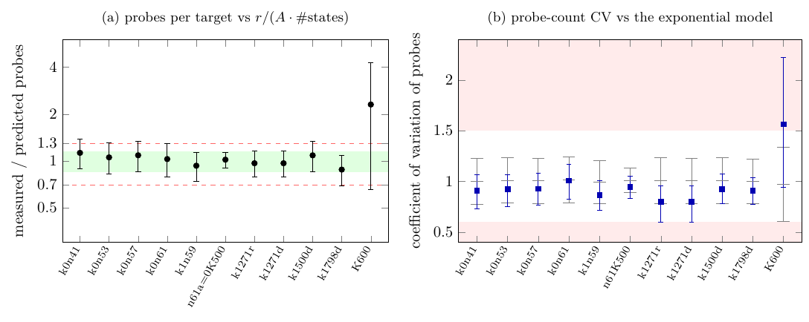
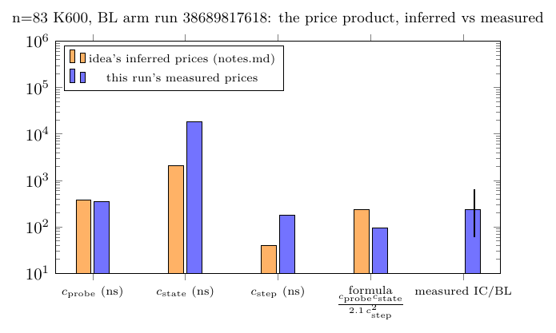

# Stage 0 on receipts: the quotient probe law and the probe distribution (2026-10-15)

**Status: measured on archived receipts (zero compute, no timed run).** This
is stage 0 of two uncommitted crypto-autoresearcher proposals:

* `IDEA-20261015-7a3c9e`: folded Koblitz index calculus is baby-step
  giant-step on the quotient. It predicts probes per target `r/(A·#states)`
  and `IC_online/BL_online = c_probe·c_state/(2.1·c_step²)`, independent of
  `r`.
* `IDEA-20261015-b41f68` (stages 0–1 here, B1–B2): the per-target probe
  count is geometric, and IC ns/probe is the host's random-access latency
  over the table's bytes.

Each verdict applies the proposal's own falsification conditions as written.
Every row uses one experiment's receipts. Prices from different experiments
are never combined into one row. `analysis.json` holds every figure;
`stage0.py` recomputes it.

## Verdicts

| idea | criterion (as written in the proposal) | result | verdict |
| --- | --- | --- | --- |
| 7a3c9e | prediction 1 outside [0.7, 1.3] at any size → falsified | 0.93–1.13 at the five m=2 §23 sizes; 1.02 at n=61 K500; 0.88–1.09 at the four n=83 dense-root bases; **2.30** at n=83 K600 (16 points, 95% [0.66, 4.27]), and **1.40** on the K600 rank stage (mean of 600 relations, run 38523707244) | **falsified at n=83 K600**; holds at the other 10 rows |
| 7a3c9e | slope of ln(IC/BL) on ln r > 0.25 → falsified | six §23 sizes: 0.086 [−0.11, 0.28] (§23 model column), 0.139 [−0.03, 0.31] (c_BL=2.1, tuned step). Neither BL value was measured | not falsified; this tests only a model, because no BL ran at §23 |
| 7a3c9e | formula off by more than 10× → falsified (prediction: within 3×) | the one measured IC/BL ratio, n=83 K600 run 38689817618: formula 94.6 against 235 [61, 645] measured, a ratio of 0.40 | inside 3× |
| 7a3c9e | Koblitz vs ordinary curve | no ordinary-curve receipt exists | not tested |
| b41f68 | probe CV < 0.6 or > 1.5 → falsified | all 64-point panels: 0.80–1.01; n=61 W=256: 0.95; **n=83 K600 16-point panel: 1.57** [0.95, 2.22]; KS against exponential p = 0.001 | **falsified on the n=83 K600 panel**; holds on the 64-point panels and at n=61 |

Overall:

* **7a3c9e is falsified by its own rule 1.** The quotient probe law
  `r/(A·#states)` is accurate to 15% on 10 of 11 receipt rows. On B's n=83
  K600 configuration, which carries the 235× BL measurement, the mean is
  2.3× the law. The rank stage's 600 relations put it at 1.40×.
* **The price product lands inside its factor-3 band at the only size with
  a measured BL.** The proposal's own back-of-envelope (231 against 235)
  agreed only by accident. Its two inferred prices are wrong:
  * c_state is 18.4 µs, not 2.1 µs: P_IC is 549.8 s over 2.99e7 states, not
    2^28;
  * c_step is 180 ns, not 40 ns.

  The two errors cancel (Figure 2).
* **b41f68 fails its CV rule on the one panel the claim is about,** n=83 K600.
  It passes everywhere else.

## Table A: probe law and price product, one experiment per row

Definitions:

* r/(A·#states): `A = 2n` signed-Frobenius classes; #states = stored folded
  pair states (§23 `stored_pairs`) or root-table entries (four-summand root
  index).
* **c_probe** (measured): mean IC online ns over mean probes, on the same rows.
* **c_state** (measured, by definition): P / #states. Each row's P is stated
  in `analysis.json`.
* **c_step** (measured): mean walk ns over mean steps for that experiment's
  rho.
* **formula**: c_probe·c_state/(2.1·c_step²).
* **IC/BL_model**: measured IC online over 2.1·(r/A)·c_step²/P. This is a
  model, because no BL ran in those experiments.

| row (source) | design | log₂ r | N | probes measured / predicted [95%] | c_probe ns | c_state ns | c_step ns | formula | IC / BL |
| --- | --- | --: | --: | --- | --: | --: | --: | --: | --- |
| §23 k0n41 | m=2 pair table | 39.0 | 64 | 28,412 / 25,233 = **1.13** [0.89, 1.39] | 43.3 | 375 | 112 | 0.61 | model 0.69 (§23 col 2.5) |
| §23 k0n57 | m=2 | 38.0 | 64 | 11,062 / 10,183 = **1.09** [0.85, 1.34] | 59.4 | 544 | 155 | 0.64 | model 0.70 (3.3) |
| §23 k0n53 | m=2 | 44.3 | 64 | 56,384 / 53,541 = **1.05** [0.83, 1.31] | 69.7 | 279 | 124 | 0.60 | model 0.63 (2.0) |
| §23 k1n59 | m=2 | 44.5 | 64 | 51,156 / 54,968 = **0.93** [0.74, 1.13] | 93.7 | 352 | 130 | 0.93 | model 0.86 (2.8) |
| §23 k0n61 | m=2 | 47.2 | 64 | 218,824 / 213,078 = **1.03** [0.79, 1.29] | 90.8 | 921 | 129 | 2.38 | model 2.45 (8.0) |
| §23 k1n47 | **m=3** (outside the claim) | 36.6 | 64 | 4.3 / 7,572 (not the m=2 law) | — | — | — | — | — |
| n=61 a=0 K500, GHA 37156392134 | four-summand root index | 47.2 | 256 | 89,110 / 87,563 = **1.02** [0.90, 1.14] | 298 | 1,444 | 227 | 3.96 | model 4.03 |
| n=83 K1271 regular, dense-root panel | root index, 8 GiB | 52.9 | 64 | 371,728 / 385,040 = **0.97** [0.79, 1.16] | 462 | 1,242 | 175¹ | 8.9 | model 8.6 |
| n=83 K1271 dense | root index, 4 GiB | 52.9 | 64 | same probes = **0.97** | 408 | 1,294 | 175¹ | 8.2 | model 8.0 |
| n=83 K1500 dense | 8 GiB | 52.9 | 64 | 300,022 / 276,452 = **1.09** [0.85, 1.34] | 431 | 1,256 | 175¹ | 8.4 | model 9.2 |
| n=83 K1798 dense | 8 GiB | 52.9 | 64 | 169,070 / 192,403 = **0.88** [0.69, 1.08] | 454 | 1,442 | 175¹ | 10.2 | model 9.0 |
| **n=83 K600, BL arm 38689817618** | root index, 4 GiB² | 52.9 | 16 | 3,979,401 / 1,727,838 = **2.30** [0.66, 4.27] | 349 | 18,403 | 180 (rT770) | **94.6** | **measured 235 [59, 649]³**; model 218 |
| n=83 K600, Tier 1 38523707244 (B) | same | 52.9 | 16 | same probes (work-identical) | 575 | 29,526 | 707 (rung 3, not tuned) | 16.2 | model 37.3 |
| n=83 K600, reconcile 38617911080 | same | 52.9 | 16 | same probes | 511 | 25,543 | 280 (rT770) | 79.0 | model 182 |

Notes:

1. The dense-root panel's c_step comes from that study's single
   primary-point rho run (`runs/rho_primary`), on the same shared M4 Pro
   host. One walk, unisolated: this price is weak.
2. 4 GiB is derived from the source, not recorded: `RootTable128` has 2^27
   slots of 32 bytes (`protocol.json` of `../ic-probe-latency-20261015`).
3. The bootstrap interval here (paired over 16 targets, this script's own
   seed) is [58.9, 649]. The run's own frozen figure is [61, 645].

Readings, labelled:

* **Measured.** At the §23 sizes, IC online over a BL model priced at the
  tuned step and `c_BL = 2.1` is 0.63–2.45. The §23 column's 2.0–8.0
  priced the walk at the cheaper canonical step with 1.93·1.21. Neither is
  a measurement of BL.
* **Derived.** At those rows, formula ÷ (IC/BL model) equals predicted
  probes ÷ measured probes by algebra. So prediction 2 adds nothing to
  prediction 1 there. The proposal's claim (4), that the formula "reproduces
  the 2.0–8.0×", cannot be tested without a BL arm at those sizes.
* **Measured.** At n=83 K600 (BL arm), formula ÷ measured = 0.40. It splits
  into two factors:
  * predicted ÷ measured probes, 1/2.30 = 0.43;
  * measured ÷ modelled BL online, 0.93. BL online steps averaged 31,506
    against 35,473 from `2.1·(r/A)/P_steps`.
* **Measured.** Across the three K600 runs (same work, three EPYC
  runners), c_probe runs 349–575 ns. Against the tuned walk, c_probe ÷
  c_step is 1.94 (run 38689817618) and 1.82 (run 38617911080).



*Figure 1. (a) Mean probes per target over r/(A·#states), one row per
experiment, 95% bootstrap over targets. Green: the claimed ±15% band. Dashed:
the [0.7, 1.3] falsification band. The m=3 §23 size is omitted, and K600 is
plotted once because its counts are identical in its three runs. (b) The
sample CV of probes with a 95% bootstrap interval (blue). Grey: the 95% range
of the CV of N exponential draws. Red: the b41f68 falsification region.
Source [`figures/probe_law.tex`](figures/probe_law.tex), data
`probe_ratio.dat` and `probe_cv.dat`, vector
[`probe_law.pdf`](figures/probe_law.pdf).*



*Figure 2. n=83 K600, run 38689817618: the three prices and the formula as
`IDEA-20261015-7a3c9e.notes.md` inferred them (orange) and as this run
measured them (blue), with the measured IC/BL ratio and its interval. Source
[`figures/price_product.tex`](figures/price_product.tex).*

## Table B1: probe-count distribution against the exponential (geometric) model

The KS test is Lilliefors-type: it uses the exponential with the sample mean,
and its p-value comes from 2,000 parametric bootstrap draws (seeded). The
family is 12 panels, so the Bonferroni level is 0.05/12 = 0.0042. The
smallest attainable p is 1/2001, below that level.

| panel | N | CV [95% boot] | exp-null CV 95% | median/mean | max/mean (≤ ln N + 1?) | KS D | p | CV in [0.6, 1.5] |
| --- | --: | --- | --- | --: | --- | --: | --: | --- |
| §23 k0n41 | 64 | 0.909 [0.73, 1.07] | [0.77, 1.23] | 0.705 | 4.34 (≤ 5.16) | 0.097 | 0.35 | yes |
| §23 k0n53 | 64 | 0.925 [0.75, 1.07] | [0.79, 1.23] | 0.689 | 4.32 | 0.101 | 0.29 | yes |
| §23 k0n57 | 64 | 0.929 [0.77, 1.08] | [0.78, 1.23] | 0.714 | 3.71 | 0.072 | 0.75 | yes |
| §23 k0n61 | 64 | 1.008 [0.82, 1.17] | [0.79, 1.24] | 0.591 | 4.57 | 0.076 | 0.69 | yes |
| §23 k1n59 | 64 | 0.867 [0.71, 1.01] | [0.78, 1.21] | 0.799 | 3.86 | 0.101 | 0.26 | yes |
| §23 k1n47 (m=3) | 64 | 0.807 | [0.78, 1.23] | 0.928 | 4.41 | 0.207 | 0.0005 | yes (exponential rejected) |
| n=61 K500, W=256 (isolated hosted run) | 256 | 0.946 [0.83, 1.05] | [0.89, 1.13] | 0.756 | 6.31 (≤ 6.55) | 0.055 | 0.20 | yes |
| n=83 K1271 regular / dense | 64 | 0.801 [0.60, 0.96] | [0.78, 1.24] | 0.905 | 4.08 | 0.154 | 0.011 / 0.018 | yes |
| n=83 K1500 dense | 64 | 0.925 [0.78, 1.08] | [0.78, 1.24] | 0.627 | 3.61 | 0.066 | 0.83 | yes |
| n=83 K1798 dense | 64 | 0.911 [0.78, 1.04] | [0.78, 1.22] | 0.587 | 3.70 | 0.090 | 0.45 | yes |
| **n=83 K600, 16 fresh points** | 16 | **1.567** [0.95, 2.22] | [0.60, 1.34] | 0.283 | 4.55 (> 3.77) | 0.385 | **0.001** | **no** |
| (context) n=83 BL online steps, 16 points | 16 | 1.209 | [0.60, 1.40] | 0.725 | 4.60 | 0.268 | 0.034 | — |

* **The m=2 §23 panels, n=61 and the dense-root bases.** None is rejected
  at the Bonferroni level. The CV of 7 of 10 in-scope panels lies inside
  the proposal's tighter [0.9, 1.1]. k1n59 (0.87) and K1271 (0.80) fall
  below it, so they are lighter-tailed than exponential.
* **n=83 K600 is heavier-tailed than any exponential of its size.**
  * Three of 16 fresh points took 14.5M–18.1M probes, against a law mean of
    1.73M, and Q0 took 8.85M.
  * For an Exp(1.73M), P(X > 14.4M) = 2.4e−4.
* **Hypothesis, not tested.** The cause may be the wide producer's scan
  order. It is source-read from crypto `770f6a69`
  `examples/koblitz_orbit_dlp_fast_online.rs`, wide `extract`:
  * The scan is left-orbit-major. One left orbit is
    600·83·332 ≈ 16.5M probes.
  * With only 600 columns, about 1.6 three-sum representations are
    expected per (target, left orbit). So about 20% of targets would find
    no hit in their first block and need another full block.
  * That predicts the tail at about one block length, and the excess mean.
  * At K1798 the same estimate gives about 40 per block, which is why the
    dense bases look geometric.
  * Testing it needs the per-block hit counts or a re-run with a shuffled
    scan order; neither is done here.

## B2: IC ns per probe against table bytes

| row | host | table bytes | c_probe ns (all online) | lookup-only ns |
| --- | --- | --- | --: | --: |
| §23, five m=2 sizes | x86_64, crypto §23 host (`runs/host.json`); 2.4e5–6.3e6 stored pairs | not recorded | 43–94 | 22–50 |
| n=61 K500, GHA 37156392134 | EPYC 7763 | not recorded (peak RSS 1.45 GB, 1.5e7 entries) | 298 | — |
| n=83 K1271 regular / dense, same host | Apple M4 Pro, shared | 8 GiB / 4 GiB (allocated) | 462 / 408 | — |
| n=83 K1500 / K1798 dense | same | 8 GiB / 8 GiB | 431 / 454 | — |
| n=83 K600 runs 38689817618 / 38617911080 / 38523707244 | EPYC 9V45 / 7763 / 9V74 | 4 GiB (derived) | 349 / 511 / 575 | ≈ online (PDP is 99.99%) |

* **Same host, same probes, half the bytes.** K1271 at 4 GiB (dense)
  against 8 GiB (regular) is 12% cheaper per probe. This is unisolated,
  one study.
* **Across hosts at fixed work.** K600 spans 1.65× (349–575 ns) over three
  EPYC runners.
* **The pointer-chase null object does not exist yet in any receipt.** No
  run has measured it, so b41f68's predictions 2 and 3 remain untested
  here. Stage 1, the pointer chase, and stage 2, the huge-page pair, are
  prepared as a Tier 1 workflow in
  [`../ic-probe-latency-20261015/`](../ic-probe-latency-20261015/).

## Sources (all read-only; one experiment per row)

The crypto commits are crypto `ecc27ef8` (local `main` checkout); the files
read were last changed at `30745078` and `0f0db951`:

* `research/ic_single_target_20260930/runs/k*n*/T??-R1.price.json` and
  `analysis.json`;
* `research/n83_dense_root_20261013/analysis_panel.json`,
  `runs/panel/*/targets_result.jsonl` and `runs/rho_primary/receipt.json`;
* `research/sat_factor_base_review_20260908/autolab/evidence/20261003-koblitz-n61-hosted-isolated/autolab_runs/gha-37156392134-1/logs/`.

cryptanalysis sources:

* `main` `0382c341`:
  * `experiments/koblitz-single-target-n83-tier1-20261014/tier1_github_38523707244/`;
  * `experiments/koblitz-n83-reconcile-20261014/run_github_38617911080/`.
* branch `claude/n83-bl-arm` `4b8ff92a` (PR #918):
  * `experiments/koblitz-n83-bl-arm-20261014/run_github_38689817618/`.

**Not used.** The 2026-10-12 isolated n=61 K500 64-point panel (autolab run
`20261012T173628Z-3fd988ea23`) is not committed: its receipts are on a Modal
volume, and a GitHub code search found nothing. The n=61 hosted isolated run
`gha-37156392134-1` (W=256, EPYC 7763, `isolated_bench reserve`) stands in
for it.

```sh
python3 -I stage0.py --crypto /path/crypto \
  --n83-tier1 ../koblitz-single-target-n83-tier1-20261014/tier1_github_38523707244 \
  --reconcile ../koblitz-n83-reconcile-20261014/run_github_38617911080 \
  --bl-arm <checkout of claude/n83-bl-arm>/experiments/koblitz-n83-bl-arm-20261014/run_github_38689817618 \
  --out analysis.json
python3 -I make_figures.py analysis.json figures
(cd figures && pdflatex probe_law.tex && pdflatex price_product.tex)
```

## Claim classes and limits (controlled-experiment skill)

* **Exact computation.** Probe and step counts, r, #states, and table
  geometry read from source.
* **Comparative / statistical.**
  * Every ratio carries a bootstrap or t interval.
  * The KS tests are Bonferroni-corrected over 12 panels.
  * The detector's power at N=16: an exponential sample of 16 has a CV
    above 1.34 with probability 2.5%.
  * Receipts already exist, so this is a retrospective analysis; nothing
    was preregistered beyond the proposals' own thresholds.
* **Heuristic.** BL online `2.1·(r/A)·c_step²/P` is a model wherever no BL
  arm ran. The scan-order explanation for K600 is a hypothesis.
* **Out of scope.**
  * No speed claim for any method.
  * No transfer to ECC2K-130.
  * The four-summand root index and the m=2 pair table are different
    designs. The proposal's claim names the "folded pair-state" index
    calculus, and its own n=83 example is the four-summand root index, so
    both were tested.

**Success criterion (AGENTS.md).** This is a negative/attribution result,
not an IC baseline improvement. The next improvement it names is the stage 2
huge-page pair on B's K600 producer. If that pair lowers ns per probe on the
same instance with every answer verified, it is an online-stage engineering
improvement.
