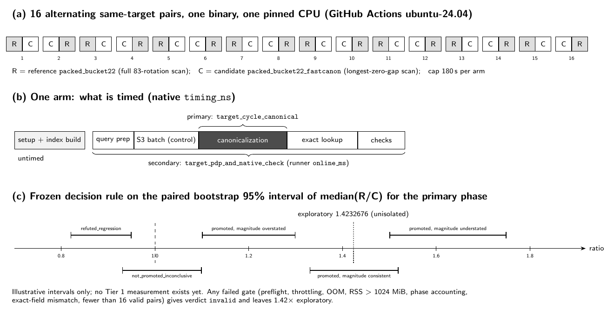
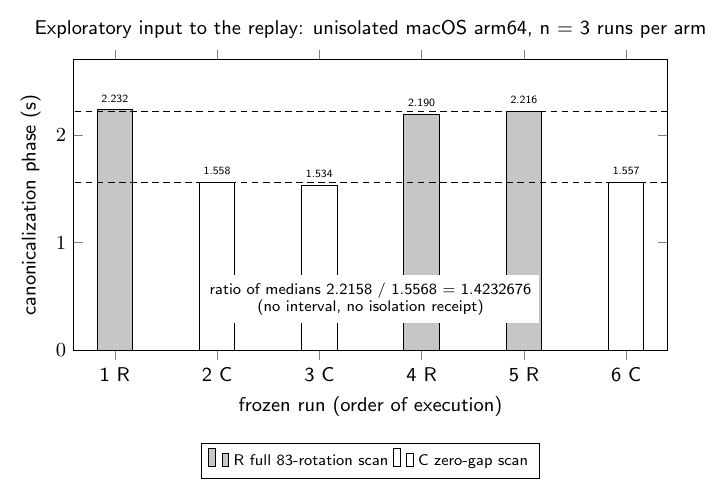
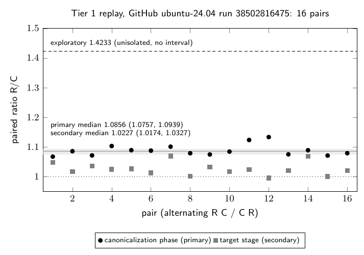

# N83 E-1 full scan against zero gap: Tier 1 replay protocol

**Status: run; verdict `promoted` (Tier 1, magnitude `refuted_overstated`).** See [Result](#result).
This directory froze a Tier 1 (cloud instance) paired replay of the n=83 Frobenius
canonicalization stage, which settles the paper's exploratory
canonicalization-phase ratio of **1.42×**. That figure
([`papers/frobenius-orbits/sec-benchmarks.tex`](../../../papers/frobenius-orbits/sec-benchmarks.tex),
Table "survives") comes from three unisolated macOS runs per arm. This
replay either promotes it to an instance-scoped Tier 1 result or refutes it.

| Item | Value |
| --- | --- |
| Run | GitHub Actions run `38502816475`, `ubuntu-24.04`, instance `gh-38502816475-1-paired-stage`, receipt [`tier1_github_38502816475/`](tier1_github_38502816475/) |
| Proposal | `Q2026100902` (candidate ID `null`: only the PDP stage is specified) |
| Curve | `EC1N83Ckb1h876c2921cb64` |
| Workload | `981ac530e67e` (one frozen public target, 2,000,000 pair states, 1,024 MiB RSS cap) |
| Frozen experiment | [`../packed_index_e1_canonical_20261009/`](../packed_index_e1_canonical_20261009/README.md) |
| Stage wrapper (reused unchanged) | [`../packed_index_e1_isolated_replay_20261010/benchmark_stage.py`](../packed_index_e1_isolated_replay_20261010/benchmark_stage.py) |
| Reference arm R | `packed_bucket22`: full 83-rotation scan |
| Candidate arm C | `packed_bucket22_fastcanon`: exact longest-zero-gap scan |
| Native source | `390f16b16800d0542bd0769e1d3f2ac80fdaa647e67184e23e8b586db71691cf` |
| Pair certificate | `7cfba6355dc0a0dd4c67bfcf585377b57caa50c4391554ac5ab5ec86d7acaff8` |
| Tier 1 protocol | [`tier1_protocol.json`](tier1_protocol.json), SHA-256 `6ce0131883afb695f34efe9df90c6e38eb488c79675e5af4dabde6d5d0111b90` |
| Workflow | [`.github/workflows/n83-e1-canonical-tier1.yml`](../../../.github/workflows/n83-e1-canonical-tier1.yml) |

## What is frozen

The [Tier 1 protocol](tier1_protocol.json) was written before any timing in
this directory. It does the following:

- **Bindings.** It binds by SHA-256 the frozen canonical protocol, stage
  manifest, workload, summary and native source, plus the Cargo files,
  bridge, representatives, both expected raw rows, the stage wrapper and
  `scripts/isolated_bench.py`.
- **Pairs and order.** There are 16 same-target pairs in the order R C, C R,
  repeated eight times. That is the order `isolated_bench.py` produces for a
  single case. All arms use one release binary on one pinned CPU, with a
  180 s cap per arm and a 5,760 s cap for the panel.
- **Correctness.** Each arm must reproduce every frozen arm field of its
  mode's published row. These fields include:
  - the operation counts: 328,000,000 / 656,000,000 rotations for the full
    scan and 19,127,078 / 38,261,354 for the zero-gap scan;
  - `lookup_sample`, which holds the canonical key and the stored Frobenius
    shift of the 64 roots of the first 32 indexed states.

  Both arms must also share the 20-field pair certificate.
- **Noise gates.** These are the Tier 1 preflight before the panel and before
  and after each arm, plus per-arm checks:
  - exit 0, no timeout, `verified=1`, and an unchanged executable;
  - zero `nr_throttled`, `oom` and `oom_kill` deltas;
  - native peak RSS of at most 1,024 MiB;
  - phase accounting: query prep + S3 batch + partner check ≤ target stage,
    and canonicalization + exact lookup ≤ partner check.

  Steal, IRQ, involuntary switches and child CPU time are recorded but not
  gated.
- **Statistics.** All three are paired ratios R/C, taken as the median of
  the 16 per-pair ratios. The 95% interval is a paired bootstrap:
  `random.Random(20261011)`, 10,000 resamples, sorted, indices 250 and 9749.
  This is the runner's own Tier 1 rule, applied with a fresh generator for
  each statistic.
  - *Primary*: canonicalization phase, `timing_ns.target_cycle_canonical`,
    decoded from each arm's embedded raw result.
  - *Secondary*: the target stage (`target_pdp_and_native_check`, the
    runner's `online_ms`).
  - *Negative control*: the S3 batch phase, which does identical work in
    both arms. It is reported to show instrument noise and is never gated.
- **Decision rule** (on the primary interval):
  - `invalid`: any gate fails. There is no verdict, and 1.42× stays
    exploratory.
  - `promoted`: the lower bound is above 1. The claim reports the measured
    median and interval, the provider, the instance and the tier. It does
    not report 1.42×.
  - `refuted_regression`: the upper bound is below 1.
  - `not_promoted_inconclusive`: the interval contains 1.
  - The magnitude check against 1.4232676 is separate:
    `consistent` / `refuted_overstated` / `refuted_understated`.
  - The secondary statistic is classified the same way but never changes the
    primary verdict.

  A promoted result is a stage diagnostic on one target and one instance. It
  is not a complete single-target IC speedup.

The exploratory 1.4232676 is a ratio of six-run medians
(2,215,795,406 / 1,556,836,845 ns). The Tier 1 statistic is a median of
paired ratios, so the two estimators differ, and the protocol records that.

## Files

| File | Role |
| --- | --- |
| `tier1_protocol.json` | frozen pairs, order, gates, statistics, and decision rule |
| `verify_inputs.py` | checks every binding, the six frozen rows, the rotation counts, the pair certificate and the exploratory ratio |
| `restore_crypto_source.py` | restores crypto `904f0f84` into the frozen experiment's gitignored `crypto_source_snapshot/` and checks its tree digests |
| `make_tier1_manifest.py` | writes the `isolated_bench.py` Tier 1 manifest (sixteen pairs, one case) |
| `verify_tier1_receipt.py` | audits an archived receipt, replays the raw results, recomputes all ratios and intervals, and prints the verdict |
| `tier1_github_38502816475/` | archived receipt of the run: allocation, host probe, preflight, manifest, raw pairs, build log, `verdict.json` |
| `figures/*.tex`, `figures/*.pdf`, `figures/*.png` | diagram and graph TikZ sources, vector and PNG renderings |
| `README.pdf` | this report with its figures |
| `report_header.tex`, `report_filter.lua` | PDF build: `pandoc README.md -o README.pdf --pdf-engine=pdflatex -H report_header.tex --lua-filter report_filter.lua -V geometry:margin=2cm -V fontsize=10pt -V colorlinks=true` |

## How it runs

A push to `claude/frobenius-orbit-canonicalization-gwmz8z` runs the workflow
when the push touches the workflow or this directory. It can also be started
with `workflow_dispatch`. The workflow does the following:

1. Records an allocation receipt and host probe for the fresh `ubuntu-24.04`
   runner.
2. Restores the pinned crypto source and runs `cargo test --release --locked`.
3. Builds the frozen binary.
4. Runs `verify_inputs.py`.
5. Writes the manifest and the Tier 1 preflight.
6. Runs the sixteen pairs.
7. Copies the runner output to `results/` and runs `verify_tier1_receipt.py`
   into `verdict.json`.
8. Uploads the whole receipt directory as artifact
   `n83-e1-canonical-tier1-<run_id>-<attempt>`, including failures.

To archive a receipt, download that artifact into
`tier1_github_<run_id>/` here and run
`python3 verify_tier1_receipt.py tier1_github_<run_id>`.

## Local preparation checks (2026-10-14, cloud agent VM; no timing claims)

These checks ran in a Firecracker VM inside Docker: 4 vCPU, Intel Xeon
@ 2.10 GHz, rustc 1.97.0, Python 3.13.16. Other agents were running at the
same time.

- **Build and tests.** `cargo test --release --locked` passed all 4 tests,
  including `zero_gap_canonical_matches_full_rotation_scan`, which is
  exhaustive at n = 3, 5, 7, 11 plus 100,000 fixed-seed 83-bit words. The
  release build produced binary SHA-256
  `15690b8dc13ce8a9a18af4cc54ee1331b846b529038c17d3dd6070832e4f4a86` (Linux
  x86-64). Its digest is not the frozen macOS binary's and is not expected to
  be.
- **Input verification.** `verify_inputs.py` returned `PASS`.
- **Manifest.** `make_tier1_manifest.py` wrote a 16-repetition manifest with
  446 hashed artifacts.
- **Probes.**
  - `isolated_bench.py probe` on the Tier 1 manifest returned `ok: true` with
    no problems. This host meets the Tier 1 preflight's mechanical checks
    (Linux, affinity, cgroup throttling and OOM counters). But it is a shared
    container, not the instance the protocol names, so the result is not used.
  - The Tier 0 manifest of the original adapter
    (`../packed_index_e1_isolated_replay_20261010/make_manifest.py`) was
    rejected with 16 problems, including Docker virtualisation, a missing
    isolated cgroup, `nohz_full`, frequency, `numactl`, and IRQ affinity.
- **Smoke run.** One unisolated arm of each mode ran through the frozen
  wrapper. Both reproduced every frozen arm field of the macOS rows on Linux
  x86-64.
  - Both returned `verified=1`.
  - The `lookup_sample` keys and shifts (64 roots) were identical, and so was
    the pair certificate.
  - Operation counts differ only in `canonical_rotation_steps`.

  Their timings are not reported. They come from an unqualified host.
- **Receipt verifier.** To exercise `verify_tier1_receipt.py`, the full
  16-pair panel ran once through `isolated_bench.py run` on this shared VM,
  using a local allocation receipt (`local_agent_vm`). The panel completed:
  16/16 valid pairs, artifacts stable. The verifier then replayed it without
  error and returned a verdict.
  - Setting one arm's `nr_throttled` delta to 1 gave verdict `invalid`.
  - Corrupting one arm's raw-result digest raised an error.

  The panel is a code-path test only. It is not committed, and its timings
  and verdict are not a measurement.

## Result

Run `38502816475` (commit `66e16796`, public runner image `ubuntu24`
20261004.327.1, 4 exposed CPUs, one pinned) completed with conclusion
`success`. The artifact was downloaded through the GitHub API and archived in
[`tier1_github_38502816475/`](tier1_github_38502816475/) without the runner's
queue lock file. `verify_tier1_receipt.py` replayed the archived raw results
from the committed copy and reproduced the workflow's `verdict.json` byte for
byte. All 16 pairs were valid and every gate passed (peak native RSS
562,561,024 bytes against the 1,024 MiB cap).

| Statistic (paired R/C, median of 16) | Median | 95% paired bootstrap | Rule outcome |
| --- | --- | --- | --- |
| Primary: canonicalization phase | 1.0856 | [1.0757, 1.0939] | `promoted` (lower bound above 1) |
| Secondary: target stage | 1.0227 | [1.0174, 1.0327] | `promoted`, never changes the primary |
| Negative control: S3 batch phase | 1.0073 | [0.9968, 1.0171] | not gated; interval contains 1 |

Median canonicalization phase: 1,172,834,420 ns (R) against 1,079,689,756 ns
(C). Median target stage: 4,419.0 ms (R) against 4,272.3 ms (C).

**Verdict by the frozen rule.** `promoted`: the primary lower bound is above 1.
The claim is a canonicalization-phase ratio of 1.086 [1.076, 1.094] on GitHub
Actions, instance `gh-38502816475-1-paired-stage`, tier 1. The magnitude check
is `exploratory_magnitude_refuted_overstated`: the exploratory 1.4233 lies far
outside the interval, so 1.42x is not supported and is not reported as a
result. The negative control stayed near 1 as intended.

Limits: one target, one instance, a stage diagnostic (canonicalization is
about a quarter of the target stage; the target stage moves only 1.023x). A
container affinity mask does not prove host-wide exclusivity, and steal and
involuntary switches were recorded, not gated. This is not a complete
single-target IC speedup and is not a Tier 0 result.

## Replicate

Run `38524295231` was started unintentionally: the push that archived the first
receipt touched this directory, which the workflow's path filter watched. It
ran the same frozen protocol at commit `7da160a2` on a different runner
(`GitHub Actions 1000294691`) and is archived as a **replicate** in
[`tier1_github_38524295231/`](tier1_github_38524295231/). It is reported
beside the first run and is not pooled with it. `verify_tier1_receipt.py`
reproduces its `verdict.json` byte for byte; all 16 pairs valid, all gates passed.

| Statistic (paired R/C, median of 16) | Run 38502816475 | Replicate 38524295231 |
| --- | --- | --- |
| Primary: canonicalization phase | 1.0856 [1.0757, 1.0939] | 1.0953 [1.0812, 1.1062] |
| Secondary: target stage | 1.0227 [1.0174, 1.0327] | 1.0215 [1.0162, 1.0350] |
| Negative control: S3 batch phase | 1.0073 [0.9968, 1.0171] | 1.0176 [0.9994, 1.0277] |
| Verdict / magnitude | `promoted` / `refuted_overstated` | `promoted` / `refuted_overstated` |

Each run's verdict stands on its own under the frozen rule. Both lower bounds
are above 1 and both intervals lie far below 1.4233. The workflow's path filter
now excludes receipts and report files, which stops further retriggers; the
frozen protocol is unchanged.

## Graphs checked

`figures/tier1_result.{tex,pdf,png}` is new and plots the receipt. The paper's
Table "survives" row and the `sec-benchmarks.tex` zero-gap paragraph now cite
the Tier 1 figure and state that the unisolated 1.42x is refuted; the
frozen-protocol and exploratory-input figures are unchanged and remain current.
