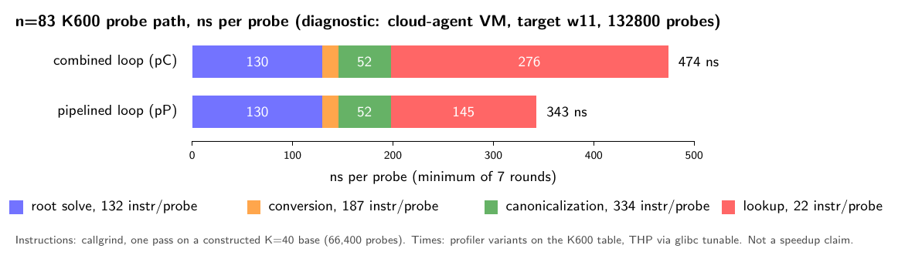
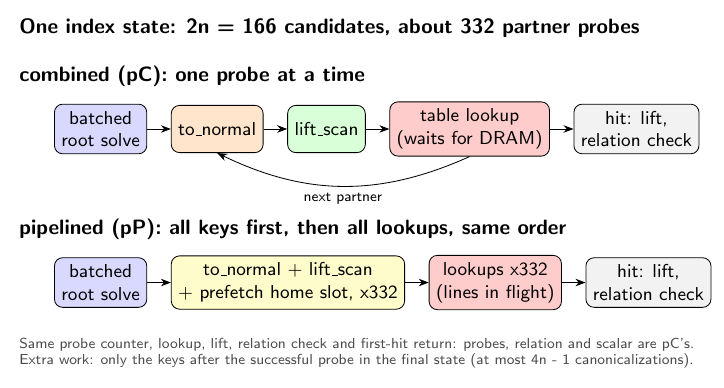

# Probe pipeline: prefetched root-table probes for the combined n = 83 K600 one-target index calculus

**Status (2026-10-15): measured; frozen primary rule applied; verdict
`improvement`.** GitHub Actions run
[38822490448](https://github.com/aburan28/cryptanalysis/actions/runs/38822490448)
(attempt 1, one `ubuntu-24.04` runner, Intel Xeon Platinum 8370C, Tier 1
instance scope) ran the frozen [protocol](protocol.json) and
[schedule](schedule.json). Its artifact `n83-probepipe-38822490448-1` is
archived in [`run_github_38822490448/`](run_github_38822490448/). On 384 new
points the probe pipeline cuts the one-target online interval of the
combined producer by **1.4001 [1.3971, 1.4032]** (R_m = mean `pC` / mean
`pP`), with probes, relation and scalar identical. See [Result](#result).

## Question

The n = 83 a = 1 K600 one-target IC's online interval is about 100%
`target_PDP`: per probe, a batched S3 root solve, a `to_normal` byte-table
conversion, canonicalization, and a lookup into the ~4 GiB root table. Two
promoted improvements are now combined (`claude/n83-combined`, protocol
frozen, run 38803625711 in flight): `lift_scan` canonicalization (1.52x
online) and the Feistel scan order (1.45x on held-out points). The
`ic-probe-latency-20261015` experiment measured an IC probe at 574 ns against
a bare 4 GiB pointer chase at 140 ns.

Which component dominates the combined producer's probe, and does the fix
that matches it lower the one-target online time on new public points, with
probes, relation and scalar unchanged? Under AGENTS.md's success criterion,
a verified, measured improvement over the current baseline is a success and
becomes the new baseline.

## 1. Profile of the combined probe path (diagnostic)

All numbers in this section come from the cloud-agent VM, a shared 4-vCPU
guest. They chose the fix; they are not evidence of a speedup. The raw files
are in [`smoke/profile/`](smoke/profile/), the table in
[`analysis/profile_local.json`](analysis/profile_local.json)
(`analysis/make_profile_table.py`).

- **Instrument.** The profiler `ic_probe_profile_r770`
  (`make_profile_source.py`, a derived copy of the producer that is never a
  timed arm) walks the first 400 index states of target w11's Feistel order
  (132,800 probes) and times cumulative variants of the per-state work, all
  probes and no early exit, 7 rounds in rotated order: roots; + `to_normal`;
  + `lift_scan`; + inline lookup (the combined loop); and, for comparison,
  the pipelined lookup. Differences are marginal costs in situ. The root
  table is THP-backed (`glibc.malloc.hugetlb=1`), as on the runner, whose
  THP mode is `always`.
- **Instruction counts.** callgrind on the same profiler, one variant per
  run, with 1 and 2 passes; the difference is one pass, so setup cancels.
  It runs on a constructed K = 40 base (200 states, 66,400 probes), because
  instructions per probe do not depend on the table size
  ([`smoke/profile/callgrind.sh`](smoke/profile/callgrind.sh)).
- **The rest.** The real producer (`KIC_PROBE_PIPELINE=off`, the combined
  loop) on w11, w08 and w14 ran at 472 ns/probe on the same VM. That is the
  inline-lookup variant's 474 ns within noise, so everything else (hits,
  lift, relation check, laps, the Feistel order) is about 0.

| component | ns/probe (diagnostic) | share of 472 ns | instructions/probe (callgrind) |
| --- | ---: | ---: | ---: |
| root solve (2n inputs + batched S3 solve) | 130 | 28% | 132 |
| `to_normal` conversion | 16 | 3% | 187 |
| `lift_scan` canonicalization | 52 | 11% | 334 |
| **root-table lookup (4 GiB)** | **276** | **59%** | **22** |
| rest | about 0 (-2) | 0% | |

**The dominant cost is the root-table lookup, and it is latency-bound:**
22 instructions per probe take 276 ns, 59% of the probe. The compute
components together are 198 ns. Instruction counts per variant come from a
different codegen of each variant, so the per-component instruction split
(especially conversion against root solve) is approximate; the
latency reading does not depend on it.

So the fix is the latency fix, not a wider batch for the root solve (28%) or
a GFNI/clmul conversion (3%).

## 2. The fix: software-pipelined probes with prefetch

`make_online_source.py` derives the producer in two steps:

1. `make_combined_source.py` is `claude/n83-combined`'s
   `make_online_source.py` @ 88e1929fb, verbatim. Its output must hash to
   the combined protocol's frozen producer digest (`f65e518a...`), so the
   baseline text is exactly the combined producer.
2. Counted, exact replacements add a compile-time selector `P` on the
   target scan, chosen per process by `KIC_PROBE_PIPELINE`:
   - `off`: `scan_state128`, byte for byte unchanged (the combined loop);
   - `prefetch`: `scan_state128_pipelined`. Same root batch. Then, in the
     same candidate order (shift outer, stored root inner, solver partner
     order), every partner's `to_normal` word and `lift_scan` key, each
     followed by `_mm_prefetch(T0)` of its home slot. Then the lookups, lift
     and relation check in that same order, with the same probe counter
     and the same first-hit return.

**Exactness.** The probe sequence, the counter, the lookup, the lift and the
return are those of `off`, so the probes, relation and scalar are identical
on every target. The only extra work is computing keys for the probes after
the successful one in the final state (at most 4n - 1 canonicalizations),
which the clock charges. The rank stage always runs `PIPE_OFF`. Locally, on
w11, w08 and w14, both settings gave identical probes (160,866, 161,864,
183,505), relations and scalars, equal to the earlier combined binary's; see
[`smoke/`](smoke/README.md).

In the profiler the pipelined lookup costs 145 ns/probe instead of 276
(474 → 343 ns/probe, diagnostic). A deeper, cross-state pipeline (a state's
lookups consumed after the next state's keys) gave the same 342 ns, so the
remaining lookup cost is not a short prefetch distance. The lookup-only
loops (65-73 ns per lookup with no compute) point at TLB and page-walk cost
under the VM's nested paging; that is a hypothesis for the next step, not a
measurement.

## 3. Frozen Tier 1 design

| Arm | Canonicalizer | Order | Probe loop | Panel | Role |
| --- | --- | --- | --- | --- | --- |
| `pC` | lift | Feistel | off | primary | baseline: the combined producer |
| `pP` | lift | Feistel | prefetch | primary | candidate |
| `pPaa` | lift | Feistel | prefetch | primary | A/A control |
| `pX` | lift + discarded full scan | Feistel | prefetch | primary | planted positive control |
| `rT` | — | — | — | primary, every point | tuned rho rT770 (Fold/64/DP6), seed 850000 + point seed |
| `oC`, `oP` | lift | Feistel | off / prefetch | Q0 + B's 16 fresh, 1 block | exactness against the archived Feistel identities; secondary |

- **Primary panel.** 384 new public points (`inputs/primary_targets.json`,
  `make_targets.py`) from B's public hash-to-curve law with the new role
  `probepipe-primary-v1`, seeds 0..383. They are checked disjoint from Q0,
  B's 16 fresh points (role `eval`), the 384 scan-order held-out points and
  the 576 combined primary points (both regenerated from the law). No scalar
  is known for any of them.
- **One job, one pinned CPU.** Six primary slices of 64 points and one
  Q0 + fresh block, P1, P2, P3, O1, P4, P5, P6. Within each segment the
  order is a seeded shuffle. Every primary slice holds one process per IC
  arm and one rho process per point. Each IC process does its setup once and
  then gives each target its own one-target online interval.
- **Primary statistic.** R_m = mean `pC` / mean `pP`, online time over all
  384 points, bootstrap over points, 10,000 resamples.
- **Decision rule.** **Improvement** iff the 95% lower bound of R_m exceeds
  1; regression iff its upper bound is below 1; otherwise not_separated. The
  verdict is **invalid** if an exactness gate fails, the A/A (`pP`/`pPaa`
  inside [0.97, 1.03]) or the planted control (`pX`/`pP` lower bound above
  1) fails, or any of the 384 points lacks a valid row in an arm.
- **Also reported.** R_g (paired geometric means), ns/probe per arm, the
  probe ratio (must be exactly 1), the new `S_rho` for `pC` and `pP` and its
  delta, the tuned-rho gap on the same points, the slice bootstrap and
  per-slice ratios, and the Q0 + fresh block.
- **Exactness gates.** On every primary point the four IC arms have
  identical probes and relation; one scalar across them and the tuned rho;
  every scalar replays as [d]G = Q in the pinned oracle. On Q0 + 16 fresh,
  both arms reproduce the archived Feistel probes and relations of run
  38786433493, the archived scalars, and Q0's validation sidecar.
- **Power, checked before freezing** (`power_check.py`,
  `analysis/power.json`). The population is the old held-out panel's
  measured Feistel times over the measured lift_scan ratio. The per-point
  effect spread is the 16 measured lift_scan ratios', with timing noise
  sigma 0.02 per target and 0.01 per process. For a minimal effect of
  interest of 1.03, power is 0.81 at 64 points, 0.92 at 128 and 1.00 at 384.
  The smallest size passing 0.80 after two Monte Carlo SEs is 128. The panel
  is the design floor of 384, so that the slice bootstrap has six clusters.
- **Runtime estimate.** About 1.0 to 1.6 h including the build, with a
  300-minute time guard. A last step runs the profiler on Q0 on the runner
  (`profile_diagnostic_*.json`), diagnostic only; it never enters the
  decision.

## Local validation (cloud-agent VM; no timing claims)

See [`smoke/README.md`](smoke/README.md).

## Files

| File | Role |
| --- | --- |
| `protocol.json`, `make_protocol.py`, `schedule.json`, `make_schedule.py` | frozen protocol, its builder, frozen run order |
| `make_combined_source.py`, `make_online_source.py`, `online/`, `lift2/` | combined producer (verbatim derivation, digest-checked) plus the probe-pipeline selector; tuned rho; the two-limb canonicalizer crate |
| `make_profile_source.py`, `analysis/make_profile_table.py`, `analysis/profile_local.json`, `smoke/profile/` | the diagnostic profiler, the profile table and its raw inputs |
| `restore.py`, `check_log_table.py` | restore and digest-check crypto 770f6a69 and every local source; re-verify B's factor-log table |
| `make_targets.py`, `inputs/primary_targets.json` | the new primary panel |
| `inputs/archived_identities.json` | archived probes, relations and scalars of Q0 and the 16 fresh points (from `claude/n83-combined`) |
| `power_check.py`, `inputs/power_prior.json`, `analysis/power.json` | power simulation, its prior, its result |
| `arm.py`, `panels.py`, `run_schedule.py` | one arm per pinned process; panels; the schedule runner |
| `verify_receipt.py` | gates, statistics, decision rule; `result.json`, `result_table.md` |
| `make_figures.py`, `figures/` | TikZ sources and renders of the profile, the pipeline diagram and the Tier 1 result |
| `run_github_38822490448/` | the archived artifact: allocation, builds, raw runs, `panel/result.json`, runner profiler step |

## Result

All gates pass: the four primary IC arms have identical probes and relation
on every point, one scalar across the arms and the tuned rho, every scalar
replays in the pinned oracle, Q0 equals the validation sidecar, both arms
reproduce the archived Feistel identities on Q0 + 16 fresh, the A/A and the
planted control pass, and the primary panel is complete (384/384).
`verify_receipt.py` re-run on the archive reproduces `result.json` byte for
byte.

, [vector](figures/result.pdf), rendered by
[`make_figures.py`](make_figures.py)).](figures/result.png)

### Primary (frozen rule)

The pipeline is an improvement iff the 95% lower bound of R_m exceeds 1.

| Statistic (n = 384 new points) | Estimate [95%] | Reading |
| --- | --- | --- |
| R_m = mean pC / mean pP | 1.4001 [1.3971, 1.4032] | **improvement** |

The probe ratio combined / pipeline is exactly 1.0000 [1.0000, 1.0000], as
the gate requires. Ratchet: the new n = 83 one-target pipeline is
lift_scan + Feistel order + software-pipelined, prefetched root-table
probes.

### Also reported

| Statistic | Estimate [95%] |
| --- | --- |
| R_g (paired geometric means), reported | 1.4002 [1.3974, 1.4030] |
| R_m, slice bootstrap (6 slices), sensitivity | 1.4001 [1.3850, 1.4170] |
| R_m per slice | 1.3757, 1.4370, 1.4168, 1.3801, 1.4015, 1.3964 |
| A/A pPaa: pP / pPaa | 0.9961 [0.9944, 0.9978] (inside [0.97, 1.03]) |
| Planted: pX / pP | 2.0106 [2.0036, 2.0172] |
| Q0 + 16 fresh, combined / pipeline (means, 16 fresh) | 1.3936 [1.3914, 1.3961] |
| Tuned rho / pipeline (means) | 6.8396 [6.1494, 7.6526] |
| Tuned rho / pipeline (geomeans) | 9.3651 [8.1982, 10.6940] |
| Tuned rho / combined (means) | 4.8852 [4.3824, 5.4682] |

- **ns/probe** (online time over probes; probes mean/law 1.007 in every
  arm): pC 302.1 (online mean 525.8 ms, geomean 323.6 ms); pP 215.8 (375.5
  ms, geomean 231.1 ms); pPaa 216.6 (377.0 ms); pX 433.9 (755.1 ms). Q0 block:
  oC 587.6 ms, oP 423.6 ms.
- **S_rho** (online cost over √r in tuned-rho steps; this run's measured rT770
  step, 275.5 ns here): pC 0.02062, pP 0.01473. Delta S_rho (pipeline minus
  combined) = −0.00589. `S_probe` is 0.01880 for both, as the probes are
  identical. No cold `S` was measured.
- **Gap to tuned rho.** Online IC / tuned rho on the same 384 points: 0.1462
  (inverse of 6.8396) with the pipeline, against 0.2047 (inverse of 4.8852)
  with the combined producer. This is distance remaining and is online only;
  the precomputation is not in it. It is not a claim to beat rho.

### Runner profiler step (diagnostic only; never part of the decision)

The last workflow step ran `ic_probe_profile_r770` on Q0 on this runner, 2
rounds of 7 repeats each (`profile_diagnostic_1.json`, `_2.json`; medians,
round 1 / round 2 agree within 1 ns). Marginal costs, ns/probe, from the
cumulative variants:

| component | round 1 | round 2 |
| --- | ---: | ---: |
| root solve | 121.3 | 121.0 |
| `to_normal` conversion | 13.8 | 13.4 |
| `lift_scan` canonicalization | 48.7 | 49.0 |
| root-table lookup, inline (combined loop) | 105.7 | 108.2 |
| root-table lookup, pipelined | 26.9 | 26.9 |

Variant totals: inline 289.5 / 291.6; pipelined 210.7 / 210.3; cross-state
pipelined 207.9 / 207.8. On this runner the inline lookup is about 37% of the
probe (the VM profile in section 1 gave 59%), so the profile transfers in
direction and not in size. The pipelined lookup removes about 79 ns of the
inline lookup's 106 ns, the same order as the 86 ns (about 1.4×) by which
the Tier 1 arms differ, 302.1 against 215.8 ns/probe. A deeper cross-state pipeline gains nothing
more here either (207.9 against 210.7). These profile numbers are a single
instrument on Q0 and explain; they decide nothing.

### Limits of this result

- One runner, one pinned CPU, Tier 1 instance scope. Intervals are over
  points (the slice bootstrap is the sensitivity to process-level effects).
- The comparison is the two probe loops, compiled in one binary, on the same
  points in one job. It does not re-run the combined experiment's own
  binary, and the combined experiment's own frozen rule found the
  lift_scan x Feistel combination `not_separated` against its better single
  arm (PR #929). The baseline `pC` here is the combined producer, as
  frozen.
- Next step: the residual lookup cost (26.9 ns/probe pipelined), by the
  candidates listed under Limits below.

## Limits

- The profile is a VM diagnostic. Its component split can differ on the
  runner (an AMD EPYC in recent runs); the runner's profiler step records
  the same variants there, still as a diagnostic.
- Tier 1, instance-scoped: one runner, one pinned CPU, not host-isolated.
- `pC` is the combined producer's probe loop compiled into the same binary
  as `pP`, as a separate monomorphization. This experiment does not re-run
  the combined experiment's own binary; it compares the two loops on the
  same points in one job.
- The tuned-rho gap is distance remaining, not a claim to beat rho.
- Next step after this run: the residual lookup cost (TLB and page walks
  under nested paging, by hypothesis). Candidates are a smaller table slot
  (16 bytes instead of 32) or a two-level table whose first level stays
  cache- and TLB-resident.
