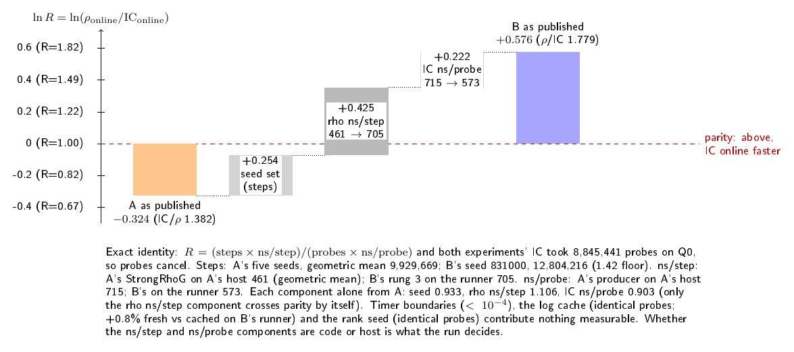
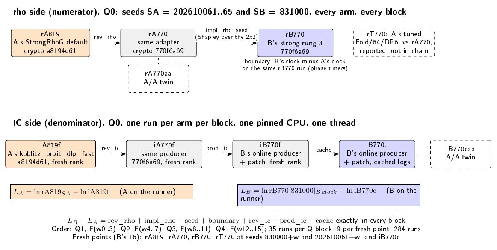

# N83 Q0: reconciling A (rho faster) and B (IC faster)

**Status (2026-10-14): source audit done; protocol frozen; the Tier 1 run
starts on push of branch `claude/n83-reconcile`. No timing result exists
yet.** This directory makes no performance claim. Results will land as
`run_github_<id>/` with `result.json` and `result_table.md`, and this README
will be updated with them. The workflow's path filter ignores those files.

Two measurements of the same point disagree in direction:

| | A | B |
| --- | --- | --- |
| Where | crypto `research/n83_evaluation_20261012/` | cryptanalysis `experiments/koblitz-single-target-n83-tier1-20261014/` (run `38523707244`) |
| Crypto source | `a8194d61` | `770f6a69` |
| Rho | `StrongRhoG<WideGf2,u64>` default (32 lanes, DP 4, escape off), seeds 202610061..65 | `koblitz_rho_batch_ks_strong_online` rung 3 (32 lanes, DP 4), seed 831000 |
| IC | `koblitz_orbit_dlp_fast`, fresh in-process rank (seeds 21..25) | `koblitz_orbit_dlp_fast_online` + `ic_log_cache.patch`, cached factor-log table |
| Host | 5-vCPU KVM guest, one pinned CPU | GitHub ubuntu-24.04 runner, one pinned CPU |
| Q0 result | IC/rho online 1.382 [1.036, 1.882] (5 pairs) | rho/IC online 1.779 [1.775, 1.783] (8 pairs, one rho walk) |
| Reading | rho online faster | IC online faster |

Point Q0 = (2655898345537166180532960, 3881526307991673265292615) on
`EC1N83Ce1h35c7ced6b497` (y^2 + xy = x^3 + x^2 + 1 over
GF(2)[z]/(z^83+z^7+z^4+z^2+1), r = 8569786107849059), retained K600 base
`d4a4da26...a9f7`.

## Source audit (before any timing)

[SOURCE_AUDIT.md](SOURCE_AUDIT.md) ([PDF](SOURCE_AUDIT.pdf)). Both IC runs
did identical work on Q0: 8,845,441 probes and the same relation, at every
rank seed, cached or fresh. So the gap splits exactly into rho steps x ns per
step over IC probes x ns per probe:



*Figure 1. The published A to B gap in ln(rho/IC) on Q0, split into its
three exact components from the raw receipts
([source](figures/audit_decomposition.tex),
[vector](figures/audit_decomposition.pdf)). These are not one-host
measurements.*

* **Explained without a run:** the two harnesses' timer boundaries cover the
  same operations (difference under 1e-4 in ln R). The log cache moves no work
  (identical probes; +0.8% fresh against cached on B's runner). The rank
  seed is irrelevant online. A's median agrees with A's geometric mean. B's
  seed made Q0 a long walk: 1.42 times the floor, against a geometric mean of
  1.10 over A's five seeds. That gives +0.254 in ln R, which cannot flip A's
  direction alone (0.933).
* **Not explained without a run:** rho ns per step is 461 for A's StrongRhoG
  on A's host and 705 for B's rung 3 on the runner (+0.425, enough to flip
  alone: 1.106). IC ns per probe is 715 for A's producer on A's host and 573
  for B's on the runner (+0.222). Each could be code or host: both hosts
  report an AMD EPYC 9V74 and rustc 1.99.0, but they are different VMs.

## Frozen design ([protocol.json](protocol.json), [schedule.json](schedule.json))



*Figure 2. Arms and the exact chain from A's configuration to B's
([source](figures/design.tex), [vector](figures/design.pdf)).*

| Arm | Code | Revision | Role |
| --- | --- | --- | --- |
| rA819 | A's `n83_strong_point_eval` (StrongRhoG default) | a8194d61 | A's exact rho |
| rA770 | same adapter | 770f6a69 | rho revision |
| rA770aa | same as rA770 | 770f6a69 | A/A control |
| rB770 | rung 3 | 770f6a69 | B's exact rho |
| rT770 | A's tuned worker, Fold/64/DP6 | 770f6a69 | reported, not in the chain |
| iA819f | A's `koblitz_orbit_dlp_fast`, fresh sequential rank | a8194d61 | A's exact IC |
| iA770f | same producer | 770f6a69 | IC revision |
| iB770f | B's online producer + patch, fresh sequential rank | 770f6a69 | IC producer |
| iB770c | same, cached table (`KIC_LOG_TABLE_IN`) | 770f6a69 | B's exact IC |
| iB770caa | same as iB770c | 770f6a69 | A/A control |

* **Points:** Q0, plus B's 16 fresh public points (B's `inputs/targets.json`,
  hash-bound).
* **Q0 panel:** 4 complete blocks. Each block runs every rho arm at all six
  seeds (A's 202610061..65 and B's 831000) and every IC arm once: 35 runs, in
  a frozen pseudo-random order. Fresh-rank arms use rank seed 20 + block.
* **Fresh panel:** per point, rA819, rA770, rB770 and rT770 at seeds
  830000 + w (B's rule) and 202610061 + w (A's family), and one cached IC run.
  That is 9 runs per point.
* **Order:** Q1, F(w0-3), Q2, F(w4-7), Q3, F(w8-11), Q4, F(w12-15); 284 runs
  in all. One process at a time on one pinned CPU, in one job.
* **Factorial:** every arm runs in every block, so every rho arm x seed x IC
  arm combination is a within-block paired ratio. Rho implementation (3
  levels) x seed set (2) is fully crossed. Revision is nested in A's code,
  and the log source in B's IC producer, because the other code does not exist
  at n=83 at a8194d61 (SOURCE_AUDIT section 5).
* **Statistic:** natural logs. Per block, `L_A` = mean over A's seeds of
  ln rA819 minus ln iA819f; `L_B` = ln rB770[831000] (B's clock) minus
  ln iB770c. Then `L_B - L_A` = rev_rho + impl_rho + seed + boundary + rev_ic
  + prod_ic + cache, exactly. impl_rho and seed are Shapley values over the
  2x2. The bootstrap resamples blocks (10,000 draws; 95% intervals, and
  Bonferroni 99.29% for m = 7). On the fresh points: each rho factor per
  point, bootstrapped over points, and B's section 23 statistic per rho arm.
* **Decision rule:** a factor is *sufficient to flip* if A reproduces on the
  runner (L_A upper bound < 0) and L_A + D_f has a Bonferroni lower bound
  > 0. It *contributes* if its Bonferroni interval excludes 0 and |D_f| >=
  0.05. It is *negligible* if its 95% interval lies inside [-0.05, 0.05].
  The responsible factors are every sufficient one, or else the smallest
  greedy set of contributing ones that flips L_A. If A's configuration
  already reads IC-faster on the runner, the responsible factor is
  `host_or_instance`.
* **Controls:** two A/A twins (rho on all six seeds, and cached IC). Each
  passes if |mean ln| <= 0.03 and its 95% interval lies inside
  [-0.05, 0.05]. A positive control: the instrument must recover, within
  0.10, the exact ln step ratio 0.978 between rA770's seeds 202610064 and
  202610063. Identity checks: one scalar per point, equal to Q0's sidecar and
  replayed in `oracle.py`; identical steps per seed across rA819, rA770 and
  rA770aa; identical probes across IC arms; every fresh table's logs equal
  to B's archived table.
* **Validity:** invalid rows (exit, verification, timeout, memory event) make
  `no_result`. Contention flags from isolated_bench's Tier 1 gate (steal,
  throttling, major faults) keep the row. The decision is recomputed without
  flagged blocks, and a different answer reads `sensitive_to_contention`.

## Resources and expected runtime

| Stage | Estimate | Basis |
| --- | --- | --- |
| rustup 1.99.0, two crypto builds, bin tests | 15-30 min | local builds 5.6 + 4.7 min at -j3 |
| B's table re-verified in oracle.py | about 10 s | local |
| Q0 block (3 fresh-rank IC at about 14-18 min each, 2 cached IC, 30 rho) | 48-62 min | B runner: fresh B producer 888 s, cached 52 s, rung 3 705 ns per step; A host: A's IC 1,054 s per process |
| Fresh segment (4 points x 9 runs) | 6-8 min | B Panel B: IC median 645 ms online + 46 s setup, rho 6.2 s |
| Audit | 5-15 min | oracle replays and log-table checks |
| **Total** | **about 4.1-5.3 h** | job timeout 350 min; a time guard skips whole segments past 325 min |

Memory: fresh-rank IC peaks at about 5.8 GB, one process at a time, within 16 GB.

## Local validation (correctness only; no timing is reported)

Local validation ran in a shared, contended container. Receipts:
[`smoke/`](smoke/README.md).

* `restore_sources.py`: both snapshots match `protocol.json`. Every file
  shared with B also matches B's frozen digests, and A's adapter matches
  A's recorded 82bc92d2.
* Both crates build with `--locked`. `cargo test --release --locked --bins`
  passes: 12 tests (r819) and 32 tests (r770).
* `run_schedule.py --segments Q1,F1 --one-per-arm` ran all 10 arms on Q0
  and the 5 fresh-panel arms on point w00: 15 valid rows. Then
  `verify_receipt.py --correctness-only` passed every identity check (see
  the list after this one).
* Earlier direct `arm.py` calls reproduced A's and B's exact step counts on
  Q0: 10,203,425 at seed 202610061 for rA819 and rA770, and 12,804,216 at
  seed 831000 for rB770.
* `make_schedule.py --check` passes. `verify_log_table.py` passes on B's
  archived table. `verify_receipt.py` on synthetic data reproduced the chain
  identity to rounding, and a deadline-0 run of `run_schedule.py` recorded
  all 284 runs as `skipped_time_guard`.
* Workflow: YAML parses; `actionlint` 1.7.7 with shellcheck 0.10.0 passes.

The identity checks that passed:

* one scalar per point; Q0's equals the sidecar 3141592653589793; every
  scalar replays in `oracle.py`;
* steps equal A's receipts (14,229,982 and 13,159,092 at seeds 202610064
  and 202610065) and B's (9,447,525 on w00 at seed 830000);
* probes are 8,845,441 for every IC arm on Q0 and 14,455,639 on w00, as in
  B's Panel B;
* the fresh B-producer table's 600 logs equal B's archived table.

## Gaps and limits

* The chain is measured on **one runner**. A residual between A's published
  L_A and the runner's L_A is the A-host effect, and it cannot be split
  further here.
* B's IC producer and rung 3 have no n=83 path at a8194d61. Their revision
  effects are therefore not estimable, and only A's code carries the revision
  factor.
* IC producer, revision and log-source effects are measured on Q0 only (each
  fresh-rank arm costs about 15 min). The fresh points carry the rho factors
  over targets.
* Seed-set effects are fixed effects of these seeds. Q0 intervals cover
  repeat and timing variation, not seed or target variation.
* Tier 1 instance scope: one pinned exposed CPU on a shared VM. Exclusivity is
  not certified.
* Canonical graphs checked: B's `figures/prior_ratios.*` and
  `figures/tier1_result.*`, and `experiments/volcano-ic/figures/`. None
  changes until a result exists. This directory's figures are new.

## Files

`protocol.json` (frozen design and digests), `schedule.json` (frozen order),
`SOURCE_AUDIT.md`, `restore_sources.py`, `crates/{r770,r819}/`, `arm.py`,
`make_schedule.py`, `run_schedule.py`, `verify_log_table.py`,
`verify_receipt.py`, `figures/`, `smoke/`, and the workflow
[`.github/workflows/n83-reconcile.yml`](../../.github/workflows/n83-reconcile.yml).
The workflow reuses from B: `ic_log_cache.patch`, `inputs/targets.json` and
the archived factor-log table of run 38523707244.

## Reproduce

```sh
git clone https://github.com/aburan28/crypto /path/crypto
python3 restore_sources.py --crypto-repo /path/crypto
python3 make_schedule.py --check
(cd crates/r819 && cargo build --release --locked); (cd crates/r770 && cargo build --release --locked)
python3 verify_log_table.py --table ../koblitz-single-target-n83-tier1-20261014/tier1_github_38523707244/precompute/factor_logs_n83_K600.json
python3 run_schedule.py --bin-dir $CARGO_TARGET_DIR/release \
  --log-table ../koblitz-single-target-n83-tier1-20261014/tier1_github_38523707244/precompute/factor_logs_n83_K600.json \
  --receipt-dir R/panel --cpu 0
python3 verify_receipt.py R/panel
```
