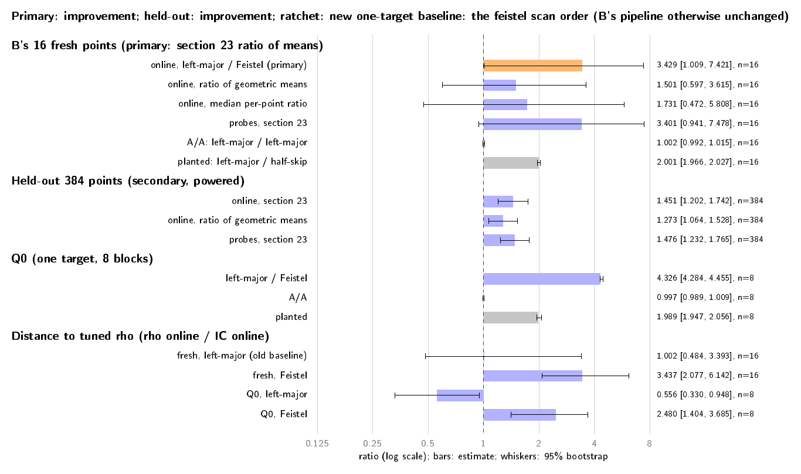

# Scan order of the n = 83 K600 one-target index calculus

**Status (2026-10-15): measured; frozen primary rule applied; verdict
`improvement`, with a lower bound of 1.009 that barely clears 1.** GitHub
Actions run [38786433493](https://github.com/aburan28/cryptanalysis/actions/runs/38786433493)
(attempt 1, one `ubuntu-24.04` runner, AMD EPYC 9V45, Tier 1 instance scope)
ran the frozen [protocol](protocol.json); its artifact
`n83-scan-order-38786433493-1` is archived in
[`run_github_38786433493/`](run_github_38786433493/). The pre-registered
384-point held-out panel is reported separately in [Result](#result) and never
changes the verdict.

## Question

The finding comes from stage 0 of the quotient law
(`claude/ic-probe-latency`, `experiments/ic-quotient-law-stage0-20261015/`,
commit `cfa806a38`). On B's 16 fresh points, the K600 cached-log baseline
used 2.30× [0.66, 4.27] the probes predicted by `r/(A·#states)`. Its CV was
1.57 and the KS test gave p = 0.001. Three points took 14.5–18.1M probes,
against a law mean of 1.73M. Every other base follows the geometric law.

That raises two questions:

- Is the scan order the cause?
- Can an exact change to the order lower the current baseline's one-target
  online time?

This is an iteration under AGENTS.md "Success criterion: iterative
improvement of the index-calculus baseline" (PR #919).

## What the source and the receipts show (exact)

, [vector](figures/scan_blocks.pdf)).](figures/scan_blocks.png)

**The source** is crypto `770f6a69`
`examples/koblitz_orbit_dlp_fast_online.rs`, `mod wide`, plus B's
`ic_log_cache.patch`:

- `build_index128` pushes one state for every (left, right, relative), in
  that loop order. Every pair gives a state, because its two roots are
  $x(A \pm \tau^{rel} B)$. The receipts confirm this: `regular_states` is
  29,880,000 = 600·600·83. The state vector is therefore **left-orbit-major**,
  with 49,800 states per left orbit.
- `extract128_timed` scans `states[start..]` and then `states[..start]`. Here
  `start` is the public-point hash mod S.
- `scan_state128` batch-solves 2n = 166 roots per state and probes two
  partners per root, so one state is 332 probes. A left block is 16,533,600
  probes, against a law mean of 1,727,752.

**The receipts.** `receipt_blocks.py` recomputes each point's start state
from the point alone, and its states scanned from `root_calls / 166`. It
takes the first IC receipt per point of BL-arm run 38689817618, copied into
`inputs/bl_run_38689817618_ic/`. It then checks the implied hit state against
the relation's own x-codes: left orbit, right orbit and relative shift. All
17 of 17 match. So every archived baseline scan is reconstructed exactly,
state by state.

| point | probes | × law | start block, states left in it | hit block, offset | hit-free states before the hit | geometric-law tail prob. |
| --- | --: | --: | --- | --- | --: | --: |
| w00 | 14,455,639 | 8.37 | 214, 2,219 | 215, 41,322 | 43,541 | 2.3e-4 |
| w05 | 18,098,258 | 10.48 | 427, 31,284 | 428, 23,228 | 54,512 | 2.8e-5 |
| w13 | 17,634,153 | 10.21 | 230, 1,745 | **232** (231 empty), 1,569 | 53,114 | 3.7e-5 |
| Q0 | 8,845,441 | 5.12 | 524, 13,103 | 525, 13,539 | 26,642 | 6.0e-3 |
| other 13 fresh | 0.10–3.83M | 0.06–2.22 | — | 10 of 13 in the start block | — | ≥ 0.11 |

What this establishes:

- **The mechanism is confirmed: the tail is a scan-order artefact.** A
  geometric probe count cannot produce hit-free runs of 43–55 thousand
  consecutive states, about 10 law means, in 3 of 16 points. The left-major
  scan produces them by walking through sparse left blocks.
  - Each four-term representation Q = ±A ± B ± C ± D is found at the 12
    ordered states over its four orbits. That puts 3 hits in each of 4 left
    blocks.
  - So the hit density varies by left block, and a scan stays in one block
    for 16.5M probes.
  - w13 crossed the whole of block 231 without a hit.
- **The arithmetic of the hypothesis is refuted.** "About 20% of targets
  find no hit in the first block and pay a whole extra block" is not what
  happened:
  - Six of 16 fresh points hit past their start block. Five of them started
    within 10,005 states of that block's end (1,745 to 10,005 states left).
  - Only one point (w13) paid a whole empty block.
  - The receipts show runs through *sparse* blocks, not one-block quanta.
- **A model, labelled as such.**
  - Assume each target has Poisson(λ = C(99,600, 4)/r = 478) representations,
    each one hitting 3 states in each of its 4 blocks.
  - Under that model, a left-major scan from a uniform start costs
    **1.33–1.36×** the law (CV 1.33). A uniformly random state order costs
    **0.99×** (CV 0.99).
  - The rank stage measured 1.40× over its 600 relations (run 38523707244),
    close to the model.
  - The model makes three tails in 16 points unlikely (p ≈ 0.002). Either
    the 16-point panel is an unlucky draw, or the clustering is stronger than
    the model. Both readings favour a random order.

## The fix

, [vector](figures/scan_order.pdf)).](figures/scan_order.png)

`make_online_source.py` derives the producer from B's patched producer by
counted, exact string replacements in `mod wide`. It adds a compile-time
state-order selector, `KIC_SCAN_ORDER`:

- **`left_major`.** This is the default, and the rank stage always uses it.
  It is B's code path unchanged. The gate requires it to reproduce B's
  archived probe count and relation on all 17 points.
- **`feistel`.** It visits the same 29,880,000 states, each exactly once, in
  the order of a keyed four-round balanced Feistel bijection on [0, 2^26).
  Images ≥ S are skipped.
  - The key is the same public-point hash that B uses as `start`.
  - The order is computed inside the timed interval, one evaluation per
    index, so no work moves out of the interval.
  - Everything per state is B's: the 166 batched root calls, the full
    83-rotation canonicalizer `NormalBasis128::canonical` on every partner,
    the root-table lookup, `lift128` and the descent.
  - The canonicalizer is deliberately left at the baseline's full scan.
    `lift_scan` (`claude/n83-liftscan`, run 38776966036) touches the same
    path and is measured separately.
- **Exactness.**
  - The order is a bijection, so the search covers the same states. It finds
    a relation exactly when B's search does.
  - Every relation is still the first one that `lift128` verifies. Its
    scalar comes from the same verified factor-log table and is replayed as
    [d]G = Q.
  - The DLP is unique, so the recovered scalars must be identical across
    orders. The relation and the probe count differ, which is the point of
    the change.
  - Setup self-tests the bijection on the real S with two keys, in every
    process and outside the interval. The crate tests check every length
    1..2100 under five keys, and the real S.

## Frozen design

[`protocol.json`](protocol.json) (with its power check) and
[`schedule.json`](schedule.json) were committed before any timing.
`restore.py` and `make_schedule.py --check` re-verify every digest on the
runner, as do `make_heldout_targets.py --check` and the regeneration of
`inputs/planted_starts.json`. The run uses one GitHub-hosted
`ubuntu-24.04` runner, with every process pinned to one CPU under the
`isolated_bench` Tier 1 counters. Rows the time guard skips are written as
`skipped_time_guard`.

| Arm | Order | Role |
| --- | --- | --- |
| `fB` / `qB` | left-major | baseline on B's 16 fresh points / on Q0 |
| `fP` / `qP` | Feistel | candidate |
| `fBaa` / `qBaa` | left-major | A/A control |
| `fH` / `qH` | left-major, `KIC_SCAN_START_OVERRIDE` | planted positive control: starts halfway through B's own hit-free stretch, so it must report exactly the predicted probes (`inputs/planted_starts.json`) and B's relation, at about half the work |
| `rT` | — | A's tuned rho, rT770 (Fold/64/DP6), on Q0 (seed 202610060 + block) and each fresh point (seed 830000 + w) |
| `hB` / `hP` | left-major / Feistel | secondary held-out panel: 384 new public points (role `scanorder-heldout`), in six 64-point processes per arm, with one online interval per target |

- **Order.** Q1, F1, Q2, F2, H1, Q3, F3, H2, …, Q7, F7, H6, Q8, F8. Within
  each segment the order is a seeded shuffle.
- **Primary (the rule as given).** The §23 ratio of means, fB/fP, on
  online time over the 16 fresh points, with a bootstrap over points
  (10,000 draws).
  - **Improvement** if the lower bound is above 1.
  - **Regression** if the upper bound is below 1.
  - Otherwise **not_separated**.
  - Both A/A controls (fresh and Q0) must lie inside [0.97, 1.03], and both
    planted lower bounds must exceed 1. Otherwise the verdict is `invalid`.
  - An improvement makes the Feistel order the new one-target baseline.
- **Also reported.**
  - Geometric means of probes and of online time for each arm, and their
    ratio, with a bootstrap.
  - Mean probes over the law, and the CV.
  - Q0 per-block ratios.
  - The held-out panel's §23 ratio and geometric-mean ratio.
  - `S_probe` and `S_rho`, the online cost in this job's tuned-rho steps
    over √r, for the old and new baselines, with their deltas.
  - The tuned-rho gap on the same points.
  - The BL gap. It is **derived across experiments**: this job's IC/rT
    times BL run 38689817618's rT/BL of 232.1 on the same 16 points. It is
    distance only.
- **Power, checked before freezing** (`power_check.py`,
  `analysis/power.json`). Probes stand in for time.
  - **The primary has about 11% power.** The 16-point baseline mean is
    carried by three tail points, so a bootstrap over 16 points has a wide
    interval. If the candidate follows the law, the lower bound exceeds 1 in
    only 11% of simulated experiments.
  - So `not_separated` is the expected primary outcome **even if the fix
    works as modelled**.
  - These 16 points are also the panel on which the anomaly was found. Their
    gain is expected to overstate the gain on new targets.
  - The 384-point held-out panel has about **94%** power at the model's
    1.33×, and it has no selection bias. It is pre-registered as a
    secondary because the primary rule was given; it never changes the
    verdict.
- **Runtime estimate.** About 1.6–2.6 h, including a 15–25 min build.

## Local validation (2026-10-15, cloud-agent VM; no timing claims)

The VM is a shared 4-vCPU guest, so its clocks are not evidence. The smoke
receipt [`smoke/`](smoke/README.md) holds correctness only.

- **Build and tests.** rustc 1.97.0 here; the runner pins 1.99.0. The online
  crate's 6 producer tests pass, including the three new Feistel bijection
  tests, as do the tuned rho's 4 tests. B's factor-log table re-verifies in
  the pinned oracle (PASS).
- **Exactness on Q0** (direct arm runs):
  - `qB` reproduced B's 8,845,441 probes and relation [87298, 27061, 36601,
    66281].
  - `qH` gave exactly the predicted 4,422,869 probes and the same relation.
  - `qP` (Feistel) found a different relation, [77273, 22971, 54962, 62539],
    after 1,988,184 probes.
  - All three recovered 3141592653589793, the validation sidecar.
- **Smoke run** (`smoke/`). `run_schedule.py --segments Q1,F1,H1` ran 17
  rows through the real wrapper, gates and verifier: Q0, w00 and w01 with
  all five arms, and held-out slice 0..63 in both orders. All 17 rows were
  valid and every correctness check passed:
  - the left-major arms reproduced B's archived probes and relations;
  - the planted arms hit their predicted counts exactly;
  - all scalars agree across both orders and the tuned rho, and replay in
    the oracle, as do the 64 held-out seeds.
  - A dry run of the full analysis and figure scripts on that partial
    receipt worked; its outputs were discarded.

## Result

Run 38786433493, attempt 1, sha `ba49f0854` (`run_github_38786433493/panel/result.json`
and `result_table.md`). `verify_receipt.py` re-run on a copy of the archived
panel, with the pinned crypto `770f6a69` verifier sources, reproduced
`result.json` and `result_table.md` byte for byte. Intervals are 95% bootstrap
(frozen).

**Gates.** All hold: every scheduled row valid and matching the schedule; the
left-major arms reproduce B's archived probes and relation on every point; the
planted arms hit the predicted probe counts and B's relation; one scalar per
point across every IC arm and the tuned rho; every scalar replays as
`[d]G = Q` (17 points and all 384 held-out points); Q0 equals the validation
sidecar. Both A/A controls (fresh 1.0017 [0.9917, 1.0148], Q0 0.9967
[0.9886, 1.0088]) lie inside [0.97, 1.03], and both planted controls exceed 1
(fresh 2.0008 [1.9658, 2.0269], Q0 1.9893 [1.9469, 2.0565]). One contention
flag exists: the Q0 planted process `qH` (serial 2) carries `major page faults`;
the frozen rule does not drop flagged rows.

### Frozen primary verdict

**Primary (the rule as given): the section-23 ratio of means, left-major /
Feistel, online time over B's 16 fresh points: 3.4287 [1.0090, 7.4215].** The
lower bound is above 1, so the verdict is **improvement**, and the ratchet
reads: the Feistel scan order becomes the new one-target baseline (B's pipeline
otherwise unchanged). Read this with the caveats the protocol pre-registered:

- The lower bound clears 1 by 0.009. The primary's power was about 11%, so a
  `not_separated` result was the expected outcome; this one barely escaped it.
- The same 16 points are the panel on which the anomaly was found, so their
  gain overstates the gain on new targets (compare the held-out panel below).
- Other estimators on the same 16 points do not separate: the ratio of
  geometric means is 1.5010 [0.5970, 3.6151], the median per-point ratio 1.7315
  [0.4717, 5.8080], and the section-23 ratio of probes 3.4012 [0.9411, 7.4777].
  Only the frozen primary is the verdict.

| statistic (16 fresh points, Q0) | estimate [95%] | reading |
| --- | --- | --- |
| Fresh primary, section 23, online | **3.4287 [1.0090, 7.4215]** | improvement |
| Fresh, ratio of geometric means, online | 1.5010 [0.5970, 3.6151] | |
| Fresh, median per-point ratio, online | 1.7315 [0.4717, 5.8080] | |
| Fresh, section 23, probes | 3.4012 [0.9411, 7.4777] | |
| Fresh A/A; planted | 1.0017 [0.9917, 1.0148]; 2.0008 [1.9658, 2.0269] | pass; pass |
| Q0, left-major / Feistel (median of 8 blocks) | 4.3257 [4.2837, 4.4547] | improvement |
| Q0 A/A; planted | 0.9967 [0.9886, 1.0088]; 1.9893 [1.9469, 2.0565] | pass; pass |

Q0 is one target: its 8 blocks vary only in timing, so its interval does not
include target-to-target variation. The Feistel order found Q0's relation after
1,988,184 probes against 8,845,441 for left-major, a different relation of the
same unique logarithm.

### Probes against the law, and CV

| arm | mean probes / law [95%] | CV | geometric mean probes | geometric mean online ms |
| --- | --- | --- | --: | --: |
| fresh, left-major (`fB`) | 2.303 [0.656, 4.209] | 1.62 | 1,142,075 | 417.4 |
| fresh, Feistel (`fP`) | 0.677 [0.407, 1.003] | 0.93 | 759,062 | 278.1 |
| held-out, left-major (`hB`) | 1.428 [1.234, 1.638] | 1.42 | 1,178,423 | 426.2 |
| held-out, Feistel (`hP`) | 0.967 [0.863, 1.074] | 1.08 | 907,420 | 334.9 |

The model estimated 1.33 to 1.36 times the law (CV 1.33) for left-major and
0.99 (CV 0.99) for a random order. The held-out panel, which has no selection
bias, gives 1.43 and 0.97. The 16 fresh points' 2.30 was the unlucky draw the
README anticipated.

### Secondary: the pre-registered 384-point held-out panel

Reported separately; it does not change the verdict. 384 new public points, one
online interval per target, `hB` against `hP`.

| statistic | estimate [95%] |
| --- | --- |
| Held-out, section 23 (ratio of means), online, left-major / Feistel | **1.4507 [1.2023, 1.7424]** (n = 384) |
| Held-out, ratio of geometric means, online | 1.2728 [1.0636, 1.5278] |
| Held-out, section 23, probes | 1.4760 [1.2321, 1.7651] |

The held-out panel agrees with the primary in direction and is the unbiased
size estimate: about 1.45 on means (about 31% less online time), 1.27 on
geometric means. It had about 94% power at the model's 1.33.

### New baseline `S` and its delta

`S_probe = probes / sqrt(r)` and `S_rho` (online ms over this job's tuned-rho
ms/step, 0.18972 us, over sqrt(r)):

| panel | online ms old to new | `S_probe` old to new | `S_rho` old to new | delta `S_rho` |
| --- | --- | --- | --- | --: |
| 16 fresh (the primary's panel) | 1,456 to 425 | 0.04299 to 0.01264 | 0.0829 to 0.0242 | -0.0587 |
| Q0 | 3,262 to 748 | 0.09555 to 0.02148 | 0.1858 to 0.0426 | -0.1432 |
| 384 held-out | 891 to 614 | 0.02664 to 0.01805 | 0.0507 to 0.0350 | -0.0158 |

The held-out row is the unbiased delta; the fresh and Q0 rows are the
selected points.

### Gap to the tuned rho (rT770, Fold/64/DP6), rho online / IC online

Above 1: the IC is faster.

| panel | left-major | Feistel |
| --- | --- | --- |
| Q0, median of blocks | 0.556 [0.330, 0.948] (rho faster) | **2.480 [1.404, 3.685]** (IC faster) |
| 16 fresh, section 23 | 1.002 [0.484, 3.393] (not separated) | 3.437 [2.077, 6.142] |
| 16 fresh, geometric means | 2.790 [1.096, 6.347] | 4.188 [2.312, 7.401] |

The tuned-rho gap was not measured on the held-out panel (no rT arm there).
On the selected panels, Feistel moves the IC from parity or behind the tuned
rho to ahead of it. That is a distance, not a claim to beat rho: a claim needs
the cold `S`, growth in n and an independent replay.

### Distance to Bernstein-Lange (derived across experiments)

IC / BL online on the same 16 points = (this job's mean IC / mean tuned rho) x
(BL run 38689817618's mean tuned rho / mean BL): **231.6** for left-major and
**67.5** for Feistel. Distance only; it combines two experiments and is not a
measurement of either.

### Reading

- **Verdict (frozen primary): improvement, barely.** Exact: every relation is
  verified, scalars are identical across orders, the search covers the same
  states.
- **The mechanism is supported.** The held-out left-major mean is 1.43 times
  the law (model 1.33 to 1.36) and the Feistel order is 0.97 (model 0.99), so
  the scan-order tail is real but smaller than the 16 points suggested.
- **Size of the gain.** About 1.45 (means) or 1.27 (geometric means) on new
  targets; the 3.4 and 4.3 on the fresh points and Q0 are selected and
  overstate it.
- Not claimed: a cold or setup gain, a gain at other sizes, beating rho, or a
  combination with `lift_scan` (measured separately, run 38776966036).

*Figure. Every frozen ratio with its 95% bootstrap interval
([source](figures/result.tex), [vector](figures/result.pdf), rendered by
`make_figures.py`).*

## Files

| File | Role |
| --- | --- |
| `protocol.json`, `make_protocol.py`, `schedule.json`, `make_schedule.py` | frozen protocol, its builder, frozen run order |
| `make_online_source.py`, `online/` | scan-order producer derived from B's producer by counted exact replacements, plus A's tuned rho; reconcile's `Cargo.lock` |
| `restore.py`, `check_log_table.py` | restore and digest-check crypto 770f6a69 and every local source; re-verify the factor-log table |
| `receipt_blocks.py`, `analysis/receipt_blocks.json` | exact reconstruction of the 17 archived baseline scans; planted starts; the representation model |
| `power_check.py`, `analysis/power.json` | power of the primary and the held-out panel (model) |
| `make_heldout_targets.py`, `inputs/heldout_targets.json` | the 384 held-out public points |
| `inputs/bl_run_38689817618_ic/`, `inputs/planted_starts.json` | archived baseline receipts (copied from `claude/n83-bl-arm` @ 4b8ff92a, digests in `protocol.json`); planted-control starts |
| `arm.py`, `run_schedule.py` | one arm per pinned process; the schedule runner (liftscan's, adapted) |
| `verify_receipt.py` | gates, statistics, decision rule; `result.json`, `result_table.md` |
| `make_figures.py`, `figures/` | figure sources (TikZ), PDF and PNG renders |
| `README.pdf` | this report: `pandoc README.md -o README.pdf --pdf-engine=pdflatex -H report_header.tex --lua-filter report_filter.lua -V geometry:margin=2cm -V fontsize=10pt -V colorlinks=true` |

## Limits

- All verdicts are Tier 1 and instance-scoped: one runner, one pinned CPU,
  not host-isolated.
- **The order changes which relation is found, so probes differ by
  design.** Each fresh point is one draw per arm. The primary's interval
  carries that target-level randomness, which is why its power is low.
- The held-out panel runs 64 targets per process. Each target has its own
  one-target online interval, with no shared target-dependent work, but the
  process is warm. The panel is secondary.
- The representation model is a heuristic estimate. It is not the reason
  for any verdict.
- The tuned-rho and BL gaps are distance remaining. Nothing here is a claim
  to beat rho.
- **Next improvements to try** after this run:
  - combine the Feistel order with `lift_scan`, once both are measured;
  - fold the redundant ordered states (A, B) and (B, A), which test the same
    pair-sum orbit. That halves the index setup, but the per-probe hit rate
    is unchanged, so it is a setup and memory improvement, not an online
    one.
