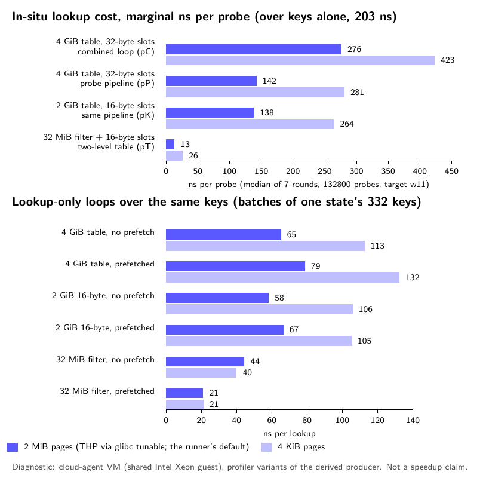
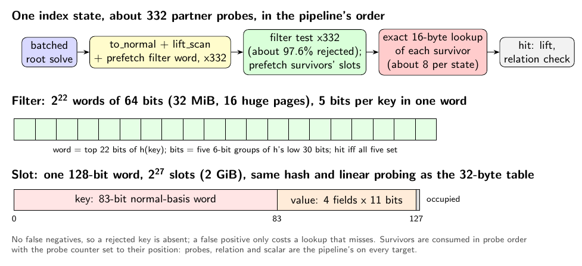

# Two-level root table: a TLB-resident filter in front of 16-byte exact slots for the n = 83 K600 one-target index calculus

**Status (2026-10-15): measured; frozen primary rule applied; verdict
`improvement`, a small one.** GitHub Actions run
[38829449594](https://github.com/aburan28/cryptanalysis/actions/runs/38829449594)
(attempt 1, one `ubuntu-24.04` runner, AMD EPYC 9V74, Tier 1 instance scope)
ran the frozen [protocol](protocol.json) and [schedule](schedule.json). Its
artifact `n83-tablefilter-38829449594-1` is archived in
[`run_github_38829449594/`](run_github_38829449594/). On 384 new points the
two-level table lowers the one-target online interval of the probe-pipeline
producer by **1.0633 [1.0589, 1.0679]** (R_m = mean `pP` / mean `pT`), with
probes, relation and scalar identical. See [Result](#result). The gain is
far smaller than the VM diagnosis in section 1 suggested.

## Question

The current n = 83 a = 1 K600 one-target probe path is the probe-pipeline
producer (`claude/n83-probe-pipeline` @ ddbb86a9c: lift_scan + Feistel order
+ prefetched root-table probes; run 38822490448 in flight). Its profile put
the root-table lookup into the ~4 GiB table at 59% of a 472 ns probe at 22
instructions per probe; prefetch cut it from 276 to 145 ns in a VM
diagnostic, and a deeper pipeline did not help. About one probe in 1.7
million hits the table.

What limits the remaining lookup, and does a root-table layout built for
that limit lower the one-target online time on new public points, with
probes, relation and scalar unchanged? Under AGENTS.md's success criterion a
verified, measured improvement over the current baseline is a success and
becomes the new baseline.

## 1. Diagnosis (diagnostic)

All numbers in this section come from the cloud-agent VM, a shared 4-vCPU
Intel Xeon guest. They chose the design; they are not evidence of a speedup.
Raw files: [`smoke/profile/`](smoke/profile/); table:
[`analysis/profile_local.json`](analysis/profile_local.json)
(`analysis/make_profile_table.py`).

**Layout (from the source).** `RootTable128` is open addressing with linear
probing over `(u128, u64)` slots, which pad to 32 bytes; its capacity is
`(2 * 2 * #states).next_power_of_two()` = 2^27 slots, 4 GiB, for 29,878,182
keys (load 0.22). A probe hashes the 83-bit canonical key multiplicatively
to its home slot and reads one or two slots. Each index state makes about
332 probes; all but about one in 1.7 million miss.

**Instrument.** The profiler `ic_table_profile_r770`
(`make_profile_source.py`, a derived copy of the producer, never a timed
arm) keeps the probe-pipeline profiler's variants and adds, from the same
4 GiB table's entries, a 16-byte-slot copy and a 32 MiB blocked filter. It
walks the first 400 states of target w11's Feistel order (132,800 probes),
7 rounds in rotated order, median per variant. In-situ variants are
cumulative over the key computation (203 ns/probe); lookup-only loops run
over the same keys in batches of one state's keys. Each was run with 2 MiB
pages (THP via `glibc.malloc.hugetlb=1`, the runner's default) and with
4 KiB pages.

| lookup | in situ, THP (ns/probe) | in situ, 4 KiB | lookup only, no prefetch / prefetched (THP) |
| --- | ---: | ---: | ---: |
| 4 GiB, 32-byte slots, combined loop (pC) | 276 | 423 | 65 / 79 |
| 4 GiB, 32-byte slots, probe pipeline (pP) | **142** | 281 | |
| 2 GiB, 16-byte slots, same pipeline | 138 | 264 | 58 / 67 |
| 32 MiB filter + 16-byte slots, two-level loop | **13** | 26 | 44 / 21 (filter) |

**Reading.** (i) Prefetching does not overlap lookups into the 2 to 4 GiB
tables: in a lookup-only loop the prefetched version is no faster than the
plain one (79 against 65 ns), and in situ about 140 ns per probe remain even
though about 200 ns of key computation separate each prefetch from its use.
(ii) Halving the slot to 16 bytes changes almost nothing (142 to 138 ns). So
bytes per slot and cache-line traffic are not the limit. (iii) 4 KiB pages
double the big tables' cost, while the 32 MiB filter's prefetched lookups
cost 21 ns under either page size, and its prefetches do overlap (44 to
21 ns). The limit is address translation for a working set far beyond TLB
reach: page walks whose own page-table entries are not cached, with few
walks in flight, which a software prefetch cannot hide. This matches the
`ic-probe-latency-20261015` pointer chase on the runner (4 GiB: 140 ns with
THP against 200 ns at 4 KiB; 2 MiB buffer: 15 ns) and the earlier
hypothesis. It is a diagnosis from one VM; the runner's AMD EPYC may differ
in degree, and the run's last step records the same variants there.

So the fix is (b), a small first level that is TLB-resident and rejects most
misses, with (a), the 16-byte slot, for the rare survivors (it halves the
table's memory and its zero-fill, not the probe's latency).

## 2. The two-level root table

`make_online_source.py` derives the producer in two steps:

1. `make_probepipe_source.py` is `claude/n83-probe-pipeline`'s
   `make_online_source.py` @ ddbb86a9c, verbatim (with the combined
   derivation it imports). Its output must hash to the probe-pipeline
   protocol's frozen producer digest (`840b1648...`), so the baseline text is
   exactly that producer.
2. Counted, exact replacements add `KIC_ROOT_TABLE`, read once per process
   when the index is built:
   - `base` (default): `RootTable128`, built and probed exactly as before.
     The baseline arm runs `scan_state128_pipelined`, unchanged.
   - `compact`: `CompactRootTable128`. One 128-bit word per slot: bits 0..83
     the whole key, bits 83..127 the four `pack` fields (left, right,
     relative shift, stored shift) in 11 bits each, bit 127 occupied. Same
     capacity rule (2^27 slots, now 2 GiB), the same multiplicative hash and
     the same linear-probe sequence, filled by the same inserts in the same
     order. A key wider than 83 bits or a field of 2^11 or more panics on
     insert; at n = 83, K = 600 the fields are below 600 and 83.
   - `filter`: the compact table plus `RootFilter128`, a register-blocked
     Bloom filter: 2^22 words of 64 bits (32 MiB, 16 huge pages; 2^28 bits,
     9 bits per key). A key's 64-bit hash picks the word with its top 22
     bits and sets five bits from its low five 6-bit groups. It is built
     after the table from the table's keys, timed separately in setup
     (`root_filter_build_ms`). The predicted false-positive rate is 2.3%
     (Poisson model); the local smoke saw 2.45% of probes pass falsely over 64 primary-panel targets.
   - `filter_plant`: the planted positive control (below).

   With a new layout the target scan is `scan_state128_filtered`
   (`KIC_PROBE_PIPELINE=prefetch`, lift_scan and the Feistel order only):
   the probe pipeline's root batch and keys in the same order (shift outer,
   stored root inner, solver partner order), each key followed by a prefetch
   of its filter word; then, in probe order, the filter test, prefetching
   each survivor's home slot; then the survivors, in probe order, get the
   exact compact-table lookup, lift and relation check, with the probe
   counter set to the survivor's position in the state.

**Exactness.** The filter has no false negatives: every stored key was
inserted, and insertion only sets bits. So a rejected key is absent from the
table, and the base lookup would have returned nothing for it. A false
positive only costs a compact lookup that misses. The compact table stores
the same key → value map as the base table (same inserts, and the 128-bit
word holds the full key and every value field exactly). Survivors are
consumed in probe order, the counter at a hit equals the pipeline's
(`first + position + 1`, and `first + keys` at the end of a state), and the
first lifted relation returns. Therefore every target's probes, relation,
intermediates and scalar are those of the probe pipeline. The only extra
work is the filter test and keys after the successful probe in the final
state, which the clock charges. The rank stage is unchanged and needs the
base table; the new layouts refuse to run without the verified cached
factor-log table (every arm uses it).

Checks in the producer's tests (`cargo test --bins`, run again on the
runner): the slot round-trips every field and refuses overflow; on a 9-orbit
n = 83 base the compact table returns the base table's value for every
stored key and agrees on 200,000 random keys; the filter has no false
negatives (with 2^28, 2^14 and 2^16 bits); and on 24 planted four-point
targets, with lift and full canonicalizers and both scan orders, every layout
(including a 2^13-bit filter that passes most probes) gives the pipeline's
exact relation and probe count, no rejected key is found in the table, and
filter passes lie between table hits and probes.

**Setup and memory.** The compact table halves the root table (4 → 2 GiB)
and its zero fill; the filter adds 32 MiB and one pass over the 2 GiB
table. Locally (diagnostic) peak RSS fell from 5.81 to 3.70 GB, the index
build from 74.9 to 65.4 s, and the filter build took 1.7 s inside it. The
Tier 1 run reports setup, index build, filter build, peak RSS and the cold
cost (setup + one target) for every arm.

**Not combined with the state fold.** `claude/n83-state-fold` (run
38819494806, in flight) halves the stored states and the table capacity to
2^26 slots. With the filter, the big table is touched by about 2.5% of
probes, so the fold's capacity change no longer bears on the lookup; its
setup saving is independent and is the next combination to try once both
runs report.

## 3. Frozen Tier 1 design

| Arm | Table | Filter | Panel | Role |
| --- | --- | --- | --- | --- |
| `pP` | base (32 B slots, 4 GiB) | — | primary | baseline: the probe-pipeline producer |
| `pT` | filter + compact (16 B, 2 GiB) | 32 MiB | primary | candidate |
| `pTaa` | filter + compact | 32 MiB | primary | A/A control |
| `pX` | filter + compact + discarded lookups | 32 MiB | primary | planted positive control |
| `pK` | compact only | — | primary | secondary: slot size alone |
| `pT29` | filter + compact | 64 MiB | primary | secondary: filter size |
| `rT` | — | — | primary, every point | tuned rho rT770 (Fold/64/DP6), seed 860000 + point seed |
| `oP`, `oT` | base / filter | — / 32 MiB | Q0 + B's 16 fresh, 1 block | exactness against the archived Feistel identities; secondary |

Every IC arm runs lift_scan, the Feistel order and the prefetch pipeline.
The planted control `pX` looks up, in the compact table, every key the
filter rejects (prefetched with its filter word) and discards the result:
it re-adds the big-table access the filter removes, so `pX/pT` must exceed 1,
and every such lookup must find nothing (`planted_rejected_found` = 0).

- **Primary panel.** 384 new public points (`inputs/primary_targets.json`,
  `make_targets.py`) from B's public hash-to-curve law with the new role
  `tablefilter-primary-v1`, seeds 0..383, checked disjoint from every earlier
  n = 83 panel of that law on main and the open branches: Q0 and B's fresh
  points (`eval`), the 384 scan-order held-out points (main), the 576
  combined primary points (`claude/n83-combined`), the 384 probe-pipeline
  primary points (`claude/n83-probe-pipeline`) and the 16 state-fold cold
  points (`claude/n83-state-fold`), all regenerated. The section 23 panel
  has no n = 83 curve. No scalar is known for any of them.
- **One job, one pinned CPU.** Six primary slices of 64 points and one
  Q0 + fresh block, P1, P2, P3, O1, P4, P5, P6, each a seeded shuffle. Every
  slice holds one process per IC arm and one rho process per point. Each IC
  process does its setup once, then gives each target its own one-target
  online interval.
- **Primary statistic.** R_m = mean `pP` / mean `pT`, online time over all
  384 points, bootstrap over points, 10,000 resamples.
- **Decision rule.** **Improvement** iff the 95% lower bound of R_m exceeds
  1; regression iff its upper bound is below 1; otherwise not_separated. The
  verdict is **invalid** if an exactness gate fails, a decision arm's row is
  invalid, the A/A (`pT`/`pTaa` inside [0.97, 1.03]) or the planted control
  (`pX`/`pT` lower bound above 1) fails, or any of the 384 points lacks a
  valid row in `pP`, `pT`, `pTaa`, `pX` or `rT`.
- **Also reported.** R_g (paired geometric means); ns/probe and the filter's
  false-positive share per arm; the probe ratio (must be exactly 1);
  `pP/pK` and `pK/pT` (slot size against filter), `pT/pT29` (filter size);
  setup, index and filter build and peak RSS per arm, and the cold ratio
  (slice setup + target online); `S_rho` and cold `S_rho` for `pP` and `pT`
  and their delta; the tuned-rho gap on the same points; the slice
  bootstrap and per-slice ratios; the Q0 + fresh block.
- **Exactness gates.** Every process reports the requested layout and filter
  size, 29,878,182 keys in 2^27 slots, and `KIC_ROOT_BLOOM` off. On every
  primary point the six IC arms have identical probes and relation; one
  scalar across them and the tuned rho; every scalar replays as [d]G = Q in
  the pinned oracle; in every filter record, table hits ≤ filter passes ≤
  probes; no record finds a rejected key. On Q0 + 16 fresh, both arms
  reproduce the archived Feistel probes and relations of run 38786433493,
  the archived scalars and Q0's validation sidecar.
- **Power, checked before freezing** (`power_check.py`,
  `analysis/power.json`). The probe-pipeline run had not reported, so the
  prior is the earlier one (the old held-out panel's Feistel times over the
  measured lift_scan ratio; per-point effect spread from the 16 lift_scan
  ratios; noise sigma 0.02 per target, 0.01 per process). For a minimal
  effect of interest of 1.03, power is 0.77 at 64 points, 0.92 at 128 and
  1.00 at 384; the smallest size passing 0.80 after two Monte Carlo SEs is
  128. The panel is the design floor of 384, so that the slice bootstrap
  has six clusters.
- **Runtime estimate.** About 1.3 to 2.0 h including the build, with a
  300-minute time guard. A last step runs the profiler on Q0 on the runner
  (`profile_diagnostic_*.json`), diagnostic only.

## Local validation (cloud-agent VM; no timing claims)

See [`smoke/README.md`](smoke/README.md).

## Files

| File | Role |
| --- | --- |
| `protocol.json`, `make_protocol.py`, `schedule.json`, `make_schedule.py` | frozen protocol, its builder, frozen run order |
| `make_online_source.py`, `make_probepipe_source.py`, `make_combined_source.py`, `online/`, `lift2/` | the two-level table producer (verbatim parent derivations, digest-checked, plus `KIC_ROOT_TABLE`); tuned rho; the two-limb canonicalizer crate |
| `make_profile_source.py`, `analysis/make_profile_table.py`, `analysis/profile_local.json`, `smoke/profile/` | the diagnostic profiler, the diagnosis table and its raw inputs |
| `restore.py`, `check_log_table.py` | restore and digest-check crypto 770f6a69 and every local source; re-verify B's factor-log table |
| `make_targets.py`, `inputs/primary_targets.json` | the new primary panel |
| `inputs/archived_identities.json` | archived probes, relations and scalars of Q0 and the 16 fresh points (from `claude/n83-combined`) |
| `power_check.py`, `inputs/power_prior.json`, `analysis/power.json` | power simulation, its prior, its result |
| `arm.py`, `panels.py`, `run_schedule.py` | one arm per pinned process; panels; the schedule runner |
| `verify_receipt.py` | gates, statistics, decision rule; `result.json`, `result_table.md` |
| `make_figures.py`, `figures/` | TikZ sources and renders of the diagnosis, the table diagram and the Tier 1 result |
| `run_github_38829449594/` | the archived artifact: allocation, builds, raw runs, `panel/result.json`, runner profiler step |

## Result

All gates pass: the six primary IC arms have identical probes and relation
on every point, one scalar across them and the tuned rho, every scalar
replays in the pinned oracle, Q0 equals the validation sidecar, both old-panel
arms reproduce the archived Feistel identities, the decision arms' rows are
valid, the A/A and the planted control pass, and the primary panel is
complete (384/384). `verify_receipt.py` re-run on the archive reproduces
`result.json` byte for byte. One tuned-rho row (serial 44) carries a
major-page-fault flag; it is a rho row, not a decision arm.

, [vector](figures/result.pdf), rendered by
[`make_figures.py`](make_figures.py)).](figures/result.png)

### Primary (frozen rule)

The table is an improvement iff the 95% lower bound of R_m exceeds 1.

| Statistic (n = 384 new points) | Estimate [95%] | Reading |
| --- | --- | --- |
| R_m = mean pP / mean pT | 1.0633 [1.0589, 1.0679] | **improvement** |

The probe ratio pipeline / filter table is exactly 1.0000 [1.0000, 1.0000].
Ratchet: the new n = 83 one-target pipeline is lift_scan + Feistel order +
prefetched probes + the two-level root table (32 MiB blocked filter, 16-byte
exact slots).

### Secondaries and controls

| Statistic | Estimate [95%] |
| --- | --- |
| R_g (paired geometric means) | 1.0611 [1.0579, 1.0644] |
| R_m, slice bootstrap (6 slices) | 1.0633 [1.0428, 1.0882] |
| R_m per slice | 1.1157, 1.0681, 1.0625, 1.0297, 1.0570, 1.0396 |
| A/A pT / pTaa | 1.0011 [0.9999, 1.0022] (inside [0.97, 1.03]) |
| Planted pX / pT | 1.0545 [1.0529, 1.0565] |
| pK: pP / pK (compact 16-byte slots only) | 1.0581 [1.0536, 1.0627] |
| pK / pT (filter on top of compact) | 1.0049 [1.0035, 1.0066] |
| pT / pT29 (32 MiB against 64 MiB filter) | 1.0029 [1.0019, 1.0039] |
| Cold (slice setup + online) pP / pT | 1.0101 [1.0090, 1.0113] |
| Q0 + 16 fresh, pP / pT (16 fresh, means) | 1.0573 [1.0509, 1.0633] |
| Tuned rho / pT (means) | 6.5642 [5.8533, 7.3649] |
| Tuned rho / pT (geomeans) | 9.9310 [8.6688, 11.3811] |
| Tuned rho / pP (means) | 6.1734 [5.5050, 6.9319] |

- **Reading of pK and pT29.** The 16-byte slot alone (pK) gives 1.0581 of
  the 1.0633; the filter on top adds only 1.0049. The larger filter (pT29, 64
  MiB, false-positive share 0.0030 against 0.0244) is faster than pT by
  0.29%, a small effect. So on this runner the gain is almost all the
  compact slot, not the filter. The diagnosis in section 1 attributed the
  gain to the filter; this run does not.
- **Per-arm means** (online ms, ns/probe): pP 473.0, 253.8; pT 444.8, 238.7;
  pTaa 444.4, 238.4; pX 469.1, 251.7; pK 447.0, 239.8; pT29 443.5, 238.0.
  Probes per law 1.079 in every arm.
- **Setup, index, filter build, peak RSS** (mean per process, 6 processes
  each): pP setup 51,081 ms, index build 48,423 ms, peak RSS 5.41 GiB; pK
  49,288 ms, 46,638 ms, 3.41 GiB; pT 50,593 ms, 47,948 ms, 3.45 GiB, filter
  build 1,304 ms (32 MiB); pT29 50,705 ms, 48,061 ms, 3.48 GiB, filter build
  1,439 ms. Setup pP / pT 1.0097; peak RSS pP / pT 1.5714. The filter build
  is about 1.3 s of the 50.6 s setup.
- **Cold ratio.** Cold pP / pT is 1.0101 [1.0090, 1.0113], because the
  setup is about 99% of the cold cost and changed by under 1%.
- **S_rho** (online cost over √r in tuned-rho steps; this run's rT770 step,
  318.3 ns): pP 0.01605, pT 0.01510; delta (filter minus pipeline)
  −0.00096. Cold S_rho: pP 1.74985, pT 1.73231; delta −0.01754.
- **Gap to tuned rho** (same 384 points). Tuned rho / pT is 6.5642
  [5.8533, 7.3649] on means (IC / rho online 0.1523) against 6.1734
  [5.5050, 6.9319] for pP (0.1620). Distance remaining, online only, not a
  gate.

### Runner profiler step (diagnostic only; never part of the decision)

The last workflow step ran `ic_table_profile_r770` on Q0 on this runner (2
rounds; medians, ns/probe). It did not reproduce the VM diagnosis:

| variant | round 1 | round 2 |
| --- | ---: | ---: |
| key computation (roots + conversion + lift_scan) | 225.5 | 225.9 |
| inline lookup into the 4 GiB table (combined loop) | 356.4 | 365.5 |
| pipelined lookup, 32-byte slots (pP loop) | 245.7 | 239.3 |
| pipelined, compact 16-byte slots | 256.0 | 275.5 |
| pipelined, filter + compact (pT loop) | 241.2 | 240.2 |
| cross-state pipelined | 242.7 | 240.3 |

On this runner the prefetched lookup into the big table costs about 14 to
20 ns over the key computation (the VM measured about 140 ns), so the
remaining lookup cost that the filter targets is small: round 1 shows the
filter loop 4.5 ns/probe under the pipeline, round 2 shows it 0.9 above it.
The compact-only variant is noisy (256.0 and 275.5), and the Tier 1 arms
(pK 239.8 and pT 238.7 against pP 253.8 ns/probe) put the gain at about 14
ns/probe. The profile is one instrument on Q0 and decides nothing; its
spread is larger than the effect.

### Limits of this result

- One runner, one pinned CPU, Tier 1 instance scope; the profile and
  diagnosis in section 1 came from an Intel VM, and the runner's AMD EPYC
  has different translation behaviour. The runner's own profile shows the
  big-table lookup is already mostly hidden by the pipeline, so there was
  little for the filter to remove.
- The gain is 6% of the online interval, which is about 1% of the cold
  cost. A pipeline whose setup dominates cold cost gains nearly nothing from
  it.
- The baseline pP is the probe-pipeline producer's loop in the same binary;
  this experiment does not re-run that experiment's binary.
- Next steps: the batched root solve (about 157 ns of a probe here), and
  combining with the state fold, as listed under Limits.

## Limits

- The diagnosis is from one Intel VM. The runner (an AMD EPYC in recent
  runs) has other TLB sizes and page-walk concurrency; the runner's profiler
  step records the same variants there, still as a diagnostic.
- Tier 1, instance-scoped: one runner, one pinned CPU, not host-isolated.
- The baseline `pP` is the probe-pipeline producer's loop compiled into the
  same binary as the candidate; this experiment does not re-run that
  experiment's binary.
- The filter size (32 MiB) and five hash bits were chosen from the Poisson
  model and the local diagnosis, before any Tier 1 timing; `pT29` is a
  reported secondary, not a tuning step.
- The tuned-rho gap is distance remaining, not a claim to beat rho.
- Next steps after this run: combine with the state fold (setup and table
  memory), then the next-largest probe component, the batched root solve
  (about 130 ns of a probe whose lookup would then cost about 15 ns).
