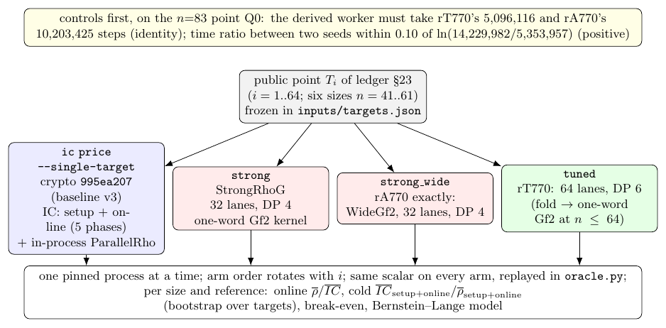
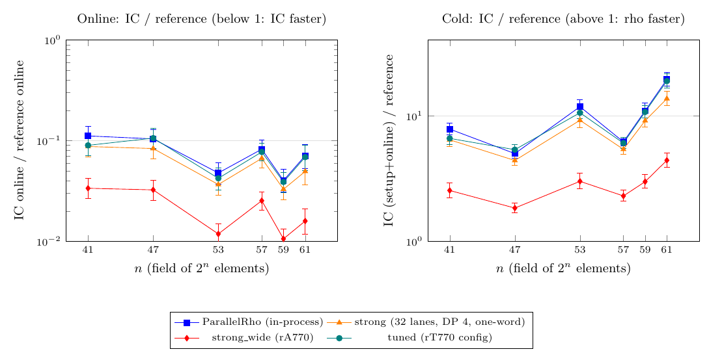

# Section 23 against the tuned rho: one unseen point, six sizes, four rho references

**Status (2026-10-15): measured; verified.** GitHub run
[38777903922](https://github.com/aburan28/cryptanalysis/actions/runs/38777903922)
(one `ubuntu-24.04` runner, Tier 1, instance scoped) completed with the
frozen protocol ([`protocol.json`](protocol.json)); its artifact
`s23-tuned-rho-38777903922-1` is archived in
[`run_github_38777903922/`](run_github_38777903922/). Results are in
[Result](#result).

## Question

Ledger §23 (crypto `research/notes/index-calculus/RESEARCH_IC_BOUNDARY_LEDGER.md`)
compared the index calculus with Pollard rho on one unseen public point,
online and cold. Its sizes were `n = 47, 57, 41, 53, 59, 61` (`2^36.6` to
`2^47.2`), with 64 points each. Rule v3 (crypto `research/ic_tool_program/rule/v3`)
re-ran that round at the IC programme's baseline v3. Both rounds used one rho
reference, ParallelRho inside the same process.

The n=83 reconcile run (`../koblitz-n83-reconcile-20261014`) found that A's
tuned `StrongRhoG` (rT770: fold kernel, 64 lanes, DP 6) was 1.3–1.9× faster
than the default strong rho at n=83. With rT770 as the reference, the IC's
online advantage there was not separated from parity.

This round asks the same question with stronger references. On §23's
points, what are the online ratio, the cold ratio, the break-even count and
the Bernstein–Lange model at each size? It answers per reference:

| reference | what it is |
|:--|:--|
| `parallel` | §23's and rule v3's own: ParallelRho in the IC's process (64 lanes in lockstep) |
| `strong` | the default `StrongRhoG` parameters (32 lanes, DP 4, escape off) on the one-word `Gf2` field kernel |
| `strong_wide` | rA770 exactly: the default `StrongRhoG<WideGf2,u64>` (32 lanes, DP 4) |
| `tuned` | rT770's configuration (64 lanes, DP 6, escape off, A's `selected_config.json`) |

This is the "gap to the tuned rho" that `docs/ic/BASELINES.md` (cryptanalysis#922)
lists as unmeasured at n=41, 53 and 61.



*Figure 1. The design: four arms on each frozen point, the controls first
([source](figures/design.tex), [vector](figures/design.pdf)). Schematic; no data.*

## Result

**Run.** [38777903922](https://github.com/aburan28/cryptanalysis/actions/runs/38777903922),
sha `e99967c2`, Intel Xeon Platinum 8370C @ 2.80 GHz, image 20261012.334.1,
one pinned CPU ([`run_github_38777903922/`](run_github_38777903922/),
`panel/result.json`, `panel/result_table.md`). The receipt is complete and
valid: all six sizes have 64 R1 rows, no flagged rows were used, no attempt was
contended or invalid, no block was skipped, and `problems` is empty.

**Controls.** Identity passed (rT770's 5,096,116 steps and rA770's 10,203,425,
scalar 3141592653589793). The positive control passed (ln time ratio 0.992
against ln step ratio 0.978, tolerance 0.10). Section 23's claims: 408 of 408
IC rows pass. Substituted external-rho claims: 1,152 of 1,152 pass.
`verify_receipt.py` re-run offline on the archived receipt, with the pinned
checker from crypto `96911f55`, reproduced `result.json` and `result_table.md`
byte for byte.

**Reading (frozen statistic, per size and reference).** Online and cold gaps
are IC cost over reference cost; online values below 1 mean the IC is faster
(the receipt's own figure is the reciprocal, rho over IC, in the next column).
Every one of the 24 size-by-reference online readings is `ic_online_faster`
and every cold reading is `rho_cold_faster`; no reading is `not_separated`.

| n | ref | online IC/ref [95%] | rho/IC online | cold IC/ref [95%] | break-even targets | IC online / BL model |
|--:|:--|--:|--:|--:|--:|--:|
| 41 | tuned | 0.09 [0.0715, 0.111] | 11.1 [9, 14] | 6.6 [5.91, 7.4] | 7.67 | 0.53 |
| 41 | parallel | 0.112 [0.0889, 0.14] | 8.96 [7.16, 11.3] | 7.83 [7.08, 8.74] | 9.74 | 0.603 |
| 41 | strong | 0.0876 [0.0694, 0.11] | 11.4 [9.08, 14.4] | 6.43 [5.67, 7.39] | 7.44 | 0.336 |
| 41 | strong_wide | 0.0337 [0.0268, 0.0425] | 29.7 [23.5, 37.3] | 2.54 [2.23, 2.93] | 2.7 | 0.05 |
| 47 | tuned | 0.106 [0.084, 0.133] | 9.41 [7.53, 11.9] | 5.37 [4.86, 5.93] | 7.34 | 0.503 |
| 47 | parallel | 0.104 [0.0824, 0.13] | 9.58 [7.71, 12.1] | 5 [4.61, 5.47] | 7.19 | 0.49 |
| 47 | strong | 0.0837 [0.0657, 0.105] | 12 [9.57, 15.2] | 4.4 [4.05, 4.82] | 5.64 | 0.311 |
| 47 | strong_wide | 0.0325 [0.0256, 0.0407] | 30.8 [24.6, 39.1] | 1.84 [1.68, 2.03] | 2.07 | 0.0471 |
| 53 | tuned | 0.0423 [0.0325, 0.0534] | 23.6 [18.7, 30.8] | 10.6 [9.45, 12] | 11.3 | 0.322 |
| 53 | parallel | 0.0478 [0.0372, 0.0604] | 20.9 [16.5, 26.9] | 11.8 [10.5, 13.4] | 12.8 | 0.389 |
| 53 | strong | 0.0367 [0.0286, 0.0468] | 27.2 [21.4, 35] | 9.2 [8.01, 10.7] | 9.75 | 0.196 |
| 53 | strong_wide | 0.0119 [0.00915, 0.015] | 84.3 [66.5, 109] | 3.01 [2.62, 3.49] | 3.07 | 0.0203 |
| 57 | tuned | 0.0774 [0.0632, 0.0944] | 12.9 [10.6, 15.8] | 6.05 [5.51, 6.7] | 8.52 | 0.473 |
| 57 | parallel | 0.0824 [0.0661, 0.102] | 12.1 [9.8, 15.1] | 6.19 [5.75, 6.73] | 9.12 | 0.419 |
| 57 | strong | 0.0668 [0.0537, 0.0823] | 15 [12.1, 18.6] | 5.4 [4.94, 5.94] | 7.27 | 0.297 |
| 57 | strong_wide | 0.0254 [0.0203, 0.0311] | 39.4 [32.1, 49.2] | 2.3 [2.08, 2.56] | 2.65 | 0.043 |
| 59 | tuned | 0.039 [0.0304, 0.0485] | 25.7 [20.6, 32.8] | 10.7 [9.62, 12] | 11.6 | 0.301 |
| 59 | parallel | 0.0403 [0.0308, 0.052] | 24.8 [19.2, 32.5] | 11 [9.64, 12.6] | 12 | 0.343 |
| 59 | strong | 0.033 [0.026, 0.0409] | 30.3 [24.4, 38.4] | 9.12 [8.11, 10.4] | 9.71 | 0.18 |
| 59 | strong_wide | 0.0106 [0.00836, 0.0132] | 94.3 [75.8, 120] | 2.99 [2.65, 3.41] | 3.05 | 0.0186 |
| 61 | tuned | 0.0687 [0.051, 0.0903] | 14.5 [11.1, 19.6] | 18.9 [16.7, 21.5] | 20.5 | 0.759 |
| 61 | parallel | 0.0711 [0.0532, 0.0919] | 14.1 [10.9, 18.8] | 19.4 [17.3, 22.1] | 21.3 | 0.857 |
| 61 | strong | 0.0496 [0.0363, 0.0657] | 20.2 [15.2, 27.5] | 13.7 [12.1, 15.7] | 14.5 | 0.452 |
| 61 | strong_wide | 0.0159 [0.0118, 0.021] | 62.8 [47.5, 85] | 4.42 [3.89, 5.08] | 4.5 | 0.0466 |




*Figure 2. IC over reference, online (left) and cold (right), per size and
rho reference, with 95% paired bootstrap intervals over 64 targets
([source](figures/gap.tex), [vector](figures/gap.pdf), regenerated from
`result.json` by [`figures/make_figures.py`](figures/make_figures.py)).*

Per-size context for the `tuned` reference (means over 64 targets):

| n | r | IC online mean ms | IC setup mean ms | tuned rho ms/step (median) | tuned rho online mean ms | tuned/parallel ns per step |
|--:|--:|--:|--:|--:|--:|--:|
| 41 | 549,756,390,943 | 1.11 | 86 | 107.3 ns | 12.3 | 1.07 |
| 47 | 106,781,081,677 | 0.508 | 31.4 | 109.3 ns | 4.78 | 0.99 |
| 53 | 21,044,858,204,113 | 2.65 | 677 | 109.7 ns | 62.6 | 1.10 |
| 57 | 275,295,876,199 | 0.583 | 59.2 | 113.7 ns | 7.53 | 0.94 |
| 59 | 25,179,555,920,633 | 2.6 | 739 | 113.1 ns | 66.6 | 1.07 |
| 61 | 162,888,033,982,417 | 10.4 | 2.9e+03 | 113.0 ns | 152 | 1.06 |

**Gap to the tuned rho (the `tuned` rows, n=41, 53, 61).**

- **n=41.** Online: the IC takes 0.090 of the tuned rho's time, [0.071, 0.111]
  (rho/IC 11.1 [9.00, 14.0]). Cold: 6.60 [5.91, 7.40]. Break-even 7.7 targets.
- **n=53.** Online: 0.042 [0.033, 0.053] (rho/IC 23.6 [18.7, 30.8]). Cold:
  10.6 [9.45, 12.0]. Break-even 11.3 targets.
- **n=61.** Online: 0.069 [0.051, 0.090] (rho/IC 14.5 [11.1, 19.6]). Cold:
  18.9 [16.7, 21.5]. Break-even 20.5 targets.
- **n=47, 57, 59** (the other three of §23's six): online 0.106, 0.077 and
  0.039; cold 5.37, 6.05 and 10.7 (intervals in the table).

**Per reference.** The tuned rho and ParallelRho cost about the same at
every size (tuned/parallel ns per step 0.94 to 1.10; the intervals of
the two online and cold gaps overlap at every size). The default one-word
`strong` walk is 1.26 to 1.30× slower per step than `tuned`, so its gaps are
smaller (the IC looks a little better online, and the cold gap is 3% to 28%
lower).
`strong_wide` (rA770) is 3.3 to 4.0× slower per step, and is the reference the
IC looks best against (online 0.011 to 0.034, cold 1.84 to 4.42). Ranking the
references by IC online speed-up: `strong_wide` > `strong` > `tuned` and
`parallel` (the last two about equal), at all six sizes.

**What this says.**

- **Against the strongest reference measured here (`tuned`), the IC's online
  stage is 9× to 26× cheaper and the cold gap is 5.4× to 18.9× in rho's
  favour.** The picture of §23 and rule v3 (online advantage, cold
  disadvantage that grows with n) holds on this host, and the tuned rho does
  not close it: it is the same as ParallelRho within noise at these sizes.
- **The `tuned` reference is not rT770's kernel at these sizes.** `Gf2_128`
  does not exist for n ≤ 64, so `tuned` is rT770's configuration (64 lanes,
  DP 6) on the one-word `Gf2` (see Limits). A rho tuned further on the
  one-word kernel could be faster; this run does not measure that.
- **Break-even** is 7.3 to 20.5 targets at `tuned`; fewer on the slower
  references.
- **Bernstein–Lange (model only).** IC online over the BL model is 0.30 to
  0.76 against `tuned` (below 1 means the IC beats the model's online cost),
  and 0.019 to 0.050 against `strong_wide`. No BL walk ran.
- **Online IC times are small.** At n=41, 47 and 57 the IC's online stage is
  0.5 to 1.1 ms. The A/A (T01–T04 re-run) ratio R2/R1 of the IC's online time
  ranged 0.90 to 1.06 at n=41, 53, 57, 59 and 61. At n=47 the four ratios
  were 0.58, 0.85, 0.91 and 1.03 (the IC's online stage is 0.5 ms there). The
  reference arms' A/A ratios are within 0.98 to 1.02. The ratios above are means over 64 targets with bootstrap
  intervals, so the A/A spread is inside them, but the n=47 point is the one to
  distrust.
- **Class: accounting.** No algorithm changed; the reference did. This
  result does not promote an IC baseline (no IC change was measured), so
  [`docs/ic/BASELINES.md`](../../docs/ic/BASELINES.md) records these rows as
  gaps to the tuned rho, one row for this experiment, and keeps v3's own
  rows unchanged.
- **Not claimed.** Nothing here transfers to n=83 or ECC2K-130. The IC
  binary is rebuilt here with rustc 1.99.0 and runs on a different CPU from
  rule v3's container, so this run's absolute IC and rho times are not
  pooled with v3's.

## What runs

- **The IC** is crypto's `ic price --single-target` at `995ea207`: baseline
  v3, the code rule v3 measured. It runs on §23's parameter files with §23's
  rho seed `0x230000 + i`.
  - One process per point. Each process makes three repetitions of the IC
    and ParallelRho, and the median is the figure (§23's rule).
  - Online is §23's five-phase interval. Setup is the median repetition's
    `setup_ns`.
- **The three external rho arms** run on one worker,
  [`rho/s23_strong_rho_eval.rs`](rho/s23_strong_rho_eval.rs). It is derived
  from A's tuned worker at crypto `770f6a69`
  (`examples/n83_rho_optimization_eval.rs`, sha256 `fb14072f…`), and two
  things change:
  - **The curve.** It is `KoblitzCurve::new(a, n)`, taken from the command
    line. n=83 still asserts the exact legacy curve.
  - **The `fold` kernel.** Its `Gf2_128` exists only for `64 < n ≤ 127`, so at
    `n ≤ 64` the worker runs the library's one-word `Gf2`: the walk's native
    field, with pclmulqdq fold reduction where the modulus allows it. The
    receipt's `field_type` records which kernel ran.

  The walk, the jump derivation, the configs and the timer boundaries are
  the parent's. Online runs from the target's membership and subgroup check
  to a generic `[d]G = Q` replay. Setup is the excluded preparation (curve,
  normal basis, G-only jumps). A walk-only recut is reported beside it.
  Walk seed `0x230000 + i`.
- **Points.** These are §23's T01–T64 at each size: 384 public hash-to-curve
  points, frozen in [`inputs/targets.json`](inputs/targets.json) from §23's
  committed reports. The IC regenerates each one from its seed, and the
  verifier checks equality. T01–T04 run again as the A/A. **All 384 points
  are kept.** The estimate is about 2–3.5 h of a 6 h job. A time guard
  (330 min) would skip whole point blocks, and any it skips are reported.
- **Order and isolation.** One process at a time runs on one pinned CPU
  (`min(sched_getaffinity)`), with `isolated_bench`'s clean environment and
  `RAYON_NUM_THREADS=1`. The arm order rotates with the point. The Tier 1
  noise gate (throttling, steal, major faults) is recorded per process.
  - A failed or contended attempt is kept and run again, up to twice
    (§23's rule).
  - If all three attempts are flagged, the first valid one is used, marked
    as flagged, and the figures are also given without it.

## Controls (before the panel)

- **Identity.** On n=83's Q0, the derived worker must take rT770's
  5,096,116 steps (tuned, seed 202610061) and rA770's 10,203,425 steps
  (`strong_wide`, same seed), and recover 3141592653589793. This shows the
  derived worker is rT770's and rA770's walk. A failure voids the round.
- **Positive control.** The ln time ratio of `strong_wide` between seeds
  202610064 and 202610063 must be within 0.10 of the exact ln step ratio
  0.978 (14,229,982 / 5,353,957). A failure labels the readings
  `inconclusive_controls`.
- **Per row.** One scalar across the IC, ParallelRho and the three external
  arms. The IC's point equals the frozen point. The worker's order and
  generator equal the IC's fixture. The scalar replays in crypto's
  `oracle.py`.
- **Claims.** §23's own `claims.py` assembles and checks every IC row's
  `vs_rho` claim (identities, both certificates replayed in `oracle.py`,
  `validate_claim`).
  - It runs at crypto `96911f55`, rule v3's results commit, with two label
    edits that `restore_sources.py` asserts: the isolation text and the CPU.
  - At crypto main, the stricter checker no longer accepts §23's rows.
  - `verify_receipt.py` substitutes each external rho into the same claim
    and runs the same checker.

## Statistics (frozen)

Per size and reference, over the R1 rows:

- **Online:** mean rho online / mean IC online (§23's statistic), with a
  95% paired bootstrap interval over targets (10,000 resamples, seed
  2026101501). The reading is `ic_online_faster`, `rho_online_faster` or
  `not_separated`.
- **Cold:** mean (IC setup + online) / mean (rho setup + online), with the
  same bootstrap.
- **Break-even:** IC setup / (rho online − IC online) targets, or "never".
- **Bernstein–Lange (a model; no BL walk runs):** with `c` the reference's
  median ms per step, the BL online cost is `2.3353·r·c²/(2n·IC setup)` ms.
  The model is reported as IC online / BL.

An online ratio is never quoted without the cold ratio and the BL model
beside it. **Class: accounting.** No algorithm changes; the reference does.

## Local validation (correctness only; no timing is reported)

The local runs ran in a shared, contended container with rustc 1.97.0. The
workflow uses 1.99.0. Receipts are in [`smoke/`](smoke/).

- `restore_sources.py` restores both snapshots and the harness checkout,
  and all 26 digests match `protocol.json`.
- Both crates build: `crates/v3` (`ic_v3`) and `crates/r770`
  (`rho_s23_r770`).
- **Controls:** the identity control reproduced rT770's 5,096,116 and
  rA770's 10,203,425 steps on Q0, with scalar 3141592653589793. The
  positive control passed.
- **Panel:** `run_schedule.py --sizes k0n41 --targets 3 --aa 1` ran 18
  attempts, all valid (2 flagged as contended and re-run). Every arm recovered the same scalar on every point.
  - §23's `claims.py` passed 4 of 4 IC rows.
  - The substituted external-rho claims passed 9 of 9.
  - `verify_receipt.py --smoke` completed end to end.
  - An earlier smoke at k1n47 exercised the retry path: three contended
    attempts, kept, and the flagged-row fallback.
- The workflow YAML parses.

## Limits

- **Tier 1, instance scoped.** One runner and one pinned exposed CPU on a
  shared VM; exclusivity is not certified.
- **The IC binary is rebuilt here** with rustc 1.99.0 from v3's source. It
  is not rule v3's binary (`9c332039…`). crypto `995ea207` has no
  `Cargo.lock`, so `crates/v3/Cargo.lock` is crypto `770f6a69`'s, pruned.
- **`tuned` is rT770's configuration, not rT770's field kernel,** at these
  sizes: `Gf2_128` does not exist for `n ≤ 64` (see above).
- **BL is a model here.** The n=83 BL arm (`../koblitz-n83-bl-arm-20261014`)
  is the only measured BL arm.
- **Scope.** Nothing transfers to n=83 or ECC2K-130.

## Files

- `protocol.json`: the frozen design.
- `restore_sources.py`: snapshots, harness and digests.
- `crates/{v3,r770}`: the two crates.
- `rho/s23_strong_rho_eval.rs`: the derived rho worker.
- `configs/`: the default configs (the tuned config comes from crypto
  `770f6a69`).
- `inputs/targets.json`: the 384 frozen points.
- `run_schedule.py`: the schedule.
- `verify_receipt.py`: the audit and statistics.
- `figures/`: the design figure (`design.*`) and the result figure (`gap.*`, rendered from `result.json` by `make_figures.py`).
- `run_github_38777903922/`: the archived artifact of run 38777903922.
- `smoke/`: the local validation receipts.

## Reproduce

```sh
git clone --filter=blob:none --no-checkout https://github.com/aburan28/crypto C
python3 restore_sources.py --crypto-repo C
(cd crates/v3 && cargo build --release --locked); (cd crates/r770 && cargo build --release --locked)
python3 run_schedule.py --ic $CARGO_TARGET_DIR/release/ic_v3 --rho $CARGO_TARGET_DIR/release/rho_s23_r770 \
  --crypto-repo C --receipt-dir R --cpu 0
S23_ISOLATION_LABEL=... S23_CPUS=0 IC_RUNS=$PWD/R/runs IC_OUT=$PWD/R/claims_s23 \
  python3 C/research/ic_single_target_20260930/claims.py
python3 verify_receipt.py --receipt-dir R --crypto-repo C
```
