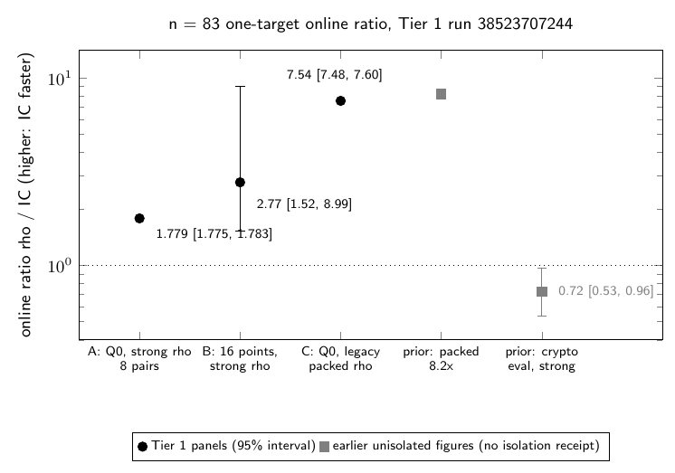
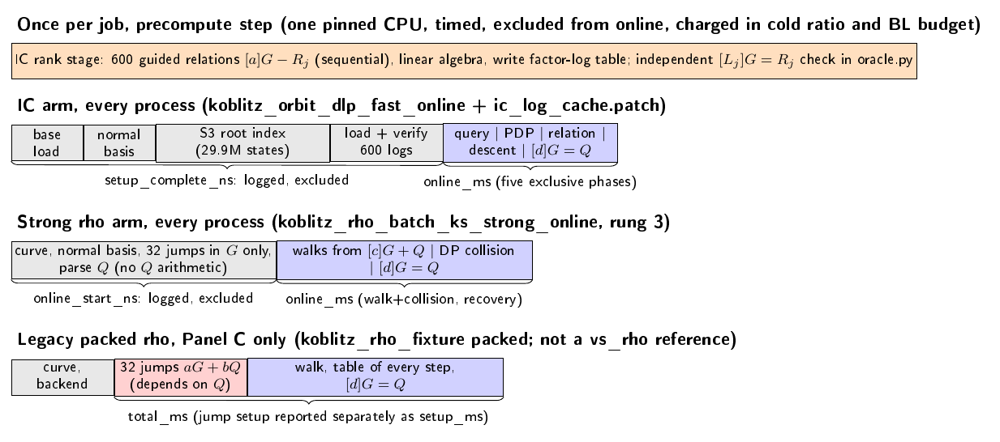
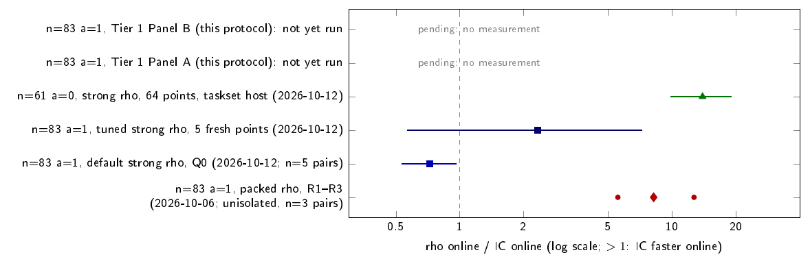

# N83 one-target IC against strong rho: Tier 1 protocol

**Status (2026-10-14): measured. GitHub run `38523707244` completed (status
`COMPLETE`, all three panels eligible); see [Result](#result).** The text below
the Result section is the frozen protocol as written before the run.
The protocol re-measures the n=83 a=1 one-target comparison on a fresh
GitHub Actions `ubuntu-24.04` instance. Today that comparison rests on three
unisolated packed-rho pairs with a median rho/IC wall ratio of 8.2×
([crypto experiment](https://github.com/aburan28/crypto/tree/770f6a6925a0d29b768bd79074f54a173e967fe7/experiments/koblitz-single-target-n83-20261006)).
This protocol is the n=83 step that the crypto `vs_rho` ledger row names as
next: "extend the isolated-host protocol to n=71 and n=83 with the same
five-phase interval and taskset receipt". It uses the same producers, claim
builder and claim checker as the n=61 isolated rung. Each claim is
reported with its cold ratio and the Bernstein–Lange model column, as
ledger §23 requires.

| Item | Value |
| --- | --- |
| Curve | `EC1N83Ce1h35c7ced6b497` (`icv1-f2m83-t6151469093347-9eba6cd5`): y² + xy = x³ + x² + 1 over GF(2)[z]/(z⁸³+z⁷+z⁴+z²+1) |
| Subgroup | r = 8569786107849059 (2^52.93), cofactor 1128547018, signed-Frobenius action of 166 elements |
| Factor base | retained K600: 600 orbit columns, 99,600 points, base hash `d4a4da26…a9f7` |
| Frozen point Q0 | (2655898345537166180532960, 3881526307991673265292615); its validation scalar is opened only by the verifier |
| Crypto source | `770f6a6925a0d29b768bd79074f54a173e967fe7` (on crypto `origin/main`), restored path-by-path with `git archive` and hash-checked |
| Harness | crypto beat `koblitz.compact_orbit.n83_single_target`; `single_target_panel.py` claim builder; `boundary_autolab.validate_claim(stage="vs_rho")` |

## Result

Run `38523707244` (commit `5a1bb18d`, crypto `770f6a69`, `ubuntu-24.04` image
`ubuntu24` 20261004.327.1, AMD EPYC 9V74, 4 exposed CPUs, one pinned) ended with
conclusion success. The artifact is archived in
[`tier1_github_38523707244/`](tier1_github_38523707244/), and
`verify_tier1_receipt.py` re-run on the archived receipt (with the pinned crypto
source restored) reproduced `tier1_result.json`, `tier1_table.md` and the
workflow's verdict byte for byte. The rank stage passed (full rank, table
verified independently, Q0 verified, base hash matched); all 32 pairs are valid
and every claim check passed.

| Panel | Pairs | IC online median (ms) | rho online median (ms) | rho / IC primary [95%] | Frozen reading | Cold IC/rho | IC online / BL model |
| --- | ---: | ---: | ---: | --- | --- | ---: | ---: |
| A: Q0, strong rho | 8 | 5,068 | 9,026 | 1.779 [1.775, 1.783] | `ic_online_faster` | 95.4 | 74.8 |
| B: 16 public points, strong rho | 16 | 645 | 6,200 | 2.769 [1.521, 8.990] | `ic_online_faster` | 134 | 33.5 |
| C: Q0, legacy packed rho | 8 | 5,110 | 38,500 | 7.536 [7.476, 7.600] | `ic_online_faster` (not a reference) | 23.1 | 1.10 |

**Verdict by the frozen rule.** Panel A reads `ic_online_faster` (lower bound
above 1), and it is the Tier 1 instance-scoped online result for Q0. It is quoted
with Panel B's section 23 figure (2.77, 12 of 16 rows IC faster), the cold ratio
and the BL column, and never as a speed of the method: the cold ratio is 95.4
(A) and 134 (B), and the break-even is 223 and 218 targets, so rho is ahead once
the 882 s setup (835.6 s rank stage plus per-process 46.5 s) is charged. Against
the BL model given that setup, IC online is 74.8x (A) and 33.5x (B) slower.
Panel C only tests the historical 8.2x: its median 7.54 [7.48, 7.60] excludes
8.2, so that figure did not survive isolation unchanged, and the packed rho is
not an accepted reference.

Limits and caveats:

* Panel A's interval covers eight repeats of one deterministic target, so it
  measures timing noise, not target variation. Rho took 1.42 times the floor
  steps on Q0 (mean over rows), against 0.995 over Panel B's 16 points, so Q0 is
  a long rho walk. Panel B has the target variation, and its wide interval
  is the honest width.
* One instance, one run, one CPU pinned on a shared cloud VM (Tier 1): not
  host-isolated, and exclusivity is not certified. `isolated_bench` marks Panel
  B `speedup_claim_eligible: false` by construction (it needs eight
  repetitions per case); the protocol's section 23 rule is used for B, as frozen.
* The precompute and the log-table load are instance observations, not
  noise-gated.
* It disagrees in direction with the 2026-10-12 crypto diagnostic (IC over
  strong rho 1.38 [1.04, 1.88], rho faster). The two differ in host, rho seed
  and index cache, and no reconciliation is claimed. No K or seed was
  re-chosen after seeing either result.
* The factor-log table (`precompute/factor_logs_n83_K600.json`, sha256
  `a771716f...d9f17e` with matching recomputation) is now archived; binding it
  in `tier1_protocol.json` is a separate, unmade change.



## What changed from the 2026-10-06 runs, and why

1. **The rho reference.** The 8.2× runs used `koblitz_rho_fixture … packed`.
   This build refuses that backend as a `vs_rho` reference: it stores every
   step and canonicalizes with an O(n) scan. The crypto evaluation of
   2026-10-12 (`research/n83_evaluation_20261012/`) measured the same Q0
   against default strong rho. Its paired IC/strong online geometric ratio
   was 1.38 [1.04, 1.88], meaning strong rho was faster online.
   The primary arm here is strong rho rung 3 (`koblitz_rho_batch_ks_strong_online`:
   32 lanes, 4 distinguished-point bits). This is the n=61 rung's rho, and
   its wide path reaches n=83. Panel C re-runs the legacy packed arm under
   isolation only to test whether the historical 8.2× survives.
2. **Where the setup boundary falls** (the gap the README names). The rho
   interval that was kept included setup whose target dependence was never
   established. The pinned sources settle it:
   * Strong rung 3 draws its 32 jumps as multiples of G alone and starts
     every walk at [c]G + Q. Before `after_target_built`, the only work on
     Q is parsing it. Curve construction, the normal basis and the jump
     table are therefore target-independent. They are logged per process as
     `online_start_ns` and excluded from online time.
   * The packed backend builds its jumps as aG + bQ, so its 7.5 ms jump
     setup depends on Q and correctly sits inside its `total_ms`. Panel C
     reports it separately as `setup_ms`. The packed run's curve
     construction was untimed and outside the interval.
3. **The IC precompute.** Every arm on the runner is pinned to one CPU.
   Running the rank stage inside each IC arm would cost about 15–25 minutes
   per process, which does not fit eight pairs in 6 hours. `ic_log_cache.patch`
   adds two environment variables to the wide path of the online producer.
   `KIC_LOG_TABLE_OUT` writes the 600 factor logs after an in-process rank
   stage. `KIC_LOG_TABLE_IN` skips the rank stage and loads the table. It
   checks n, a, r, base hash and width, then verifies every
   `[L_j]G = R_j` before any target work. The load and verification sit in
   the relation-LA slot of the reusable setup. The target code and its five
   phase timers are unchanged. The table is reproducible and hash-bound
   because `L_j = log_G(R_j)` depends on the base alone; the rank seed only
   changes how it is found. The rank stage runs once per job on the same
   pinned CPU. It is timed, logged, and excluded from online time. It is
   charged in the cold ratio and in the BL budget. `precompute.py verify`
   re-checks all 600 logs in the harness's pure-Python `oracle.py`.



*Figure 1. Clock boundaries ([source](figures/clock_boundaries.tex),
[vector](figures/clock_boundaries.pdf)). Grey: target-independent setup
measured in every process, logged and excluded. Orange: the once-per-job IC
rank stage. Blue: online intervals. Red: the packed backend's Q-dependent
jump setup, inside its interval.*

## Frozen design (`tier1_protocol.json`)

| Panel | Role | Targets | Pairs | Rho arm and seed | Statistic |
| --- | --- | --- | --- | --- | --- |
| A | primary | frozen Q0 | 8, alternating RC/CR | strong rung 3, seed 831000 (not run before freezing) | median of within-pair rho/IC ratios; isolated_bench `tier1_bootstrap95_by_pair` (10,000 resamples, seed 20261011); paired geometric mean as secondary |
| B | §23 over targets | the beat's first 16 public hash-to-curve points (`kic-n83-single-target-public-point-v1`, role `eval`) | 16, one per point, order alternating | strong rung 3, seed 830000 + w | §23: mean rho online / mean IC online, bootstrap over targets (10,000, seed 2026101400) |
| C | legacy | frozen Q0 | 8, alternating | packed, seed 202610061 (historical R1, deterministic 6,608,900 steps) | as A; not a `vs_rho` reference |

* **Envelope:** `scripts/isolated_bench.py run` launches every arm in its own
  process, pinned to one execution CPU with `RAYON_NUM_THREADS=1`. The
  isolated_bench Tier 1 gates apply: preflight, no change in
  `nr_throttled`, `oom` or `oom_kill`, an unchanged binary, exit 0,
  `verified=1`, and stable artifacts. Pair fields (`panel`, `target_sha256`,
  `recovered_scalar`, `curve_id`, `arm_verified`) must match within each
  pair, so both arms must recover the same scalar on the same point.
* **Claims:** for every Panel A and B pair, `verify_tier1_receipt.py` builds
  the n=61 harness claim (IC1 candidate, workload and run IDs, five IC
  phases, rho walk/collision/recovery) and replays both certificates in
  `oracle.py`. It then runs `validate_claim(stage="vs_rho")`.
* **Reported beside every online figure:** S = native ops / √r, with IC
  root-index probes and rho walk steps kept as separate units, since no
  common unit is claimed. Also reported: rho steps against the floor
  √(πr/4n); IC online priced in measured rho steps; the cold ratio
  (per-process setup + rank stage + online, IC over rho); the break-even
  target count; and the BL model column, IC online over
  1.93·1.21·r·c²/(2n·P). In that formula c is the measured rho ms per step
  and P is the IC setup.
* **Decision rule:** a panel is eligible only if every pair is valid, every
  claim check passes, both certificates replay, both arms agree, and Q0's
  scalar equals the sidecar. On an eligible panel, an interval lower bound
  above 1 reads "IC online faster", an upper bound below 1 reads "rho online
  faster", and an interval containing 1 reads "not separated". Any
  ineligible panel is "no result". Panel A's reading is the instance-scoped
  Tier 1 result for Q0. It is always quoted with Panel B, the cold ratio and
  the BL column, and never as a speed of the method. No K or seed is re-chosen
  after seeing a result.



*Figure 2. Prior rho/IC online ratios that this protocol re-measures
([source](figures/prior_ratios.tex), [vector](figures/prior_ratios.pdf)).
Values are as recorded in the crypto `vs_rho` row, the 2026-10-06 runs and
`research/n83_evaluation_20261012/`; intervals are 95%. The tuned-rho row
used one shared IC setup for five targets. The two Tier 1 rows are empty
because the run has not happened.*

## Resources and expected runtime

| Stage | Estimate | Basis |
| --- | --- | --- |
| Build + example tests | 5–15 min | 5 m 30 s with `-j 2` here; 19 example tests in 29 s |
| Rank stage, one thread | 15–35 min | 1.37–1.49e9 probes; 1.63e6 probes/s single-thread here (n=65 K200 rank); 1,048 s for all single-worker IC preparation on the 2026-10-12 Linux VM |
| Panel A, 8 pairs | 13–27 min | per IC process: index 65–100 s + online 6–13 s; strong rho 3–6 s |
| Panel B, 16 pairs | 27–53 min | same per pair |
| Panel C, 8 pairs | 18–40 min | packed rho 37–71 s per process |
| Claims, replay, audit | 2–10 min | `oracle.py` curve set-up 4 s; 48 certificates |
| **Total** | **about 1.3–3.0 h** | job timeout 350 min, inside the 6 h limit |

Memory: the IC root index peaked at 4.4 GB in the 2026-10-06 target receipts
and at 5.75–5.81 GB including the rank stage. Packed rho peaked at 1.1 GB and
strong rho at about 120 MB. Every arm stays inside 16 GB, and the panels run
one process at a time.

The frozen `koblitz_orbit_dlp_fast` precompute took 4.8 min with 12
threads on Apple arm64, 3,660 thread-seconds if it scaled linearly. With 4
threads on the runner's 2 SMT cores, that parallel path would take about
5–15 min. It is not used here: the online producer has only the sequential
rank, and one pinned CPU keeps the rank stage in the same unit as the arms.
On peak memory, 4 threads should stay at or below the 12-thread 5.75 GB,
since the root index dominates.

**Committing the log table.** No committed table exists yet:
`committed_log_table_sha256` is `null`. Computing the n=83 table in this
container would have meant a 5–6 GB, 15+ minute job on a shared
container with 1.5 GB of free disk, so the smoke test ran at reduced
scale instead. After the first Tier 1 run, the archived table (about 25 KB)
should be committed under `inputs/` and its SHA-256 bound in the protocol
in a separate change. Later runs then check that they reproduce it rather
than trusting it.

## Validation done here (reduced scale; not timing evidence)

The container is shared and contended, and the clocks quoted below are
diagnostics only. Receipts are in [`smoke/`](smoke/).

| Check | Result |
| --- | --- |
| `restore_crypto_source.py` | 18 file digests, the patch digest, the Rust tree digest and the snapshot tree digest match the protocol |
| `cargo build --release --locked` | pass; `cargo test --release --locked --bins`: 3 + 8 + 8 = 19 passed |
| Strong rho, n=83, Q0, seed 202610141 | recovered 3141592653589793, the validation sidecar; 4,282,875 steps; verified |
| Packed rho, n=83, Q0, seed 202610061 | recovered the same scalar; 6,608,900 steps, identical to archived R1 |
| IC wide path, n=65 a=0, K200 (26,000 points), rank in process | 200/200 relations, 0 failures; table written and `[L_j]G=R_j` asserted |
| IC with `KIC_LOG_TABLE_IN`, same base, public point | recovered 123456789012 with the identical relation (point indices, 3,621,628 probes); rank skipped |
| Strong rho, n=65, same point | same scalar |
| Tampered table (one log + 1) | producer exits 101: "factor log 5 does not map G to its representative"; `oracle.py` check FAIL on column 5 |
| `isolated_bench.py run`, n=65, 2 pairs | 4 valid rows, 2 valid pairs, pair fields matched |
| `isolated_bench.py probe`, Tier 1 manifest | **accepted** (`ok: true`, docker, host exclusivity "unverified"). The Tier 0 probe rejects with 16 problems |
| Claim builder + `validate_claim`, n=83 | PASS, all nine replay checks true. Schema check only: it used the archived R1 relation and R1 timers, not a measurement |
| `make_targets.py` | 16 Panel B points derived with the harness law; disjoint from Q0 |
| Workflow | YAML parses; every `run:` block passes `bash -n`; the embedded Python compiles |

## Gaps

* No n=83 IC process ran here: not the online producer, not the patched
  wide path, not the n=83 rank stage. They run first on the runner. The wide
  patch was exercised at n=65, and the n=83 IC path was last run in the
  2026-10-06/12 evidence.
* The Tier 1 probe accepted this container, contrary to expectation. Tier 1
  observes counters and does not certify exclusivity, so its acceptance here
  shows the gate is weak, not that this container is isolated.
* Panel B's `speedup_claim_eligible` flag from isolated_bench is always
  false, because its gate needs eight repetitions per case. Panel B's
  reading uses the protocol's own rule and the §23 statistic instead.
* The precompute and the `KIC_LOG_TABLE_IN` load are not noise-gated; they
  are instance observations. Cold ratio and BL inherit that.
* Deviations from the crypto beat: K is fixed at 600 with the retained base
  (no {200, 600} tune), the factor-log table is cached, and Panel A is added.
  Results are instance-scoped. Independent-host replay and ledger promotion
  stay outstanding.
* Canonical graphs (as checked before the run; `figures/tier1_result.*` is new):
  Checked: `experiments/volcano-ic/figures/` (census, ecdlp and tau figures;
  no n=83 vs_rho data) and crypto `docs/index-calculus-scoreboard.html`, whose
  `n83-retained-gates-20261010` entry concerns the a=0 81-bit model and
  stage-only gates. The crypto ledger row, scoreboard and `benchmarks/` entry belong to
  the PR that lands the Tier 1 result.

## Files

`tier1_protocol.json` (frozen design and digests), `restore_crypto_source.py`,
`ic_log_cache.patch`, `Cargo.toml`/`Cargo.lock`, `make_targets.py` and
`inputs/targets.json`, `precompute.py`, `arm.py` (the per-arm wrapper
isolated_bench launches), `make_tier1_manifest.py`, `verify_tier1_receipt.py`,
`figures/` (including `tier1_result.{tex,pdf,png}`), `smoke/`, `tier1_github_38523707244/` (the archived receipt, without the runner's queue lock), the workflow
[`.github/workflows/n83-onetarget-tier1.yml`](../../.github/workflows/n83-onetarget-tier1.yml),
the PDF `n83_onetarget_tier1_protocol.pdf`, and the result report `n83_onetarget_tier1_result.md` with its PDF.

## Reproduce

```sh
git clone https://github.com/aburan28/crypto /path/crypto
python3 restore_crypto_source.py --crypto-repo /path/crypto
python3 make_targets.py --check
cargo build --release --locked
python3 precompute.py run --binary $CARGO_TARGET_DIR/release/ic_online_logcache --cpu 0 --out R/precompute
python3 make_tier1_manifest.py --workdir <repo> --bin-dir $CARGO_TARGET_DIR/release \
  --log-table R/precompute/factor_logs_n83_K600.json --precompute-receipt R/precompute/precompute_receipt.json \
  --cpus 0 --execution-cpu 0 --provider P --instance-id I --allocation-receipt R/allocation.json --output-dir R/manifests
python3 ../../scripts/isolated_bench.py --queue-root R/queue run R/manifests/manifest_A.json > R/run-summary_A.json  # then B, C
python3 verify_tier1_receipt.py R
```
