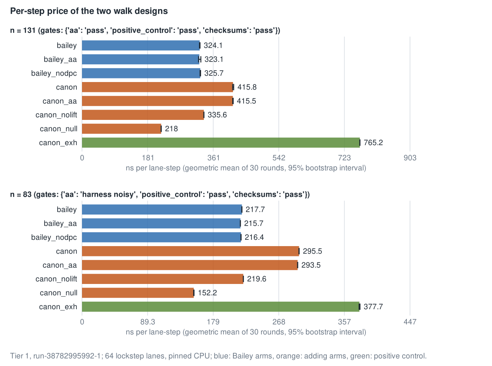
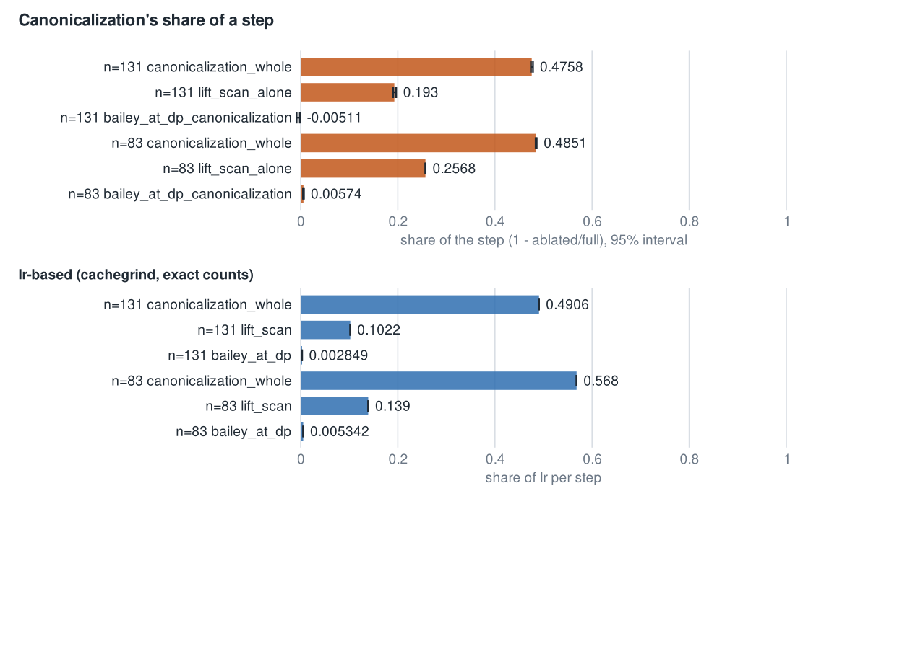
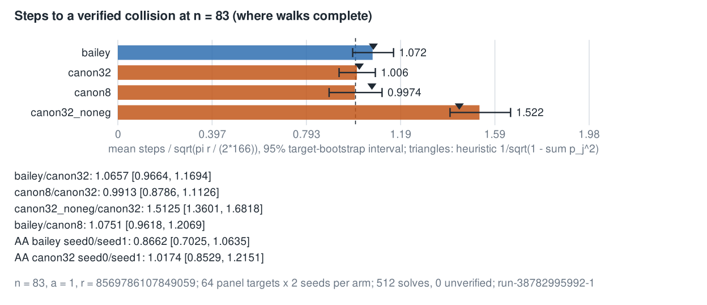

# n131-ref-walk: the n = 131 reference walk (IDEA-20261015-c6f017)

**Status (2026-10-15): measured; frozen rules applied.** GitHub run
[38782995992](https://github.com/aburan28/cryptanalysis/actions/runs/38782995992)
(attempt 1; `ubuntu-24.04`, Standard_D4ads_v5, AMD EPYC 7763; Tier 1, instance
scoped; sha `ad193b54`) passed the exactness gate and ran the frozen
[protocol](PROTOCOL.md) ([`protocol.json`](protocol.json)). Its workflow committed
the receipts to
[`results/ci/run-38782995992-1/`](results/ci/run-38782995992-1/). Results are in
[Results](#results). **The n = 83 timing family is labelled "harness noisy" by
the frozen A/A rule, so none of its timing ratios is promoted.**

## Question

Every ECC2K-130 lane (QSP, CERTBIN, FROB at n = 131) has no matched rho,
because no 131-bit signed-Frobenius walk existed: crypto's wide strong rho
stops at `MAX_N = 127`, and `papers/frobenius-orbits` says "no 131-bit
normal-basis multiply exists in the code base". This experiment builds that
walk and prices one step of it in two designs, on one Tier 1 runner:

* **(a) Bailey's walk** (ePrint 2009/541 sec. 3): `P <- P + sigma^j(P)`,
  `j = 3 + ((HW(x)/2) mod 8)`, HW in the normal basis; the state is
  canonicalized only at distinguished points.
* **(b) a canonicalizing adding walk**: `P <- canon(P + R_h(P))`, 32 jumps,
  canonical form by `lift_scan` (`experiments/canon-n131-20261014`), fruitless
  2- and 4-cycles escaped by doubling the least point of the cycle.

A full collision at n = 131 is impossible (r ~ 2^129), so the
steps-to-collision penalty of each selector is measured where walks complete:
n = 83, a = 1 (r = 8569786107849059), on the 64-point panel.


## Results

Run 38782995992, attempt 1. Source: `results/ci/run-38782995992-1/analysis.json`
and `analysis.txt`. Intervals are 95% (timing: percentile bootstrap over 30
paired rounds; completion: bootstrap over the 64 targets), unadjusted, as the
protocol states; the timing intervals describe round-to-round noise on this one
runner, not variation between hosts.

### Gates (frozen rules)

| gate | result |
| --- | --- |
| exactness (12 cargo tests, KATs with CLMUL on and off, regenerated inputs, independent Python check, known-log solves) | **pass** (528 solves verified, 0 unverified, no failures) |
| timing A/A at n = 131 (`bailey_aa/bailey` 0.9969 [0.9912, 1.0075]; `canon_aa/canon` 0.9992 [0.9942, 1.0030]) | **pass** |
| timing positive control at n = 131 (`canon_exh/canon` 1.8401 [1.8317, 1.8449]) | **pass** |
| timing A/A at n = 83 (`bailey_aa/bailey` 0.9909 [0.9904, 0.9914]; `canon_aa/canon` 0.9932 [0.9926, 0.9938]) | **"harness noisy"**: the point estimates are inside [0.97, 1.03] but both intervals exclude 1 |
| timing positive control at n = 83 (`canon_exh/canon` 1.2781 [1.2764, 1.2806]) | pass |
| completion positive control (`canon32_noneg/canon32` 1.5125 [1.3601, 1.6818]; predicted 1.414) | **pass** |
| completion A/A (bailey seed 0/1: 0.8662 [0.7025, 1.0635]; canon32: 1.0174 [0.8529, 1.2151]) | **pass** (both contain 1) |

Because the n = 83 A/A gate failed, the n = 83 ns/step values, ratios and
shares below are reported as measured but **not promoted**, and so is the
n = 131 / n = 83 ns/step ratio derived from them (1.49 bailey, 1.41 canon).

### Step price at n = 131 (promoted)

| arm | ns/lane-step [95%] | Ir/step (cachegrind) |
| --- | --: | --: |
| (a) Bailey | 324.07 [323.54, 324.92] | 4,498 |
| (b) canonicalizing, 32 jumps | 415.83 [414.77, 417.73] | 5,202 |
| (b) without canonicalization (`canon_null`) | 217.98 [217.77, 218.25] | 2,650 |
| (b) with lift_scan skipped (`canon_nolift`; fruitless test kept, no escape) | 335.59 [335.45, 335.75] | 4,670 |
| (b) with the exhaustive canonicalizer (positive control) | 765.17 [764.93, 765.45] | 7,567 |
| (a) without the at-DP canonicalization (`bailey_nodpc`) | 325.72 [325.16, 326.51] | 4,485 |

Paired ratios: **(a)/(b) = 0.7793 [0.7750, 0.7827]** (Ir: 0.8646). Canonicalization
share, whole (`1 - canon_null/canon`): **0.476 [0.474, 0.478]** (Ir 0.491).
lift_scan alone (`1 - canon_nolift/canon`): **0.193 [0.191, 0.197]** (Ir 0.102).
Bailey's at-DP canonicalization share is -0.005 [-0.008, -0.002], that is, none
measurable (the sign is timing noise).

### Cycles per iteration, beside the 2009 figure

At the runner's reported nominal clock (2.445 GHz; no maximum clock was
reported, so no range is available): Bailey 792, canonicalizing 1,017
cycles/iteration. The 2009 figure is 529 cycles/iteration on one core of a
2.997 GHz Core 2 Extreme Q6850 (534 with four cores), ePrint 2009/541 sec. 4.
The numbers are given side by side and not divided: the clock under load is
not observable, the cores differ, and the 2009 code was bitsliced normal basis
where design (a) here is polynomial-basis code with basis changes.

### Steps to collision at n = 83, a = 1 (64 targets x 2 seeds per arm)

All 512 solves verified (`[d]G = Q`, checked in Rust and in independent Python).

| arm | steps / floor [95%] | heuristic prediction | escapes per step |
| --- | --: | --: | --: |
| (a) Bailey | 1.072 [0.988, 1.160] | 1.075 | 0 |
| (b) canon32 | 1.006 [0.931, 1.084] | 1.016 | 0.00019 |
| (b) canon8 | 0.997 [0.889, 1.112] | 1.069 | 0.00075 |
| canon32_noneg (positive control) | 1.522 [1.398, 1.653] | 1.437 | ~0 |

Ratios: bailey/canon32 **1.0657 [0.9664, 1.1694]**; canon8/canon32 0.9913
[0.8786, 1.1126]; bailey/canon8 1.0751 [0.9618, 1.2069]. Per the protocol's
power note, a 7% penalty is not distinguishable from 1 at this N, and it is not
here.

### Reading against the idea's claims

| claim (IDEA-20261015-c6f017) | measured | reading |
| --- | --- | --- |
| 1. canonicalization share at n = 131 in [0.2, 0.5] | whole 0.476 [0.474, 0.478]; lift_scan alone 0.193 [0.191, 0.197] | whole: **inside**. lift_scan alone: just **below** 0.2 (interval upper bound 0.197) |
| 2. Bailey/canon ns/step <= 0.6 (falsified above 0.85) | 0.7793 [0.7750, 0.7827] | **not met**, and **not falsified** (the interval is above 0.6 and below 0.85) |
| 3. steps/floor ratio bailey/canon32 in [1.0, 1.25] (falsified above 1.4) | 1.0657 [0.9664, 1.1694] | point estimate **inside**; the interval reaches below 1.0 and excludes 1.4, so **not falsified** |

### Model composition (not a measurement)

ns/step at n = 131 x steps/floor measured at n = 83 x floor(131) = 2^60.81,
valid only under heuristic H1 (the walk's penalty depends on the selector, not
on n). Bailey: 2^60.91 steps, about 2.2e4 core-years at this run's 324 ns/step.
Canonicalizing: 2^60.82 steps, about 2.7e4 core-years at 416 ns/step. The ratio
is 0.83. This is a reference price for ECC2K-130 at this run's polynomial-basis
code, not an attack cost, and it is not compared with crypto's tuned n = 83
walk (not run here).

### Figures



*Figure 2. ns/step per arm at n = 131 and n = 83 with 95% intervals
([SVG](figures/step_price.svg)). The n = 83 panel carries the "harness noisy"
label.*



*Figure 3. Canonicalization shares from timing and Ir
([SVG](figures/shares.svg)).*



*Figure 4. Steps/floor per arm at n = 83, with the heuristic predictions
([SVG](figures/completion.svg)).*

Figures 2 to 4 are rendered by `make_figures.py` from the run's
`analysis.json`; the SVGs are also in `results/ci/run-38782995992-1/figures/`.

### Limits of this result

* Tier 1, instance scoped: one runner, one pinned CPU, exclusivity not proven.
* The n = 83 timing family failed its A/A gate; its ratios are not promoted.
* The completion intervals are about +-13% (protocol power note), so the
  selector penalty at n = 83 is resolved only against the 1.4 falsification
  line and the sqrt(2) control.
* Nothing here is about solving ECC2K-130, and the transfer of the n = 83
  penalty to n = 131 holds only under H1.

## What was built

| Piece | Where | Source it starts from |
| --- | --- | --- |
| Generic field trait, nibble-table basis changes both ways, Itoh-Tsujii inversion with rotations, batched inversion | `src/lib.rs` | crypto `StrongRhoG` / `WideGf2` (`src/cryptanalysis/koblitz_strong_rho.rs`) |
| GF(2^131): f131.h's polynomial basis (modulus `0xd1d0d000d0000000d000000000000000d`) | `F131` | the Rust port in `canon-n131-loop-20261014` (KAT-exact against `ecc2k130/src/f131.h`) |
| GF(2^83): z^83+z^7+z^4+z^2+1, two-limb CLMUL Karatsuba | `F83` | crypto's legacy n = 83 fixture |
| Canonical form (least rotation of x, sign by the smaller y word) | `Curve::canon_with` | `lift_scan` / `exhaustive` of `canon-n131-20261014`, generic `G<N, 64>` |
| Lockstep walker, 64 lanes, both designs, DP continuation, restarts, fruitless escapes, optional log tracking | `Walker::run` | crypto rung 3 (lanes, DP, history) |
| Timing harness (paired, alternating, pinned) and Ir mode | `src/bin/bench.rs` | `canon-n131-loop-20261014/src/bin/loop_bench.rs` |
| n = 83 solver to a verified logarithm | `src/bin/solve.rs`, `n83::solve` | crypto `StrongRhoG::solve` |

The same generic code runs at both degrees; only the field type differs.
Tracking of `P = aG + bQ` is a compile-time flag, and a test pins that it
does not change the trajectory.

## Exactness (all must pass before timing; the workflow re-runs them)

* `cargo test` (12 tests, `tests/exact.rs`): field products against the
  f131.h KAT (400 vectors) and a bitwise schoolbook at n = 83; inversion,
  Frobenius powers, the normal-to-polynomial basis change and the affine add
  and double formulas against a new KAT computed by `f131.h` + `packed131.h`
  themselves (`kat/point_kat.cpp`, 300 vectors, identical with CLMUL on and
  off); squaring is a one-bit rotation in both bases; `lift_scan` equals the
  exhaustive canonicalizer; ECC2K-130 group law on public points ([r]P = O,
  phi(P) = [lambda]P, associativity); canonical forms equal the exhaustive
  definition over all 2n orbit members and are invariant under +-phi^t;
  Bailey's step commutes with +-phi^t (class function); the lockstep walker
  equals a one-lane reference built from the generic group law; with logs
  tracked every lane satisfies P = aG + bQ through DPs, escapes and
  restarts.
* `check_points.py` re-checks, with independent big-integer arithmetic
  (`indep.py`, no shared code): sums, doubles, negation, [k]P for 130-bit k,
  Frobenius, canonical forms in the orbit, one Bailey step = [1 + lambda^j]P,
  HW parity = trace, every line of the point KAT, and every logarithm the
  solver returns.
* `make_inputs.py --check` regenerates every input. It reproduces Panel B of
  `koblitz-single-target-n83-tier1-20261014` (seeds 0..15) bit for bit with
  crypto's public-point law and extends it to 64 points; it computes the
  orders (ECC2K-130: #E = 4r, r = 680564733841876926932320129493409985129),
  the eigenvalues and asserts lambda has exact order n (A = 2n).
* Known-log positive control: four targets [k]G with published k, solved by
  every completion arm.

Locally (cloud-agent VM, not evidence of speed), all of the above passed; a
dry run solved one known log with each of bailey, canon32, canon8 and
canon32_noneg.

## Controls

| Family | Negative / A/A | Positive (known effect, same path) |
| --- | --- | --- |
| step price | `bailey_aa`, `canon_aa`: copies at their own addresses | `canon_exh`: the exhaustive canonicalizer must be detected as slower |
| canonicalization share | ablations `canon_null`, `canon_nolift`, `bailey_nodpc` | as above |
| steps to collision | seed-0 vs seed-1 halves of the same arm | `canon32_noneg`: Frobenius-only classes (A = n), predicted sqrt(2) more steps |
| correctness | | known-log solves |

`canon_nolift` computes the fruitless-cycle test but does not escape
(protocol amendment 1): with `k = 0` it would meet negation 2-cycles 131 times
more often than the real walk.

`canon8` (8 jumps, canonicalizing) separates selector width from
canonicalization, as the idea asks.

**Dry-run finding, disclosed in the protocol.** A Bailey walk with two
multipliers, the first planned positive control, cannot complete: the
multipliers commute, so after t steps a lane has reached only t + 1 distinct
multipliers and walks from different starts essentially never merge. This is
a structural property of commutative multiplier walks (it is why the 2009
paper checked the lattice of the logs of s_j + 1); with eight multipliers
the reachable set grows like t^7/7! and is not the limit here.

## How to reproduce

```
cd experiments/n131-ref-walk-20261015
python3 run.py exact OUT && python3 receipt.py OUT/receipt_pre.json
python3 run.py time OUT && python3 run.py ir OUT
python3 run.py solve OUT && python3 run.py check OUT
python3 analyze.py OUT && python3 make_figures.py OUT
```

Workflow: [`.github/workflows/n131-ref-walk.yml`](../../.github/workflows/n131-ref-walk.yml),
triggered by a push to `claude/n131-ref-walk`; its paths exclude
`results/ci/**`, this README, `report.*`, `figures/**` and `make_figures.py`.

## Reporting rules for the results

* Per design: ns/step at n = 131 and at n = 83, Ir/step, canonicalization's
  share (timing and Ir), the ratio (a)/(b) with its paired interval.
* Cycles per iteration: ns/step times the runner's nominal and maximum clock,
  as a range, **beside** the 2009 figure (529 cycles/iteration on one core of
  a 2.997 GHz Core 2 Extreme Q6850, 534 per core with four; ePrint 2009/541
  sec. 4, frozen at `crypto-autoresearcher:inputs/BAILEY-2009-541-ECC2K130/`),
  never divided into it.
* The ECC2K-130 reference denominator per design is a **model composition**:
  ns/step (n = 131) x steps/floor (n = 83) x floor(131) = 2^60.81, valid only
  under heuristic H1 (the penalty depends on the selector, not on n). Its
  components are reported separately.

## Not established here

Anything about solving ECC2K-130; Tier 0 isolation; a comparison with
crypto's own tuned n = 83 walk (Fold/64/DP6), which this run does not execute;
the transfer of the n = 83 penalty to n = 131 beyond H1. Bailey's own
iteration in 2009 used bitsliced normal-basis arithmetic; design (a) here is
priced on this repository's polynomial-basis code with basis changes, which
is one implementation of the walk, not theirs.
