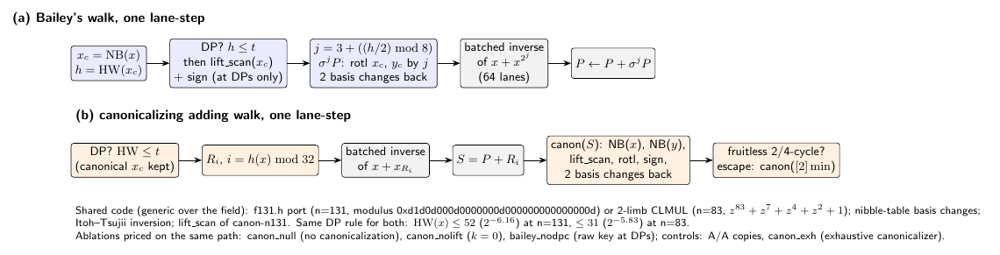

# n131-ref-walk: the n = 131 reference walk (IDEA-20261015-c6f017)

**Status (2026-10-15): code, inputs and protocol frozen; exactness verified
locally; the Tier 1 run is started by the push to `claude/n131-ref-walk` and
commits its receipts to `results/ci/run-<id>-<attempt>/`. No timing or
completion number is reported in this file yet.** Results get filled in from
those receipts, under the frozen [protocol](PROTOCOL.md)
([`protocol.json`](protocol.json)).

## Question

Every ECC2K-130 lane (QSP, CERTBIN, FROB at n = 131) has no matched rho,
because no 131-bit signed-Frobenius walk existed: crypto's wide strong rho
stops at `MAX_N = 127`, and `papers/frobenius-orbits` says "no 131-bit
normal-basis multiply exists in the code base". This experiment builds that
walk and prices one step of it in two designs, on one Tier 1 runner:

* **(a) Bailey's walk** (ePrint 2009/541 sec. 3): `P <- P + sigma^j(P)`,
  `j = 3 + ((HW(x)/2) mod 8)`, HW in the normal basis; the state is
  canonicalized only at distinguished points.
* **(b) a canonicalizing adding walk**: `P <- canon(P + R_h(P))`, 32 jumps,
  canonical form by `lift_scan` (`experiments/canon-n131-20261014`), fruitless
  2- and 4-cycles escaped by doubling the least point of the cycle.

A full collision at n = 131 is impossible (r ~ 2^129), so the
steps-to-collision penalty of each selector is measured where walks complete:
n = 83, a = 1 (r = 8569786107849059), on the 64-point panel.



## What was built

| Piece | Where | Source it starts from |
| --- | --- | --- |
| Generic field trait, nibble-table basis changes both ways, Itoh-Tsujii inversion with rotations, batched inversion | `src/lib.rs` | crypto `StrongRhoG` / `WideGf2` (`src/cryptanalysis/koblitz_strong_rho.rs`) |
| GF(2^131): f131.h's polynomial basis (modulus `0xd1d0d000d0000000d000000000000000d`) | `F131` | the Rust port in `canon-n131-loop-20261014` (KAT-exact against `ecc2k130/src/f131.h`) |
| GF(2^83): z^83+z^7+z^4+z^2+1, two-limb CLMUL Karatsuba | `F83` | crypto's legacy n = 83 fixture |
| Canonical form (least rotation of x, sign by the smaller y word) | `Curve::canon_with` | `lift_scan` / `exhaustive` of `canon-n131-20261014`, generic `G<N, 64>` |
| Lockstep walker, 64 lanes, both designs, DP continuation, restarts, fruitless escapes, optional log tracking | `Walker::run` | crypto rung 3 (lanes, DP, history) |
| Timing harness (paired, alternating, pinned) and Ir mode | `src/bin/bench.rs` | `canon-n131-loop-20261014/src/bin/loop_bench.rs` |
| n = 83 solver to a verified logarithm | `src/bin/solve.rs`, `n83::solve` | crypto `StrongRhoG::solve` |

The same generic code runs at both degrees; only the field type differs.
Tracking of `P = aG + bQ` is a compile-time flag, and a test pins that it
does not change the trajectory.

## Exactness (all must pass before timing; the workflow re-runs them)

* `cargo test` (12 tests, `tests/exact.rs`): field products against the
  f131.h KAT (400 vectors) and a bitwise schoolbook at n = 83; inversion,
  Frobenius powers, the normal-to-polynomial basis change and the affine add
  and double formulas against a new KAT computed by `f131.h` + `packed131.h`
  themselves (`kat/point_kat.cpp`, 300 vectors, identical with CLMUL on and
  off); squaring is a one-bit rotation in both bases; `lift_scan` equals the
  exhaustive canonicalizer; ECC2K-130 group law on public points ([r]P = O,
  phi(P) = [lambda]P, associativity); canonical forms equal the exhaustive
  definition over all 2n orbit members and are invariant under +-phi^t;
  Bailey's step commutes with +-phi^t (class function); the lockstep walker
  equals a one-lane reference built from the generic group law; with logs
  tracked every lane satisfies P = aG + bQ through DPs, escapes and
  restarts.
* `check_points.py` re-checks, with independent big-integer arithmetic
  (`indep.py`, no shared code): sums, doubles, negation, [k]P for 130-bit k,
  Frobenius, canonical forms in the orbit, one Bailey step = [1 + lambda^j]P,
  HW parity = trace, every line of the point KAT, and every logarithm the
  solver returns.
* `make_inputs.py --check` regenerates every input. It reproduces Panel B of
  `koblitz-single-target-n83-tier1-20261014` (seeds 0..15) bit for bit with
  crypto's public-point law and extends it to 64 points; it computes the
  orders (ECC2K-130: #E = 4r, r = 680564733841876926932320129493409985129),
  the eigenvalues and asserts lambda has exact order n (A = 2n).
* Known-log positive control: four targets [k]G with published k, solved by
  every completion arm.

Locally (cloud-agent VM, not evidence of speed), all of the above passed; a
dry run solved one known log with each of bailey, canon32, canon8 and
canon32_noneg.

## Controls

| Family | Negative / A/A | Positive (known effect, same path) |
| --- | --- | --- |
| step price | `bailey_aa`, `canon_aa`: copies at their own addresses | `canon_exh`: the exhaustive canonicalizer must be detected as slower |
| canonicalization share | ablations `canon_null`, `canon_nolift`, `bailey_nodpc` | as above |
| steps to collision | seed-0 vs seed-1 halves of the same arm | `canon32_noneg`: Frobenius-only classes (A = n), predicted sqrt(2) more steps |
| correctness | | known-log solves |

`canon_nolift` computes the fruitless-cycle test but does not escape
(protocol amendment 1): with `k = 0` it would meet negation 2-cycles 131 times
more often than the real walk.

`canon8` (8 jumps, canonicalizing) separates selector width from
canonicalization, as the idea asks.

**Dry-run finding, disclosed in the protocol.** A Bailey walk with two
multipliers, the first planned positive control, cannot complete: the
multipliers commute, so after t steps a lane has reached only t + 1 distinct
multipliers and walks from different starts essentially never merge. This is
a structural property of commutative multiplier walks (it is why the 2009
paper checked the lattice of the logs of s_j + 1); with eight multipliers
the reachable set grows like t^7/7! and is not the limit here.

## How to reproduce

```
cd experiments/n131-ref-walk-20261015
python3 run.py exact OUT && python3 receipt.py OUT/receipt_pre.json
python3 run.py time OUT && python3 run.py ir OUT
python3 run.py solve OUT && python3 run.py check OUT
python3 analyze.py OUT && python3 make_figures.py OUT
```

Workflow: [`.github/workflows/n131-ref-walk.yml`](../../.github/workflows/n131-ref-walk.yml),
triggered by a push to `claude/n131-ref-walk`; its paths exclude
`results/ci/**`, this README, `report.*`, `figures/**` and `make_figures.py`.

## Reporting rules for the results

* Per design: ns/step at n = 131 and at n = 83, Ir/step, canonicalization's
  share (timing and Ir), the ratio (a)/(b) with its paired interval.
* Cycles per iteration: ns/step times the runner's nominal and maximum clock,
  as a range, **beside** the 2009 figure (529 cycles/iteration on one core of
  a 2.997 GHz Core 2 Extreme Q6850, 534 per core with four; ePrint 2009/541
  sec. 4, frozen at `crypto-autoresearcher:inputs/BAILEY-2009-541-ECC2K130/`),
  never divided into it.
* The ECC2K-130 reference denominator per design is a **model composition**:
  ns/step (n = 131) x steps/floor (n = 83) x floor(131) = 2^60.81, valid only
  under heuristic H1 (the penalty depends on the selector, not on n). Its
  components are reported separately.

## Not established here

Anything about solving ECC2K-130; Tier 0 isolation; a comparison with
crypto's own tuned n = 83 walk (Fold/64/DP6), which this run does not execute;
the transfer of the n = 83 penalty to n = 131 beyond H1. Bailey's own
iteration in 2009 used bitsliced normal-basis arithmetic; design (a) here is
priced on this repository's polynomial-basis code with basis changes, which
is one implementation of the walk, not theirs.
