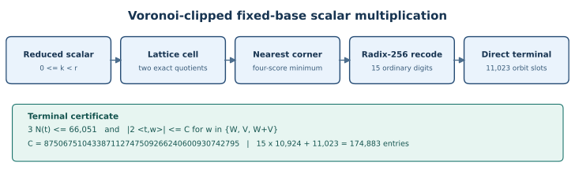
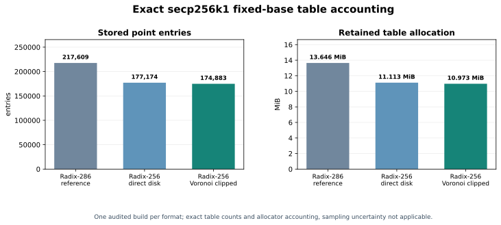

# Voronoi-clipped fixed-base scalar table: source-linked report

**Contribution.** For the secp256k1 prime-order generator, an opt-in radix-256 evaluator intersects its terminal norm disk with three Eisenstein Voronoi support strips. The exact terminal table has **11,023** unit-orbit entries, versus **13,314** for the earlier direct disk. The complete sixteen-selection format stores **174,883** point entries, a reduction of **2,291 entries / 146,624 point-payload bytes**. A native audit reports **11,505,936 bytes** of retained table allocation. This is a table-storage result; the required host-isolated online time has not been measured.

## Question and instance

Can the nearest-lattice scalar representative reduce the direct terminal table without adding point operations or a terminal search? The curve is secp256k1 over `Fp` with `p = 0xfffffffffffffffffffffffffffffffffffffffffffffffffffffffefffffc2f`, equation `y²=x³+7`, prime subgroup order `r = 0xfffffffffffffffffffffffffffffffebaaedce6af48a03bbfd25e8cd0364141`, and generator coordinates `Gx = 79be667ef9dcbbac55a06295ce870b07029bfcdb2dce28d959f2815b16f81798`, `Gy = 483ada7726a3c4655da4fbfc0e1108a8fd17b448a68554199c47d08ffb10d4b8`. The exact lattice basis and order are frozen in [search.json](search.json). The [holdout fixture](holdout.json) records the generator, scalar law, seed `2026101225603`, and independently computed expected points.

The domain is reduced public scalars `0≤k<r`. The production chooser uses two exact reciprocal cell quotients, a certified four-corner minimum or exact fallback, and fifteen ordinary radix-256 unit-orbit digits. The terminal is addressed directly by one canonical sector row and a six-unit image code. The prior [exact reciprocal protocol](../prime-j0-exact-reciprocal-20261010/PROTOCOL.md) specifies the quotient identity. The new [proof map](PROOF.md) gives the Voronoi bounds and exact hypotheses.

**Figure 1.** The highlighted terminal certificate intersects the previous `3N(t)≤66051` disk with three support strips. The diagram source is [make_figures.py](figures/make_figures.py); [sources.json](figures/sources.json) pins the data used to render it.

## Method and evidence

For `W=U−2V`, the three vectors `W,V,W+V` each have Eisenstein norm `r`. The checked Lean four-corner lemma shows that the minimum of the four floor/ceiling cell scores lies between all three pairs of Voronoi lines. Cauchy bounds the support of each ordinary digit, and the fifteen-step reconstruction gives the top-coordinate limit `C=87506751043387112747509266240600930742795`. The full derivation, code mapping, and remaining word-level bridge are in [PROOF.md](PROOF.md).

| Claim and boundary | Status | Receipt |
| --- | --- | --- |
| 66,133 terminal integer pairs, 11,023 six-unit orbits, contiguous sector rows | Derived and exhaustively checked by integer enumeration | [search.json](search.json), [search.py](search.py) |
| Four-corner geometry, Cauchy support, and conditional terminal inclusion | Lean checked with standard foundations; actual module and axiom output retained | [VoronoiTerminal.lean](VoronoiTerminal.lean), [lean-build.txt](lean-build.txt) |
| 4,096 design scalars plus 1,536 earlier holdout scalars remain in the clipped domain | Sampled implementation screen | [screen.json](screen.json), [screen.py](screen.py) |
| Four 512-case panels, including the post-source-freeze holdout, reproduce independent secp256k1 points | Native point replay passed on macOS ARM64 and in an offline Linux ARM64 Docker VM | [replay.json](replay.json), [local-build.json](local-build.json), [linux-build.json](linux-build.json) |
| 174,883 stored entries and 11,505,936 retained bytes | Exact table/accounting output from paired native audits; process RSS recorded separately | [storage-macos.json](storage-macos.json), [storage-linux.json](storage-linux.json) |

The new holdout scalar stream is `SHA-256 a00f587a5d5d352ff3ca2080aa9e9c96f9d36e706efe4f40247d55df3bf14dd6`. The semantic [replay receipt](replay.json) binds both native outputs, the point stream, overlays, and fixtures. The Linux result is a cross-OS correctness check inside a macOS-hosted VM. The storage audit records an Apple M4 Pro host and a virtual ARM64 guest, exposed topology and cache fields, CPU/memory cgroup limits, CPU affinity and memory policy, observed co-runners, and the availability of page-placement counters. Page placement was not exposed by either inspected interface. Native `retained_bytes` is allocator accounting for the table structure, not peak RSS or physical page placement.

**Figure 2.** Counts are exact for each built format; there is one audit per format and no sampling error on the integer table counts. Reference radix-286 and Voronoi-clipped values come from the paired [macOS audit](storage-macos.json); the direct-disk value comes from its frozen [native replay](../prime-j0-power2-direct-terminal-20261012/replay.json). The same candidate accounting passed the [Linux audit](storage-linux.json). The editable graph source and data digests are [make_figures.py](figures/make_figures.py) and [sources.json](figures/sources.json).

## Boundaries and next proof step

The conditional terminal theorem, four-corner cell theorem, reciprocal high-fraction enclosure, fraction-score interval bounds, and strict-separation implication are kernel checked. The checked `fraction_corner_certificate` theorem instantiates the native four classifier intervals and proves that a strict winner minimizes all exact corner scores. `fraction_corner_certified_hex_strips` then carries that winner into all six Voronoi support inequalities for normalized cells with the two coordinate enclosures. The new `fraction_corner_certified_six_neighbors` theorem converts those bounds into the actual representative's six lattice-neighbor comparisons. Lean now proves the scaled-coordinate identity for arbitrary floor quotients and all four corner offsets, and proves exact floor quotients yield normalized cell coordinates by Euclidean remainders. `exact_floor_certified_six_neighbors` composes these results under explicit high-fraction interval hypotheses. The checked `corner_representative_norm_score` equates each corner's scaled Eisenstein norm with its quadratic cell score. `fourCornerArgmin` is an explicit four-way norm selector, and `exact_fallback_six_neighbors` proves its result satisfies the six-neighbor condition for every integer scalar. The enclosure theorem derives a two-unit coordinate bound from a floor-reciprocal inequality and exact product-limb decomposition. Lean checks both committed reciprocal constants against the floor inequalities and checks the reduced-scalar range; [check.py](check.py) matches all fourteen reciprocal words to the native source. The checked `native_reciprocal_quotients_exact` theorem proves that multiplying by either copied seven-word reciprocal and shifting by 512 bits yields the exact mathematical cell quotient for every reduced scalar. Its proof uses explicit Bézout certificates for the two coefficients and the checked `subgroupOrder²<2^512` bound. Lean also proves exact-product high-word extraction, the `u128` bound for one inner multiply-add, and weighted-value, length, and 64-bit bounds for an arbitrary modeled inner word pass. Carry propagation and its zero-carry early stop are checked. The indexed outer-pass theorem matches the native offset and reciprocal-sized array slice and proves its exact positional value increment and fixed array length. The checked four-pass theorem proves every intermediate prefix-product equality, zero carry at all four offsets, and the final exact scalar-times-reciprocal product for bounded inputs in the modeled word algorithm. Its proof includes the eleven-word capacity and output-word bounds. A single checked theorem now composes the modeled four-pass product and eleven-word extraction: its high three words, word 7, and low seven words equal the exact quotient, high fractional word, and remainder of the scalar-times-reciprocal product. Lean now identifies list positions 7 and 8–10 with the fractional word and three high words and proves their values equal the exact product divisions. Formal correspondence between the native Rust array and the checked list model remains open. The Rust fallback tuple sort and returned pair must be connected to the checked norm-first selector; the finite census also lacks a Lean cardinality theorem. These obligations and exact exit criteria are tracked in [the problem record](../../problems/prime-j0-hex-terminal-formal-coverage.md). Sampled point replays are implementation controls at their recorded input law.

The source-synced `native_reciprocal_word_lists` and checked `modeled_native_reciprocal_high_quotients` theorem now prove that both complete modeled word products return high limbs equal to the exact cell quotients for every reduced four-word scalar. The exact native reciprocal-loop function, extracted from the recorded Rust source and compiled in a temporary wrapper, matched an independent unbounded-integer oracle on 5,197 deterministic inputs, including carry-heavy patterns and both production reciprocals; [the receipt](native-reciprocal-loop.json) retains the source, function, compiler, input, and output hashes. The available RunPod pod retains a serial service and an active CryptoMiniSat process. Its host probe exposes Docker/cgroup v1, no isolated CPU partition, and no `nohz_full` CPUs. Consequently this report presents exact storage and correctness evidence, with CPU timing still awaiting a host that meets [the isolation contract](../../docs/ISOLATED_BENCHMARKS.md). The incidental audit wall and CPU times in the manifests are not a performance comparison.

Canonical graph sources checked: [the prime-j0 orbit-graph inputs](../prime-j0-cost-aware-chain/orbit-graph-inputs.json), [the arithmetic optimization figures](../ec-arithmetic-optimizations/figures/), and [the volcano/IC figures](../volcano-ic/figures/). They encode relation graphs, arithmetic-operation layers, or curve/isogeny structure. This change introduces no curve, route, factor-base, or relation-graph edge, so those canonical sources remain current. Figures 1 and 2 are new to this scalar-format experiment.

## Reproduction

From the repository root, run `python3 experiments/prime-j0-hex-terminal-20261012/search.py --check`, `screen.py --check`, and `check.py --check` in the same directory. `native_overlay_hex.py` prepares the disposable evaluator, and `replay.py --check` verifies the four-panel semantic receipt when given the source-bound candidate and reference binaries and overlay records. `capture_storage_environment.py` collects fresh paired audit and placement records; fresh timestamps and co-runner snapshots are expected to differ. `figures/make_figures.py` regenerates both SVGs and their PDF-ready PNGs from the frozen receipts. The accompanying [PDF report](REPORT-2026-10-12.pdf) includes the same figures and principal evidence.
