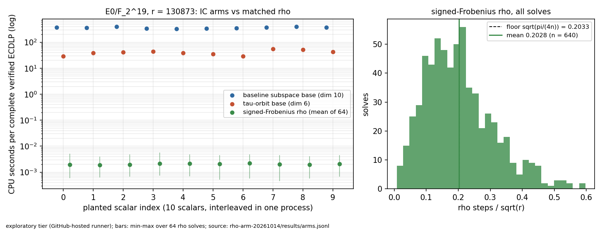

# Matched signed-Frobenius rho arm, E0/F_2^19

Protocol `volcano-ic-n19-rho-arm-20261014` (frozen before data, `protocol.json`, sha256 `e474ff26af62188cf267db119ae59f1d74addd107bcd4008d41f0f62227d96ed`). Status: **complete** (10 of 10 scalars with all three arms verified). Tier: exploratory: a GitHub-hosted VM is neither Tier 0 nor Tier 1 (no allocation receipt, no exclusive pinned CPU). Ratios are labelled exploratory CPU-time ratios.

Host: ['AMD EPYC 9V45 96-Core Processor'], 4 logical CPUs, Sage SageMath version 10.10, Release Date: 2026-09-28, commit `3f722e2e4897d956438c6bdf2becaf62dbde2f9e`, run 38520305068.

All three arms ran in one process, interleaved scalar by scalar (`protocol.json` order). No number from the 2026-09 taucmp run enters these statistics.

## CPU per complete ECDLP (measured, this run only)

| arm | CPU s / ECDLP (mean) | operations | S | S_cpu-equiv | CPU / rho (geo. mean, 95% CI) |
|---|---:|---|---:|---:|---:|
| baseline subspace base (dim 10) | 362.1 | 826.8 attempts, 826.8 GB calls, 3.81e+04 nominal group ops | 105.210 (nominal, excludes GB) | 4.61e+04 | 1.77e+05 (1.66e+05-1.89e+05) |
| tau-orbit base (dim 6) | 40.5 | 305.7 targets, 5.43e+03 GB calls, 1.41e+04 nominal group ops | 38.953 (nominal, excludes GB) | 5.15e+03 | 1.94e+04 (1.69e+04-2.23e+04) |
| signed-Frobenius rho (mean of 64) | 0.00204 | 73.4 steps, 94.2 group ops | 0.2028 steps, 0.2603 ops | 0.2603 | 1 |

S = operations / sqrt(r), r = 130873. S_cpu-equiv converts CPU seconds into rho group operations at this run's pooled rho CPU per operation (2.17e-05 s); it is a calibrated conversion, not a count. The IC nominal S counts only the double-and-add work of building targets.

## Statistics

- base / rho CPU: 1.77e+05 (1.66e+05-1.89e+05); online speedup rho/base 5.65e-06
- tau6 / rho CPU: 1.94e+04 (1.69e+04-2.23e+04); online speedup rho/tau6 5.15e-05
- base / tau6 CPU (within-run replication): 9.124 (8.122-10.270)
- rho steps / sqrt(r): 0.2028 (95% CI 0.1943-0.2112) against the floor sqrt(pi/(4n)) = 0.2033: ratio 0.997 (0.956-1.039), 640/640 logs verified, 0 fruitless cycles, 0 restarts; validity gate pass

Sensitivity (geometric means): rho rep 0 only: base 1.64e+05 (1.25e+05-2.11e+05), tau6 1.8e+04 (1.33e+04-2.43e+04); rho CPU to recovery: base 1.91e+05 (1.78e+05-2.04e+05), tau6 2.09e+04 (1.81e+04-2.4e+04); wall clock: base 1.77e+05 (1.66e+05-1.89e+05), tau6 1.94e+04 (1.69e+04-2.23e+04).

## Decisions (pre-stated in protocol.json)

- base_over_rho: X costs more CPU than matched rho: not an advance against rho on E0/F_2^19
- tau6_over_rho: X costs more CPU than matched rho: not an advance against rho on E0/F_2^19
- base_over_tau6: orbit-base speedup over the baseline replicates within this run

## Replay check (code path only)

IC arms reuse the 2026-09 rng seeds, so their counts must equal the old records: 20/20 equal.

## Figure

Failed or unverified rows: none.

