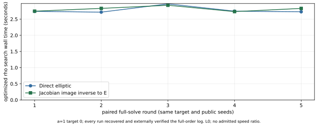
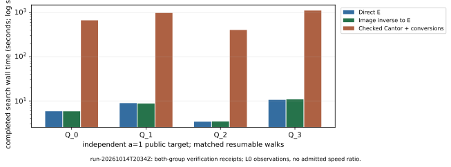
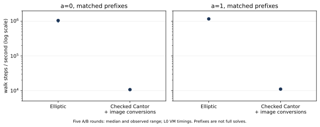

# Full-subgroup elliptic / genus-two ECDLP comparison

Seven independent a=1 targets now have completed, matched elliptic and native
genus-two full-subgroup solves. The three newly completed native searches
took **673.691, 1,083.143 and 1,154.184 seconds**; their matched elliptic searches
took **5.773, 8.900 and 8.555 seconds**. Each target used exactly the same
step count in all three arms and passed separate-process verification in
E and J(C). All eight elliptic and image-inverse targets are complete.
These are descriptive L0 VM search durations; complete priced cost and
speedup remain unset. The a=0 full solves and one native a=1 target remain
outstanding in the checkpointed campaign.

Latest snapshot: [run-20261014T2148Z](runs/run-20261014T2148Z/ARCHIVE.md),
acknowledged pause 21:49:26 UTC. It contains 23 verified resumable completions,
three beyond the preceding 20-completion snapshot. The 27 optimized reference
runs are retained earlier evidence, not new executions. The immutable
[earlier snapshots](runs/run-20261014T2034Z/snapshot.json) remain unchanged.

The user selected full-subgroup solves and a longer compute campaign. The
[protocol](PROTOCOL.md) was pushed before target generation. This is not an
interval-log experiment, and m=83 was retained throughout.

## Exact objects and inputs

Field: GF(2^83), polynomial basis `z^83+z^45+z²+z+1`.

| a | Source identity | Prime subgroup order r | Cofactor |
| --- | --- | --- | --- |
| 0 | EC1N83Ckb0h252dacc102a4 | 2417851639230796216685689 | 4 |
| 1 | EC1N83Ckb1h1f579d351b52 | 8569786107849059 | 1128547018 |

ICV1 identities are `icv1-f2m83-tm6151469093347-debefd74` (a=0) and
`icv1-f2m83-t6151469093347-cdcc5432` (a=1), as in the construction report.

The source is `E_a: y²+xy=x³+a*x²+1`. The target is the elliptic image in
`J(C_a)` for `C_a: v²+u²v=u⁵+a*u⁴+u³+u`, from the
[construction report](../binary_genus2_cover_20261014/REPORT.md). Its smooth
projective genus is two; this Jacobian is an abelian surface. The pullback is
injective on both pinned subgroups and has an explicit checked image inverse.
This study does not solve arbitrary full-Jacobian problems.
The construction's target-model SHA-256 identities are
`90ae6180515543965c342c9554238e0482a8f403395d6f266ae97f0dd4999386`
(a=0) and `e3da462358d913bb75665237fe3224e35e7d0516ff5d5cda1ff810625a690cec`
(a=1), with the full canonical models and identity definition in that report.

Eight independent nonidentity Q were drawn uniformly per a using OS rejection
sampling over `1 <= k < r`, then `Q=kP`. Only public jobs were supplied to
solvers; the scalar witness file is outside the public and solver directories,
mode 0600. Solvers accept no scalar or interval argument. Public jobs pin the
source generator and subgroup, reject unknown fields, and are bound by SHA-256.
Targets, public walk seeds and inputs are in the frozen run below. The a=1
subgroup is 53 bits: an 83-bit binary field does not imply an 83-bit prime order.

## Completed optimized reference suite

There are 27 verified full-subgroup a=1 runs over eight independent targets:
one warmup, two A/A controls, five interleaved direct/image-inverse pairs on
Q_0, and one pair on each of Q_1,...,Q_7. Repeated controls are the same target,
not extra independent instances. Every candidate was checked in a separate
process by both elliptic and native Jacobian scalar multiplication.

Q_0 required 6,631,641 rho steps in every optimized reference repetition.
The first paired search times were 2.741946817 seconds directly and
2.747020538 seconds after the checked image inverse. These are observed L0
VM search durations, with setup, transfer and verification recorded separately.
The latter run recorded 0.000114948 seconds for the two public-divisor
pullbacks and checked inverses. It establishes an executable image-to-E solve
route; it is not an independent algorithmic advantage.

## Matched resumable native arithmetic

`rho.cover_image_checkpoint/v1` is a separately named method using 32 lanes,
32 public jumps, signed Frobenius quotient size 166, distinguished points,
cycle escape, and a persistent collision table. The three arms are:

- Elliptic: individual native elliptic additions.
- Image inverse: checked public-divisor inverse, then the same elliptic walk.
- Native Jacobian: checked Cantor additions, with checked image inverses and
  pullbacks to choose canonical representatives. Starts and cursors use E;
  every native search addition and conversion is recorded. This conservative
  hybrid implementation is not optimized genus-two arithmetic.

The optimized reference on the preceding graph batches field inversions.
It is distinct from the unbatched resumable elliptic arm. For Q_0, the latter
completed 6,631,641 steps in 5.845604437 seconds; the resumable inverse-image
arm took 5.842078086 seconds. Both independently verified the recovered scalar.
The native Jacobian arm completed the same 6,631,641 steps in
669.526079432 seconds and passed separate-process verification in both groups.
It performed 6,632,874 checked Cantor additions, including cycle escapes;
the frozen counters retain mappings and all other native operations.

| a=1 target | Steps in each matched arm | Direct E search s | Image inverse/E search s | Checked Cantor/conversions search s |
| --- | ---: | ---: | ---: | ---: |
| Q_0 (previous snapshot) | 6,631,641 | 5.845604437 | 5.842078086 | 669.526079432 |
| Q_1 | 10,049,968 | 8.936632815 | 8.726057880 | 984.514533998 |
| Q_2 | 3,913,125 | 3.392115110 | 3.423350861 | 405.053302451 |
| Q_3 | 10,875,029 | 10.603287411 | 10.859175528 | 1,116.429875080 |
| Q_4 | 5,873,249 | 5.773190470 | 6.879262749 | 673.691337740 |
| Q_5 | 9,896,094 | 8.900080096 | 8.646483486 | 1,083.143331478 |
| Q_6 | 9,152,588 | 8.555052141 | 8.391081647 | 1,154.184117905 |

Every row has separate-process E and Jacobian verification. The three new
native candidates were also rechecked in further verifier invocations;
[additional receipts](runs/run-20261014T2148Z/followup-verification/) contain
the public-job hashes and both checks. The held-out witness was not accessed.
The remaining elliptic/image-inverse completions on Q_7 and all
native counters are retained per target in the native summary. Repeated
representations and verifier invocations do not add independent targets.

At the pause, native a=1 Q_7 had 3,162,845 steps with no candidate.
The a=0 checkpoints had 410,039,272 elliptic steps,
404,195,619 inverse/E steps and 4,137,664 native Jacobian steps, with no
candidates. These are censored work counts. No completed duration is assigned
to them and no scalar-space restriction was introduced.

No E-addition/Jacobian-addition count ratio is a common priced cost. Setup,
search, mappings, table operations, collision processing, checkpoint I/O,
resume and external verification are recorded separately. Native field work
and a calibrated common cost model remain missing; `speedup` and
`common_priced_work` are null. Nested checked-image-inverse calls include
internal validation and pullback reconstruction, as documented by the source.

## Prefix calibration, not full solve durations

Each curve has a warmup, A/A controls and five interleaved E/Cantor rounds on
matching trajectory prefixes. The medians and ranges are from the native
summary; no confidence interval or admitted ratio is inferred.

| a | Arm | Median walk steps/s | Observed range | Samples |
| --- | --- | ---: | ---: | ---: |
| 0 | Elliptic | 1,051,224 | 911,331–1,101,530 | 5 |
| 0 | Checked Cantor + conversions | 10,678 | 10,562–11,008 | 5 |
| 1 | Elliptic | 1,170,906 | 1,153,715–1,175,601 | 5 |
| 1 | Checked Cantor + conversions | 11,030 | 10,387–11,158 | 5 |

The birthday scales `sqrt(pi*r/(2*166))` are 151,258,823,772 steps for a=0
and 9,005,149 for a=1. Dividing those scales by short-prefix median rates gives
heuristics, not measured solve times or a calibrated ETA. For a=0 the recorded
heuristics are about 143,888 seconds at the elliptic prefix rate and
14,165,628 seconds at the checked-Cantor rate, before scheduling, collision
variability and further overhead. The latter is a months-scale work estimate
on one fully occupied core. An unfinished a=0 search does not establish
impossibility or security.

## Host, validation and limits

The worker exposes five x86-64 virtual CPUs (Intel Xeon Platinum 8573C), with
a four-CPU quota and 16 GiB memory limit. Native ecbench primitives take the
exclusive benchmark lock, attempt eviction and pin the solver to CPU 4. Actual
affinity is `[4]`; observed memory policy is default and NUMA placement is
recorded. Physical memory type is unknown. The preflight could not read CPU
or memory PSI; some user threads could not be evicted. Hardware counters
returned `perf_event_open: No such file or directory`. All times are L0 VM
observations, not admissible wall-time gains. Builds/tests finished before
timing; heavy report/archival work uses the campaign pause checkpoint.
No ARM, GPU or FPGA run was performed.

Both checkouts pass 33 native unit tests plus three cover tests, formatting,
scoped Clippy, CLI rejection controls and exact IDC1 identity replay. The
public-job restarted/uninterrupted receipts match across both repositories,
for both subgroups. A constructed unit-test collision is only a correctness
control. The earlier whole-library gate still has its two existing JV F4
completion-threshold failures, recorded in the construction study. This work
leaves backend source unchanged and does not claim that gate is green.

The [ecbench integration problem](../../problems/ecbench-binary-genus2-full-subgroup-adapter.md)
remains open: the wide constructor assumes cofactor 4/2, the a=1 pinned
subgroup needs 1128547018, and no registered Mumford-image workload exists.
These external native records are not sealed ecbench sessions or audit
certificates. Common pricing, admissible isolation, eight-target native
Jacobian completion and independent-host replay remain required for a general
performance conclusion. No index-calculus solver was measured here.

## Evidence and continuing execution

- [Latest frozen native summary](runs/run-20261014T2148Z/snapshot.json), including raw-source paths.
- [Latest run report](reports/run-20261014T2148Z/REPORT.md).
- [Preceding run report](reports/run-20261014T2034Z/REPORT.md) and its unchanged frozen evidence.
- [Earlier run report](reports/run-20261014T1901Z/REPORT.md) and its unchanged frozen evidence.
- [PDF with recorded graphs](report.pdf); [layout source](render_report.py).
- [Rust commands, methods and checkpoint controls](../../tools/binary-genus2-cover/README.md#full-subgroup-ecdlp-campaign).
- [Validation history and final logs](validation/README.md).

Reference source: crypto d38a85f7e1ac02358223b58d71633f71f2efa7fa.
Checkpointed worker source: crypto dbd33f00da0a0ac35f285603ec168ad9d91a1d79;
paired suite source 38bd48dc514ded10a4ace8279e45e71167d77de9.
Performance was executed with the crypto backend on this worker. The suite
validated matching arithmetic/restart receipts and republishes identical
frozen performance evidence; that copy is not an independent campaign.
The unchanged pinned primitives have their own source checksums. Frozen
records bind binary/source hashes, public jobs, seeds, host manifests and
verification receipts. The local held-out witness file is not published.

The actual worker runs on the current workspace with atomic checkpoints.
A live process does not guarantee persistence after worker deletion. See
`RESUME.md` for the recorded launch/resume commands and pause/stop procedure.
Future snapshots must use new directories; never edit this run's evidence.

| Requested requirement | Status and evidence |
| --- | --- |
| m=83, both pinned prime orders, original uniform public targets | Preserved; unchanged public-job hashes and native input checks |
| Eight full targets per a, in each matched arm | Partial: a=1 E/image 8/8 each, native 7/8; a=0 0/8 in each arm |
| Independent candidate verification | Verified for all 23 completed resumable solves and the earlier 27 optimized references; three new native candidates additionally checked; same host, separate processes |
| Exact checkpoint continuation | Executing on the original worker; full state archived after an acknowledged pause; durable retention remains open |
| Common priced cost, admitted speedup, ecbench audit | Not established; adapter, pricing, isolation and independent-host gates remain open |
| Reports, graphs and PDF | Refreshed for this snapshot; new benchmark entry preserves earlier copies |

This update adds observations to the same implementation, not a mathematical
advance or an arithmetic optimization. Existing geometric formalization
obligations are unchanged. The [a=0 durable-compute problem](../../problems/binary-genus2-a0-full-solve-compute.md)
and ecbench-adapter problem remain open under their original exit criteria.

Graphs checked for applicability: `docs/index-calculus-scoreboard.html`,
`docs/ic/progress-timeline.json`, `docs/ic/leaderboard.json`, and the construction
study's curve/cover figures. This generic-rho representation comparison adds
no IC/rho ratio, newly registered curve, priced IC pipeline or admitted gain;
those series remain unchanged. The benchmark index receives this report.
