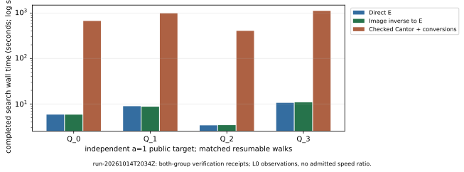

# Follow-up: four matched native full-subgroup targets

This iteration continued the original public-job campaign without restarting
its walk or generating targets. The worker, originally PID 21441, acknowledged
the archival pause at Unix 1792010264 (2026-10-14 20:37:44 UTC). Source remains
crypto dbd33f00da0a0ac35f285603ec168ad9d91a1d79; the immutable binary and
summary hashes, process-identity checks and exact limitations are in
[ARCHIVE.md](../../runs/run-20261014T2034Z/ARCHIVE.md). The
[preregistered protocol](../../PROTOCOL.md), field basis, both prime orders,
generators, public targets and walk seeds are unchanged. No held-out witness
was read, copied or supplied to a solver or verifier.

## Completed observations

There are 20 completed resumable solves: eight direct elliptic and eight
image-inverse/E targets, and native Jacobian targets Q_0 through Q_3, all for
a=1. Ten completions, including three native targets, are additions to the
previous snapshot. All 20 candidates passed both group checks in their
original separate verifier processes and in an additional separate process
per candidate during this follow-up. The a=1 prime order is
8569786107849059 (53 bits), in the unchanged field GF(2^83).
Its source identity is `EC1N83Ckb1h1f579d351b52`,
`icv1-f2m83-t6151469093347-cdcc5432`; a=0 retains
`EC1N83Ckb0h252dacc102a4`, `icv1-f2m83-tm6151469093347-debefd74`.

| Independent a=1 target | Steps in each arm | E search s | Inverse/E search s | Checked Cantor/conversions search s |
| --- | ---: | ---: | ---: | ---: |
| Q_0, earlier completion | 6,631,641 | 5.845604437 | 5.842078086 | 669.526079432 |
| Q_1 | 10,049,968 | 8.936632815 | 8.726057880 | 984.514533998 |
| Q_2 | 3,913,125 | 3.392115110 | 3.423350861 | 405.053302451 |
| Q_3 | 10,875,029 | 10.603287411 | 10.859175528 | 1,116.429875080 |

These are recorded active-search durations for
`rho.cover_image_checkpoint/v1`, not complete priced costs. Setup, mappings,
resume, table work, checkpoint I/O and verification remain separately
recorded; native operation vectors have no calibrated common price. Every
native search addition is checked Cantor arithmetic, with checked
image-inverse/pullback canonicalization. It is a hybrid software
implementation. The inverse/E arm uses elliptic search after the checked
public-divisor inverse. No index-calculus solver or optimized pure-Jacobian
solver was measured.

The 27 optimized reference runs and five-round calibration controls are
retained earlier evidence, not new executions. Repetitions, representations
and verifier invocations do not add independent target instances. The first
optimized inverse/E pair remains 2.747020538 search seconds for Q_0; its
method and batching differ from the resumable method above.

## Censored and queued work

At the pause, a=1 native Q_4 had 3,786,038 steps and no candidate; Q_5 through
Q_7 were queued. For a=0, order 2417851639230796216685689, the retained
checkpoints contain 236,882,500 E steps, 232,917,459 inverse/E steps and
2,383,516 native steps, with no candidates. These are censored observations,
not completed durations, interval solves, failed full solves or security
evidence. The original full-subgroup requirement remains open. The existing
worker resumes its exact saved state after report/publication work.

## Host, evidence and limits

The same Xeon Platinum 8573C virtual worker exposes five CPUs with a four-CPU
quota and 16 GiB limit. The campaign holds the benchmark lock and is pinned
to CPU 4. Existing manifests record actual affinity, attempted eviction and
NUMA observations. PSI and hardware counters are unavailable; some user
threads could not be moved. All search durations are L0 VM observations.
No general comparison, common priced cost, admitted speedup, independent-host
performance replay or sealed ecbench audit is available. The a=0
[durable-compute](../../../../problems/binary-genus2-a0-full-solve-compute.md)
and [ecbench-adapter](../../../../problems/ecbench-binary-genus2-full-subgroup-adapter.md)
problems remain open under their original exit criteria.

- [Native summary](../../runs/run-20261014T2034Z/snapshot.json), public inputs, raw per-quantum logs and complete checkpoint tables in the same archive.
- [Additional independent-process receipts](../../runs/run-20261014T2034Z/followup-verification/).
- [Inspected PDF](report.pdf), [layout source](render_report.py) and [TeX source](report.tex).
- [Combined report and requirement status](../../REPORT.md), [exact resume controls](../../RESUME.md).
- [Previous report](../run-20261014T1901Z/REPORT.md) and immutable previous archive.

The PDF includes the graph above plus the retained optimized-reference and
prefix-calibration graphs. Sources, figure copies and rendered PDF sit beside
this report. To reproduce its layout from this directory, run
`python3 render_report.py --study-root ../.. --output-dir . --run-id run-20261014T2034Z`.
That script only lays out values already computed/recorded by native Rust.
Performance ran once with the crypto backend; cryptanalysis republishes the
identical frozen evidence and does not claim a second campaign.

This change adds observations without changing arithmetic or solver source.
Scoped native tests remain those linked in the existing validation history;
the new validation consists of the additional both-group candidate checks,
archive hashes, report/graph consistency, PDF inspection and diff checks.
The preceding whole-library gate remains qualified by its two existing JV
F4 completion-threshold failures; it is not reported green.

Canonical IC scoreboard, progress/leaderboard data and construction cover
figures were checked for applicability. These observations add no IC/rho
ratio, registered curve, priced IC pipeline or admitted gain, so those series
remain unchanged. A new benchmark entry preserves the earlier visual copies.
