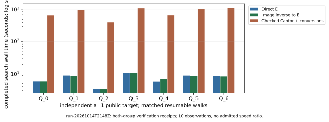

# Follow-up: seven matched native full-subgroup targets

The original worker continued the original public targets and acknowledged
the archival pause at Unix 1792014566 (2026-10-14 21:49:26 UTC). Source remains
crypto dbd33f00da0a0ac35f285603ec168ad9d91a1d79. The field basis, both prime
orders, generators, targets, walk seeds and methods are unchanged. No witness
was read, copied or supplied to a solver or verifier. No target was regenerated,
no interval substituted and no paid resource provisioned. The
[protocol](../../PROTOCOL.md) predates the campaign targets; the
[archive record](../../runs/run-20261014T2148Z/ARCHIVE.md) binds this snapshot.

## Verified full solves

There are 23 resumable completions: eight E, eight inverse/E and seven native
Jacobian targets, all for a=1. Native Q_4, Q_5 and Q_6 are the three additions
since `run-20261014T2034Z`. Every completed candidate has a separate-process
E/Jacobian verification receipt. The three new native candidates also passed
three further standalone verifier invocations at this pause; earlier successful
checks were retained without rerunning them. These are same-host process
checks, not an independent-host performance replay.

The a=1 source is `EC1N83Ckb1h1f579d351b52`,
`icv1-f2m83-t6151469093347-cdcc5432`, prime order 8569786107849059 (53 bits).
The a=0 source remains `EC1N83Ckb0h252dacc102a4`,
`icv1-f2m83-tm6151469093347-debefd74`, prime order 2417851639230796216685689.
Both use GF(2^83) with polynomial basis z^83+z^45+z^2+z+1. The target is the
elliptic pullback image in the genus-two Jacobian of
`v^2+u^2*v=u^5+a*u^4+u^3+u`, with the previously verified degree-three map.

| a=1 target | Steps in each matched arm | E search s | Inverse/E search s | Checked Cantor/conversions search s |
| --- | ---: | ---: | ---: | ---: |
| Q_0 | 6,631,641 | 5.845604437 | 5.842078086 | 669.526079432 |
| Q_1 | 10,049,968 | 8.936632815 | 8.726057880 | 984.514533998 |
| Q_2 | 3,913,125 | 3.392115110 | 3.423350861 | 405.053302451 |
| Q_3 | 10,875,029 | 10.603287411 | 10.859175528 | 1,116.429875080 |
| Q_4, new native completion | 5,873,249 | 5.773190470 | 6.879262749 | 673.691337740 |
| Q_5, new native completion | 9,896,094 | 8.900080096 | 8.646483486 | 1,083.143331478 |
| Q_6, new native completion | 9,152,588 | 8.555052141 | 8.391081647 | 1,154.184117905 |

The table reports active-search seconds for
`rho.cover_image_checkpoint/v1`. It is distinct from the optimized batched
reference. Native search uses checked Cantor addition with checked image
inverse/pullback canonicalization. This is a hybrid software implementation,
not optimized pure-Jacobian arithmetic or index calculus. Setup, transfer,
search, native counts, tables, resume, checkpoint and verification observations
remain separately recorded. No complete common-unit price or speedup exists.

The 27 optimized reference runs and prefix calibration controls repeat
earlier evidence. They are not additional executions in this follow-up.
Repeated representations or verification checks do not add independent
targets. Q_7 is missing from the native completed sample, so it is censored
rather than replaced, imputed or pooled into a completed average.

## Unfinished execution and limits

At the pause, native a=1 Q_7 had 3,162,845 steps and no candidate. All a=0
full solves remain outstanding: the first target has 410,039,272 E steps,
404,195,619 inverse/E steps and 4,137,664 native steps without candidates.
These are work counts of censored searches, not completed durations or
negative full-solve results. Later a=0 targets are queued. The existing
worker resumes its exact collision tables and lane state after publication.

Host remains the Xeon Platinum 8573C VM, five exposed CPUs, four-CPU quota,
16 GiB memory limit, pinned CPU 4 and the original exclusive benchmark lock.
Existing observations record actual affinity, NUMA and attempted eviction;
PSI and hardware counters are unavailable and some threads could not be moved.
All durations are L0 observations. Physical memory type, common cost pricing,
admissible isolation, independent-host performance replay and registered
ecbench audit remain missing. Both named problems retain their original exit
criteria: [a=0 durable compute](../../../../problems/binary-genus2-a0-full-solve-compute.md)
and [ecbench adapter](../../../../problems/ecbench-binary-genus2-full-subgroup-adapter.md).

## Evidence and publication

- [Native summary and complete raw archive](../../runs/run-20261014T2148Z/snapshot.json).
- [Three further native candidate checks](../../runs/run-20261014T2148Z/followup-verification/).
- [Inspected PDF](report.pdf), [layout source](render_report.py), [TeX](report.tex) and local figure copies.
- [Combined report and requirement status](../../REPORT.md); [exact continuation](../../RESUME.md).
- [Previous four-target report](../run-20261014T2034Z/REPORT.md) and [first native-target report](../run-20261014T1901Z/REPORT.md), with immutable evidence.

Reproduce layout from this report directory using
`python3 render_report.py --study-root ../.. --output-dir . --run-id run-20261014T2148Z`.
The renderer lays out recorded/native-computed values only. Arithmetic and
solver source did not change. Prior scoped native correctness/restart checks
remain the linked validation; this iteration adds the three candidate
verifications, snapshot/source/binary and mirror checks, PDF inspection and
diff validation. The earlier whole-library gate still has its two documented
JV F4 baseline failures and is not called green.

Performance was executed once with the crypto backend. Cryptanalysis copies
the identical evidence, not an independent campaign. A new benchmark entry
copies the inspected document and four graphs, preserving previous entries.
The canonical IC scoreboard, progress and leaderboard data, and construction
cover figures were checked for applicability: these observations add no
IC/rho ratio, new registered curve, priced IC pipeline or admitted gain, so
those series remain unchanged. No new mathematical theorem or performance
promotion is claimed; geometric/Picard Lean formalization remains partial.
