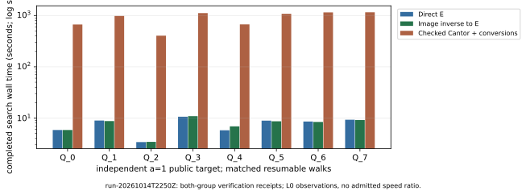

# Completed a=1 panel: eight matched full-subgroup targets

The original campaign worker acknowledged its archival pause at Unix
1792018309 (2026-10-14 22:51:49 UTC). The final a=1 native target Q_7 is
complete, making all eight targets verified in all three matched resumable
arms: 24 completions. The a=0 campaign remains unfinished. This is completion
of the a=1 execution panel, not the entire two-curve request or a performance
promotion. Source is unchanged: crypto dbd33f00da0a0ac35f285603ec168ad9d91a1d79.

The [preregistered protocol](../../PROTOCOL.md), m=83, polynomial basis,
both prime orders, generators, public targets, seeds and walk parameters are
preserved. No target was regenerated, witness accessed, scalar interval
substituted or paid resource provisioned. See the
[archive record](../../runs/run-20261014T2250Z/ARCHIVE.md) for live identity,
pause, commands, source/binary bindings and exact limits.

## Completed observations

The a=1 source is `EC1N83Ckb1h1f579d351b52`,
`icv1-f2m83-t6151469093347-cdcc5432`, prime order 8569786107849059 (53 bits).
The a=0 source is `EC1N83Ckb0h252dacc102a4`,
`icv1-f2m83-tm6151469093347-debefd74`, prime order 2417851639230796216685689.
Both use GF(2^83), basis z^83+z^45+z^2+z+1. The genus-two target is the
elliptic pullback image in the Jacobian of
`v^2+u^2*v=u^5+a*u^4+u^3+u`, with its previously verified degree-three map.

| a=1 target | Steps in each matched arm | E search s | Inverse/E search s | Checked Cantor/conversions search s |
| --- | ---: | ---: | ---: | ---: |
| Q_0 | 6,631,641 | 5.845604437 | 5.842078086 | 669.526079432 |
| Q_1 | 10,049,968 | 8.936632815 | 8.726057880 | 984.514533998 |
| Q_2 | 3,913,125 | 3.392115110 | 3.423350861 | 405.053302451 |
| Q_3 | 10,875,029 | 10.603287411 | 10.859175528 | 1,116.429875080 |
| Q_4 | 5,873,249 | 5.773190470 | 6.879262749 | 673.691337740 |
| Q_5 | 9,896,094 | 8.900080096 | 8.646483486 | 1,083.143331478 |
| Q_6 | 9,152,588 | 8.555052141 | 8.391081647 | 1,154.184117905 |
| Q_7, final native completion | 10,442,347 | 9.268307496 | 9.153279320 | 1,160.138869297 |

Each row is one independently drawn public target, with one completed
resumable search per arm. All 24 candidates retain original separate-process
E/Jacobian verification receipts. The final native Q_7 also passed one
further standalone verification at this pause. Earlier successful checks were
retained without rerunning; repeated representations or checks add no new
independent targets. Verification was on the same host, not an independent
performance replay.

These are active-search observations for `rho.cover_image_checkpoint/v1`.
The native arm uses checked Cantor additions and checked image-inverse/pullback
canonicalization; the inverse/E arm solves on E after its checked public-divisor
inverse. This hybrid native implementation is not optimized pure-Jacobian
arithmetic or index calculus. Setup, mappings, table work, checkpoint I/O,
resume and verification are separately recorded. There is no complete common
price or admitted speedup; no wall-time confidence interval is admitted.

The 27 optimized batched-reference runs and prefix-calibration controls repeat
earlier evidence, not new executions. Their method differs from the unbatched
resumable arm. Prior run directories and benchmark copies remain immutable.

## Remaining execution and measurement gates

All a=0 full solves remain outstanding. First-target checkpoints contain
1,147,759,082 E steps, 1,142,115,358 inverse/E steps and 11,707,378 native
steps, without candidates; later targets are queued. These are censored work
counts, not completed durations, failed full solves or security evidence.
The original worker continues those exact states without an overall step cap.

The host is the same Xeon Platinum 8573C VM: five exposed CPUs, four-CPU
quota, 16 GiB limit, original benchmark lock and pinned CPU 4. Affinity,
attempted eviction and NUMA observations are retained. PSI and hardware
counters are unavailable, some threads could not be moved, and physical
memory type is unknown. All times remain L0. Eight a=1 targets do not supply
admissible isolation, common pricing, independent-host replay or an ecbench
audit. No performance/security conclusion follows merely from panel completion.

The [a=0 durable-compute problem](../../../../problems/binary-genus2-a0-full-solve-compute.md)
and [ecbench-adapter problem](../../../../problems/ecbench-binary-genus2-full-subgroup-adapter.md)
remain open under their original exit criteria. The existing generic-rho
reference is unchanged. No new mathematical result is claimed; the original
geometric/Picard Lean formalization remains partial.

## Evidence and publication

- [Native summary and full raw archive](../../runs/run-20261014T2250Z/snapshot.json), including original public inputs, complete checkpoints, controls and verification receipts.
- [Further native Q_7 check](../../runs/run-20261014T2250Z/followup-verification/a1-7-jacobian.json).
- [Inspected PDF](report.pdf), [layout source](render_report.py), [TeX](report.tex) and local figure copies.
- [Current requirement status](../../REPORT.md), [exact continuation](../../RESUME.md).
- [Seven-target report](../run-20261014T2148Z/REPORT.md), [four-target report](../run-20261014T2034Z/REPORT.md) and [first native-target report](../run-20261014T1901Z/REPORT.md).

Reproduce layout from this directory with
`python3 render_report.py --study-root ../.. --output-dir . --run-id run-20261014T2250Z`.
Only native-recorded/computed values are laid out. Arithmetic/solver source
did not change. New validation is the extra Q_7 both-group verification,
source/binary/input/archive and mirror checks, PDF inspection and diff checks.
Existing scoped native correctness/restart validation remains linked; the
whole-library gate still retains its two documented JV F4 baseline failures
and is not called green.

Performance ran once with the crypto backend; cryptanalysis republishes
identical evidence, not a second campaign. A new benchmark entry copies the
inspected document and four graphs, leaving earlier entries unchanged. The
canonical IC scoreboard, progress/leaderboard data and construction figures
were checked for applicability: this panel adds no IC/rho ratio, new registered
curve, priced IC pipeline or admitted gain, so those series remain unchanged.
